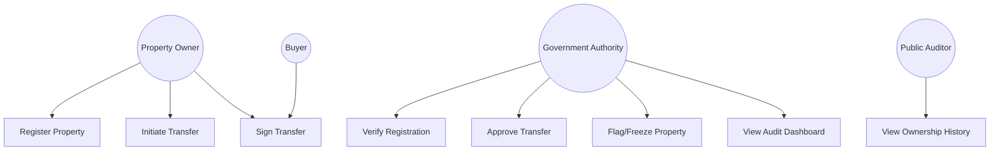
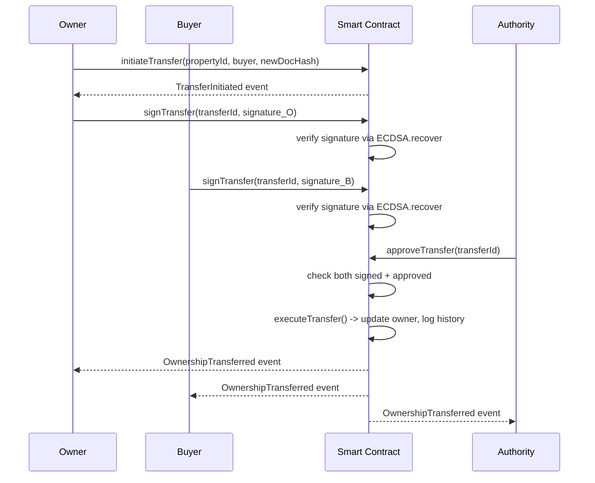
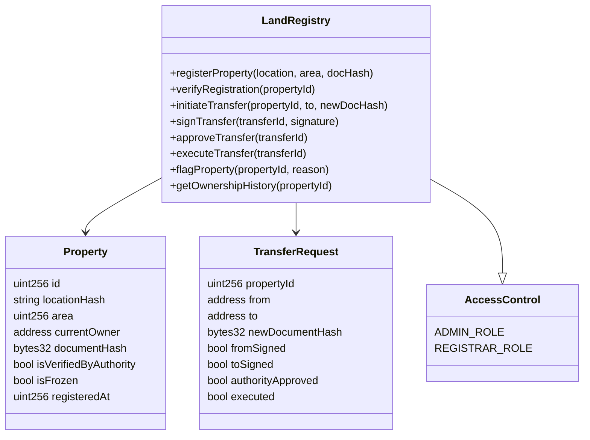
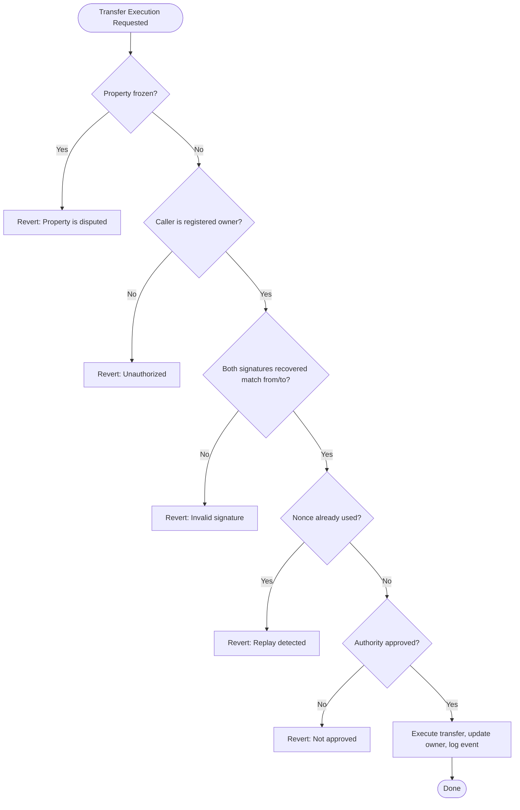

# UML Diagrams

These are written in Mermaid syntax. They render automatically on GitHub, GitLab, Obsidian, and most Markdown viewers/VS Code extensions. Your doc partner can also paste each block into the Mermaid Live Editor (mermaid.live) to export as PNG/SVG for the final report.

## 1. Use Case Diagram

## 2. Sequence Diagram — Ownership Transfer Flow

## 3. Class Diagram (maps to Solidity contract structure)

## 4. Activity Diagram — Fraud Check Logic (during transfer execution)

