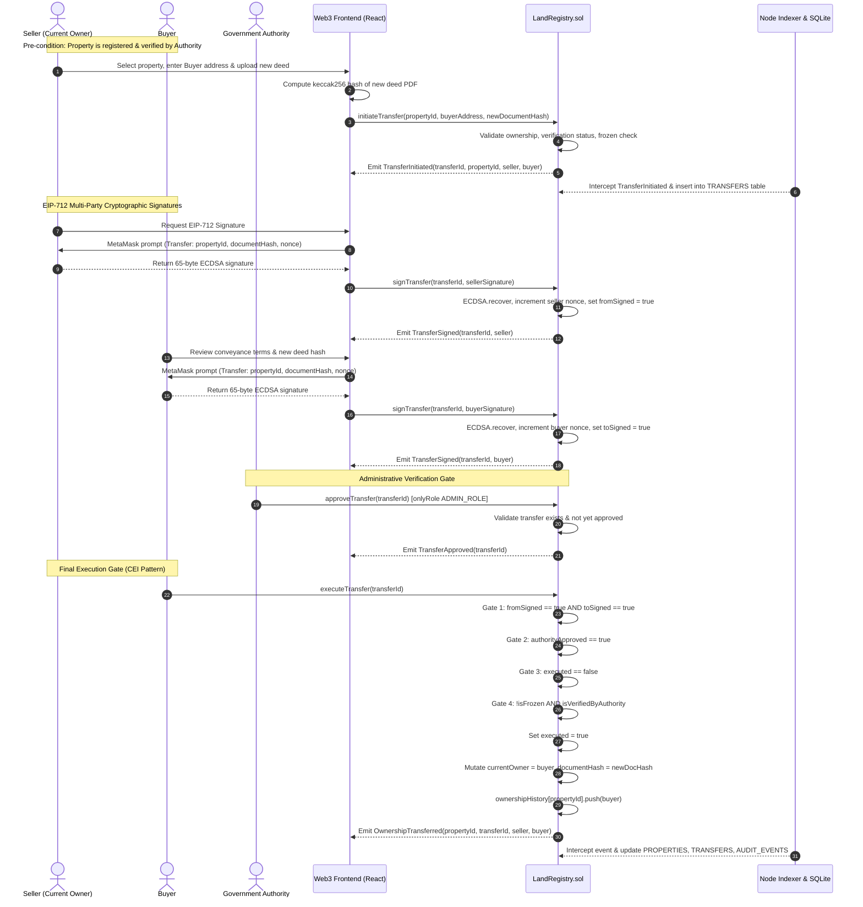
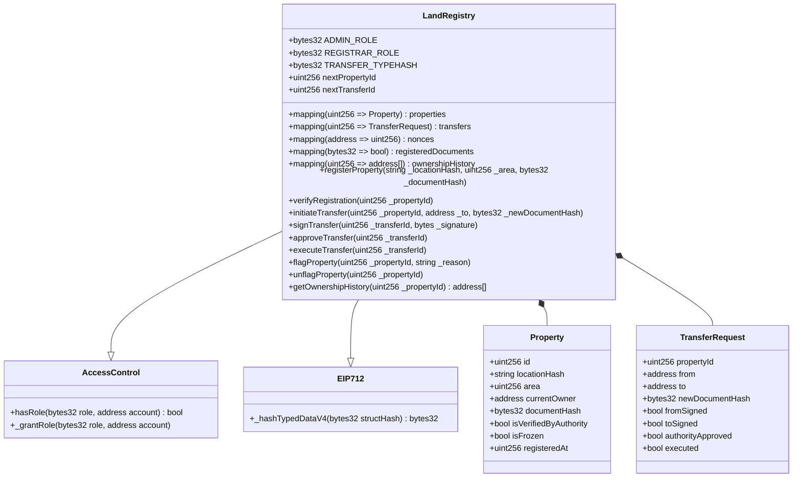
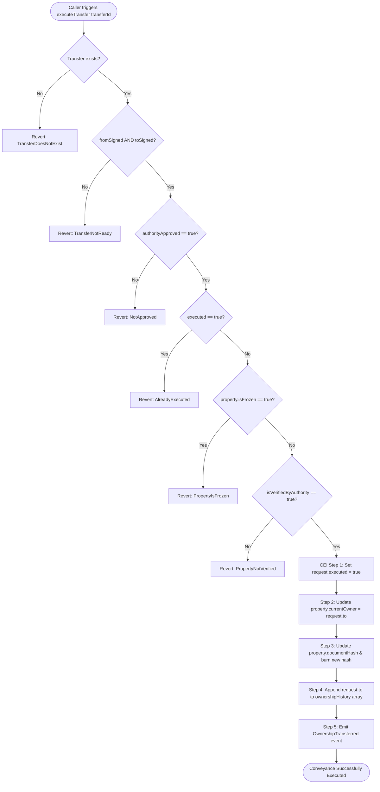

# UML System Diagrams

These diagrams specify the system architecture, component interactions, and execution workflows using Mermaid syntax.

---

## 1. Use Case Diagram

```mermaid
graph TD
    Owner(["Property Owner (Citizen)"])
    Buyer(["Buyer (Citizen)"])
    Authority(["Government Land Authority (ADMIN_ROLE)"])
    Auditor(["Public Auditor / Citizen"])

    subgraph "Land Registry Platform"
        UC1["Register Property (Area, Location, Deed Hash)"]
        UC2["Initiate Transfer (Buyer Address, New Deed Hash)"]
        UC3["Sign EIP-712 Transfer Authorization"]
        UC4["Verify Initial Property Registration"]
        UC5["Approve Conveyance Request"]
        UC6["Execute Authorized Transfer"]
        UC7["Flag / Freeze Disputed Property"]
        UC8["Unflag / Unfreeze Resolved Property"]
        UC9["Inspect On-Chain Ownership History"]
        UC10["Verify Document Hash & Download Deed"]
    end

    Owner --> UC1
    Owner --> UC2
    Owner --> UC3
    Buyer --> UC3
    
    Authority --> UC4
    Authority --> UC5
    Authority --> UC6
    Authority --> UC7
    Authority --> UC8
    
    Buyer --> UC6
    Owner --> UC6
    
    Auditor --> UC9
    Auditor --> UC10
```

---

## 2. Sequence Diagram — 4-Gate Ownership Transfer Flow

---

## 3. Class Diagram (Smart Contract & Storage Model)

---

## 4. Activity Diagram — `executeTransfer` Multi-Gate Validation

