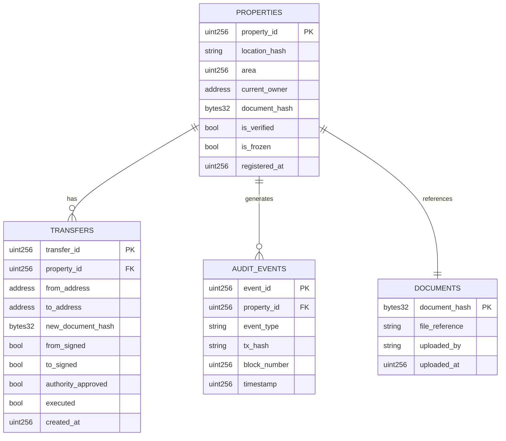

# Data Model / ER Diagram — Backend Event Cache

The blockchain itself is the source of truth (no traditional "database" for ownership). However, the Node/Express backend keeps a local cache of indexed events and document metadata so the dashboard doesn't have to re-scan the whole chain on every page load. This is the data model for that cache.

**Notes:**
- `PROPERTIES`, `TRANSFERS`, and `AUDIT_EVENTS` are populated by listening to contract events (`PropertyRegistered`, `TransferInitiated`, etc.) and mirrored into a local SQLite/Postgres DB purely for fast querying — the contract state remains authoritative.
- `DOCUMENTS.file_reference` points to wherever the actual deed PDF lives (IPFS CID or local backend storage path); only its hash is trusted on-chain.
