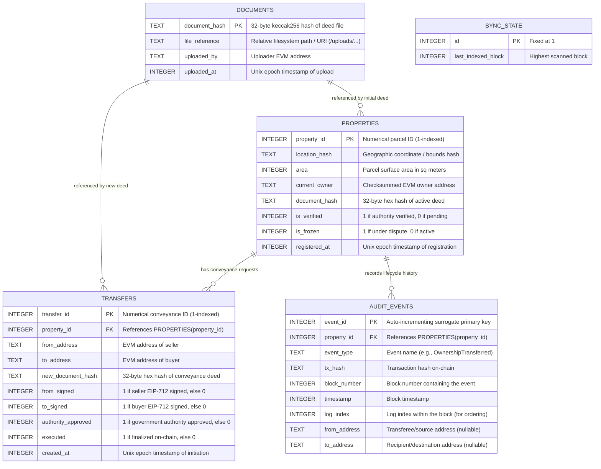

# Data Model / ER Diagram — Backend Indexer & Cache

The authoritative source of truth for all land ownership state is the `LandRegistry.sol` smart contract on the blockchain. 

To provide high-performance query capabilities, sub-millisecond filtering, and rapid UI hydration for the React frontend, the Node.js backend maintains an embedded SQLite database (`database.sqlite` initialized in `backend/db.js`). This local cache is deterministically populated and updated by the event indexer (`backend/indexer.js`).

---

## 1. Entity-Relationship (ER) Diagram

---

## 2. Table Specifications & Indexes

### `PROPERTIES`
Stores canonical state of registered parcels materialized from `PropertyRegistered`, `PropertyVerified`, `OwnershipTransferred`, `PropertyFlagged`, and `PropertyUnflagged` events.
- **Primary Key:** `property_id` (`INTEGER`)
- **Indexed Lookups:** Filtered by `current_owner` and calculated status (`is_verified`, `is_frozen`).

### `TRANSFERS`
Maintains status of in-flight and completed property transfers materialized from `TransferInitiated`, `TransferSigned`, `TransferApproved`, and `OwnershipTransferred` events.
- **Primary Key:** `transfer_id` (`INTEGER`)
- **Foreign Key:** `property_id` references `PROPERTIES(property_id)`
- **Query Optimizations:** Filtered by participant `from_address` / `to_address` and pending status (`executed = 0`).

### `AUDIT_EVENTS`
Provides an immutable, tamper-evident audit trail capturing every state modification on-chain.
- **Primary Key:** `event_id` (`INTEGER AUTOINCREMENT`)
- **Composite Unique Constraint:** `UNIQUE(tx_hash, log_index)` — guarantees idempotent event insertion during catch-up re-indexing and chain reorganizations.
- **Sorting Default:** `ORDER BY block_number DESC, log_index DESC`.

### `DOCUMENTS`
Content-addressable file index connecting off-chain physical title deed PDFs with their cryptographically verified on-chain hashes.
- **Primary Key:** `document_hash` (`TEXT`, 66-character hex string starting with `0x`).
- **File Storage:** Stored on local disk (under `uploads/<documentHash>.pdf`) or decentralized storage (IPFS CID).

### `SYNC_STATE`
Tracks indexer cursor position to ensure seamless crash-recovery and catch-up syncing across server restarts.
- **Primary Key Constraint:** `id INTEGER PRIMARY KEY CHECK (id = 1)` — singleton row pattern.
- **Fields:** `last_indexed_block` (`INTEGER`), initialized to `CONTRACT_DEPLOYMENT_BLOCK`.
