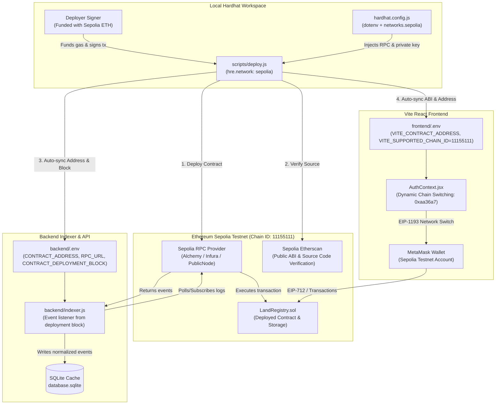

# Sepolia Testnet Deployment Blueprint & System Audit

**Document Reference**: `Docs/09-testnet-deployment-plan.md`  
**Role**: Principal Web3 System Architect  
**Agent Directive**: `--agent:Architect`  
**Status**: Proposal / Awaiting User Review & Faucet Funding  
**Target Network**: Ethereum Sepolia Testnet (Chain ID: `11155111` / `0xaa36a7`)

---

## 1. Executive Summary & Objective

The Land Registry system currently operates against a transient local Hardhat node (`http://127.0.0.1:8545`, Chain ID `31337`). When the local node restarts or encounters process churn, contract state is reset while backend SQLite caches retain stale data, causing desynchronization, nonce errors, and transaction reverts during live demonstrations.

Deploying the `LandRegistry.sol` smart contract to the public **Ethereum Sepolia Testnet**:
1. **Provides Immutable State Persistence**: The contract state, role assignments, registered parcels, and transfer histories persist indefinitely on a public Ethereum testnet.
2. **Eliminates Local Blockchain Churn**: The backend indexer and React frontend connect to a high-availability RPC endpoint (Alchemy / Infura / PublicNode), removing dependency on local node uptime.
3. **Public Transparency & Verification**: Verifying the contract on Etherscan publishes the human-readable Solidity source code and ABI, allowing auditors, evaluators, and citizens to inspect verified contract state on `sepolia.etherscan.io`.

---

## 2. Evidence-Based Repository Audit

### 2.1 Git & Working Tree Status
- **Current Branch**: `main` (1 commit ahead of `origin/main`).
- **Working Tree**: Pre-existing uncommitted changes in `backend/`, `contracts/LandRegistry.sol`, `frontend/`, and `scripts/deploy.js` are preserved intact.
- **Secret Hygiene**: Checked `.gitignore` and environment files. Sensitive private keys and API tokens are isolated in `.env` and must never be committed or logged.

### 2.2 Hardhat Configuration (`hardhat.config.js`)
- **Current State**:
  ```javascript
  require("@nomicfoundation/hardhat-toolbox");
  require("solidity-coverage");

  module.exports = {
    solidity: {
      version: "0.8.24",
      settings: {
        evmVersion: "cancun"
      }
    }
  };
  ```
- **Architectural Gaps Identified**:
  1. **Missing `dotenv`**: The config does not load environment variables via `require("dotenv").config()`. Root `package.json` currently lacks `dotenv` in `devDependencies`.
  2. **Missing `sepolia` Network Block**: No RPC URL, chain ID, or accounts array defined for Sepolia.
  3. **Missing `etherscan` Verification Block**: `@nomicfoundation/hardhat-toolbox` includes `@nomicfoundation/hardhat-verify`, but `etherscan.apiKey` is not declared.
  4. **EVM Compatibility**: Solidity compiler `0.8.24` with `evmVersion: "cancun"` is fully compatible with Ethereum Sepolia (Dencun hard fork activated March 2024).

### 2.3 Environment Templates & Variables (`.env.example` vs `.env`)
- `.env.example` already defines standard keys:
  - `SEPOLIA_RPC_URL`: JSON-RPC URL from Alchemy/Infura (`https://eth-sepolia.g.alchemy.com/v2/...` or `https://sepolia.infura.io/v3/...`)
  - `PRIVATE_KEY`: Hex-encoded 64-character private key of deployer wallet (must hold Sepolia ETH)
  - `ETHERSCAN_API_KEY`: API key from Etherscan Developer Portal
- Root `.env` contains variable placeholders. Actual API keys and private keys need verification and testnet funding before execution.

### 2.4 Frontend Network & Connection Logic (`frontend/src/`)
- **Hardcoded Localhost References**:
  1. `frontend/src/config.js` (Line 2):
     ```javascript
     export const SUPPORTED_CHAIN_ID = parseInt(import.meta.env.VITE_SUPPORTED_CHAIN_ID || "31337");
     ```
  2. `frontend/src/context/AuthContext.jsx`:
     - Line 7: `const HARDHAT_ACCOUNT_0 = '0xf39fd6e51aad88f6f4ce6ab8827279cfffb92266'` hardcoded for Authority detection.
     - Lines 44-53: `wallet_addEthereumChain` payload hardcoded with `chainName: 'Hardhat Localhost'` and `rpcUrls: ['http://127.0.0.1:8545']`.
     - Line 83: Alert message hardcoded: `Please switch to chainId: ${SUPPORTED_CHAIN_ID} (Hardhat Localhost: http://127.0.0.1:8545) in MetaMask.`
     - Line 133: Local node connection error assumption: `Cannot connect to local blockchain. Please ensure the Hardhat node is running at http://127.0.0.1:8545.`
  3. `frontend/src/App.jsx`:
     - Lines 12, 35, 244: `HARDHAT_ACCOUNT_0` fallback for `isAuthority`.
     - Line 97: `title="Connect to State Cadastral Ledger Cluster (Chain ID 31337)"`.
  4. `frontend/src/pages/AuthorityDashboard.jsx`:
     - Lines 8, 484, 1510: `HARDHAT_ACCOUNT_0` fallback for headers and document download URLs.
  5. `frontend/src/components/SignTransferModal.jsx`:
     - Line 43: EIP-712 domain uses `chainId: SUPPORTED_CHAIN_ID`. When `VITE_SUPPORTED_CHAIN_ID` is set to `11155111`, EIP-712 typed signing will seamlessly match the on-chain domain separator computed by OpenZeppelin's `EIP712("LandRegistry", "1")`.

### 2.5 Backend & Indexer Considerations (`backend/`)
- `backend/indexer.js`:
  - `RPC_URL`: Currently defaults to `http://127.0.0.1:8545`. Must be configured to `SEPOLIA_RPC_URL`.
  - `CONTRACT_ADDRESS`: Must be updated to the Sepolia deployed address.
  - **Block Range Indexing Alert**: On Sepolia (block ~7,500,000+), querying `contract.queryFilter("*", 0, currentBlock)` against Alchemy/Infura will fail with `query returned more than 10000 results` or range limit errors.
  - `backend/db.js` (Lines 120-124) seeds `SYNC_STATE.last_indexed_block` with `CONTRACT_DEPLOYMENT_BLOCK`.
  - **Requirement**: `scripts/deploy.js` must record the deployment transaction's receipt block number into `backend/.env` under `CONTRACT_DEPLOYMENT_BLOCK` so the indexer syncs only from contract creation onwards.

---

## 3. Evidence-Backed Architectural Diagram



*Freshness Baseline: Inspected against current repository source code (`contracts/LandRegistry.sol`, `scripts/deploy.js`, `backend/`, `frontend/`).*

---

## 4. Proposed Configuration Changes (Blueprint Specifications)

### 4.1 Dependency Addition (`package.json`)
Root dependencies require `dotenv` so `hardhat.config.js` can read environment variables safely.
```bash
npm install --save-dev dotenv
```

### 4.2 Updated `hardhat.config.js` Blueprint
```javascript
require("@nomicfoundation/hardhat-toolbox");
require("solidity-coverage");
require("dotenv").config();

const SEPOLIA_RPC_URL = process.env.SEPOLIA_RPC_URL || "";
const PRIVATE_KEY = process.env.PRIVATE_KEY || "";
const ETHERSCAN_API_KEY = process.env.ETHERSCAN_API_KEY || "";

/** @type import('hardhat/config').HardhatUserConfig */
module.exports = {
  solidity: {
    version: "0.8.24",
    settings: {
      optimizer: {
        enabled: true,
        runs: 200
      },
      evmVersion: "cancun"
    }
  },
  networks: {
    hardhat: {
      chainId: 31337
    },
    localhost: {
      url: "http://127.0.0.1:8545",
      chainId: 31337
    },
    sepolia: {
      url: SEPOLIA_RPC_URL,
      accounts: PRIVATE_KEY ? [PRIVATE_KEY] : [],
      chainId: 11155111
    }
  },
  etherscan: {
    apiKey: {
      sepolia: ETHERSCAN_API_KEY
    }
  },
  sourcify: {
    enabled: false
  }
};
```

### 4.3 Enhanced `scripts/deploy.js` Blueprint
Update deployment script to:
1. Capture deployment transaction receipt and block number (`deploymentReceipt.blockNumber`).
2. Sync `CONTRACT_DEPLOYMENT_BLOCK` and `RPC_URL` into `backend/.env`.
3. Sync `VITE_SUPPORTED_CHAIN_ID=11155111` into `frontend/.env`.
4. Output ready-to-run verification command.

Snippet specification:
```javascript
  const deploymentReceipt = await landRegistry.deploymentTransaction().wait(2); // Wait 2 confirmations on testnet
  const deploymentBlock = deploymentReceipt.blockNumber;

  // Sync to frontend and backend envs
  updateEnvFile(frontendEnv, "VITE_CONTRACT_ADDRESS", contractAddress);
  updateEnvFile(frontendEnv, "VITE_SUPPORTED_CHAIN_ID", (await hre.ethers.provider.getNetwork()).chainId.toString());
  updateEnvFile(backendEnv, "CONTRACT_ADDRESS", contractAddress);
  updateEnvFile(backendEnv, "CONTRACT_DEPLOYMENT_BLOCK", deploymentBlock.toString());
  if (hre.network.name === "sepolia") {
    updateEnvFile(backendEnv, "RPC_URL", process.env.SEPOLIA_RPC_URL);
  }
```

### 4.4 Dynamic Frontend Network Support (`frontend/src/context/AuthContext.jsx`)
Replace static localhost assumptions with dynamic network dictionary:

```javascript
const NETWORK_METADATA = {
  31337: {
    chainId: '0x7a69',
    chainName: 'Hardhat Localhost',
    rpcUrls: ['http://127.0.0.1:8545'],
    nativeCurrency: { name: 'ETH', symbol: 'ETH', decimals: 18 },
    blockExplorerUrls: null
  },
  11155111: {
    chainId: '0xaa36a7',
    chainName: 'Ethereum Sepolia Testnet',
    rpcUrls: ['https://rpc.sepolia.org', 'https://ethereum-sepolia-rpc.publicnode.com'],
    nativeCurrency: { name: 'Sepolia ETH', symbol: 'ETH', decimals: 18 },
    blockExplorerUrls: ['https://sepolia.etherscan.io']
  }
};
```

In `switchToSupportedNetwork()`:
- Lookup network parameters by `SUPPORTED_CHAIN_ID`.
- Request `wallet_switchEthereumChain` with `0xaa36a7`.
- If error code `4902` (chain not found), invoke `wallet_addEthereumChain` with Sepolia metadata.
- Clean role determination: Rely on contract `hasRole(ADMIN_ROLE, address)` or `hasRole(REGISTRAR_ROLE, address)` directly on-chain rather than matching hardcoded localhost address `0xf39fd6...`.

---

## 5. Deployment & Verification Strategy (Terminal Commands)

### Step 1: Install Dependencies
```bash
npm install --save-dev dotenv
```

### Step 2: Validate Environment Secrets
Verify `.env` contains:
```ini
SEPOLIA_RPC_URL="https://eth-sepolia.g.alchemy.com/v2/YOUR_ALCHEMY_KEY"
PRIVATE_KEY="0xYOUR_TESTNET_PRIVATE_KEY"
ETHERSCAN_API_KEY="YOUR_ETHERSCAN_API_KEY"
```
*Note: The deployer wallet corresponding to `PRIVATE_KEY` must have at least ~0.05 - 0.1 Sepolia ETH to cover contract deployment, role grant transactions, and gas fees.*

### Step 3: Compile Smart Contracts
```bash
npx hardhat compile
```

### Step 4: Execute Deployment to Sepolia
```bash
npx hardhat run scripts/deploy.js --network sepolia
```
*Expected Output:*
- Deployed contract address on Sepolia.
- Confirmation of `ADMIN_ROLE` and `REGISTRAR_ROLE` granted to deployer.
- Automatic synchronization of ABI to `frontend/src/LandRegistry.json`.
- Automatic synchronization of `VITE_CONTRACT_ADDRESS` and `VITE_SUPPORTED_CHAIN_ID` to `frontend/.env`.
- Automatic synchronization of `CONTRACT_ADDRESS`, `RPC_URL`, and `CONTRACT_DEPLOYMENT_BLOCK` to `backend/.env`.

### Step 5: Verify Contract on Sepolia Etherscan
Because `LandRegistry` has no constructor arguments (`constructor() EIP712("LandRegistry", "1")`), verification is a single direct command:
```bash
npx hardhat verify --network sepolia <DEPLOYED_CONTRACT_ADDRESS>
```
*Verification Confirmation URL:*
`https://sepolia.etherscan.io/address/<DEPLOYED_CONTRACT_ADDRESS>#code`

### Step 6: Initialize / Reset Backend Indexer Cache
Reset the local SQLite cache so the indexer syncs freshly from `CONTRACT_DEPLOYMENT_BLOCK`:
```bash
cd backend
rm -f database.sqlite
npm run indexer
```

### Step 7: Launch Frontend
```bash
cd frontend
npm run dev
```
MetaMask will detect Chain ID `11155111` and prompt switching to Sepolia Testnet.

---

## 6. Risk Assessment & Pre-requisites Checklist

| Checkpoint | Status | Mitigation / Requirement |
| :--- | :--- | :--- |
| **Sepolia RPC Endpoint** | Required | Free tier Alchemy, Infura, or QuickNode RPC URL. |
| **Deployer Gas Balance** | Required | Obtain 0.1+ Sepolia ETH via [Google Cloud Web3 Faucet](https://cloud.google.com/application/web3/faucet/ethereum/sepolia) or [Alchemy Faucet](https://www.alchemy.com/faucets/ethereum-sepolia). |
| **Etherscan API Key** | Required | Free API Key from [Etherscan API Portal](https://etherscan.io/myapikey). |
| **EIP-712 Domain Consistency** | Validated | `SignTransferModal.jsx` passes `SUPPORTED_CHAIN_ID`, which dynamically becomes `11155111`. Matches `block.chainid` in contract. |
| **Event Filter Limits** | Addressed | Indexer will start sync from `CONTRACT_DEPLOYMENT_BLOCK` rather than block 0, avoiding RPC rate limit blocks. |

---

## 7. Next Actions

Execution is paused awaiting user review and approval:
1. **User Action**: Arrange required API keys (`SEPOLIA_RPC_URL`, `PRIVATE_KEY` with testnet ETH, `ETHERSCAN_API_KEY`).
2. **User Authorization**: Provide explicit **`PROCEED`** command.
3. **Execution Phase**: Implement config changes, deploy contract to Sepolia, verify on Etherscan, and validate live synchronization.
