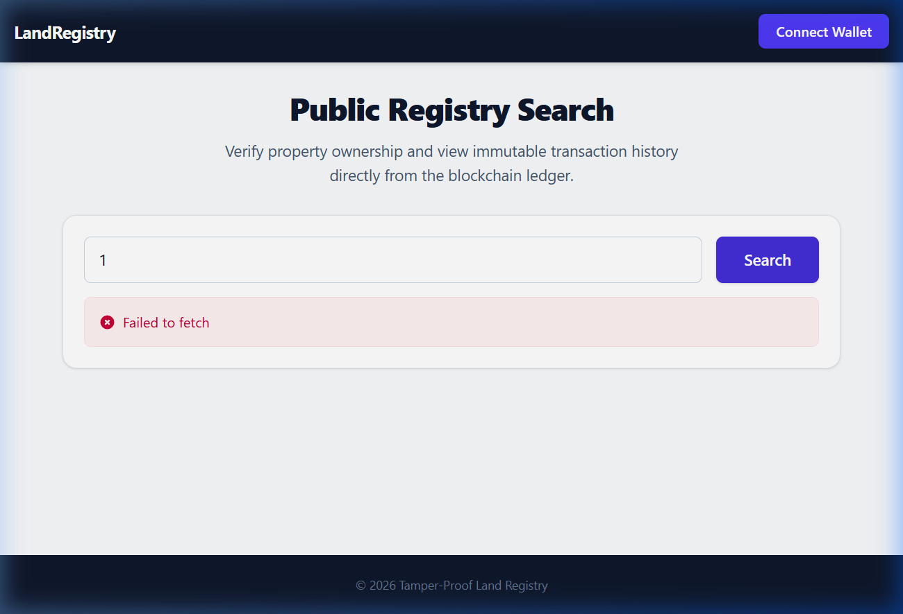

# User Manual

## 1. Prerequisites
- Install [MetaMask](https://metamask.io) browser extension
- Create/import a wallet, switch network to [Sepolia / Polygon Amoy]
- Get testnet funds from a faucet (e.g. Sepolia faucet) to pay gas fees

## 2. Connecting Your Wallet
1. Open the application in your browser.
2. Click **Connect Wallet**.
3. Approve the connection request in the MetaMask popup.
4. Your role (Owner / Authority) is automatically detected based on your wallet address's on-chain role.

## 3. For Property Owners
### Registering a Property
1. Go to **Register Property**.
2. Enter location details and area.
3. Upload the deed document — the app hashes it automatically.
4. Click **Submit Registration** and confirm the transaction in MetaMask.
5. Your property now shows status **Pending Verification** until the Authority approves it.

### Transferring Ownership
1. Go to **My Properties** → select a verified property → **Initiate Transfer**.
2. Enter the buyer's wallet address and upload the new/updated deed document.
3. Confirm the transaction.
4. Sign the EIP-712 message when prompted (this is your cryptographic consent to the transfer).
5. Wait for the buyer to sign and the Authority to approve — status updates automatically.
6. Once all three conditions are met, the transfer executes and ownership updates on-chain.

## 4. For Buyers
1. You'll see incoming pending transfers under **Pending Transfers**.
2. Review the property details and deed hash.
3. Click **Accept & Sign** and confirm the EIP-712 signature prompt in MetaMask.

## 5. For Government Authority
### Verifying Registrations
1. Go to **Admin Dashboard → Pending Registrations**.
2. Review submitted details and deed document.
3. Click **Verify** (or **Reject** with a reason).

### Approving Transfers
1. Go to **Admin Dashboard → Pending Transfers**.
2. Confirm both parties have signed.
3. Click **Approve** to authorize execution.

### Auditing & Flagging
1. Use **Search Properties** to find any record.
2. Click a property to view its **full ownership history and event timeline**.
3. If a dispute is suspected, click **Flag Property** and enter a reason — this blocks any further transfers until unflagged.

## 6. For Public/Auditors
- Anyone can use the **Public Registry Search** to view a property's public ownership history — no login/wallet required for read-only access.
- Enter a Property ID to view its details (Location Reference, Area, Verification Status) and historical ownership log.

## 7. Troubleshooting
| Issue | Fix |
|---|---|
| Transaction fails / reverts | Check the error message — usually indicates a permission or state issue (e.g. property frozen, not yet approved) |
| "Insufficient funds" | Get more testnet ETH/MATIC from a faucet |
| Wrong network | Switch MetaMask to the correct testnet |
| Signature prompt doesn't appear | Ensure MetaMask is unlocked and on the correct account |
