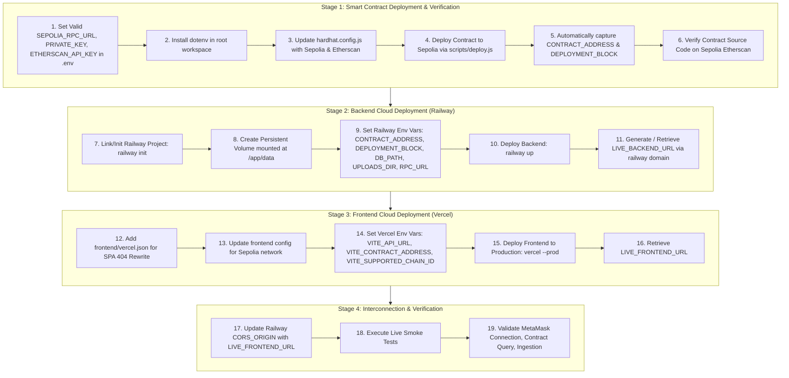

# Unified Fullstack Deployment Blueprint & Pre-Deployment Audit

**Document Reference**: `Docs/10-fullstack-deployment-plan.md`  
**Role**: Principal DevOps & Web3 Deployment Architect  
**Agent Directive**: `--agent:Architect`  
**Status**: Deployment Succeeded & Live Verification Passed ✅  
**Live Endpoints**:
- **Smart Contract**: [`0x4F6AA71b5233C49c09d4BF3559236409B4854fD7`](https://sepolia.etherscan.io/address/0x4F6AA71b5233C49c09d4BF3559236409B4854fD7#code) (Ethereum Sepolia, Block `12166212`)
- **Live Backend API**: [`https://backend-production-64c480fe.up.railway.app`](https://backend-production-64c480fe.up.railway.app) (Railway, `/app/data` Persistent Volume)
- **Live Frontend App**: [`https://land-registry-frontend-opal.vercel.app`](https://land-registry-frontend-opal.vercel.app) (Vercel Production)  
**Target Environment**: 
- **L1 Blockchain**: Ethereum Sepolia Testnet (`chainId: 11155111` / `0xaa36a7`)
- **Backend & Indexer Cloud**: Railway (`lakshay.narula.dev@gmail.com`) with Persistent Storage Volume
- **Frontend Cloud**: Vercel (`lakshayn02-5357` / Hobby Team)

---

## 1. CLI & Environment Preflight Check

### 1.1 Installed Tooling & Authentication Status
A live, non-destructive inspection of the host environment confirms the following CLIs are installed and authenticated:

| Tool / CLI | Binary Path / Version | Authenticated Identity / Plan | Scope / Capability |
| :--- | :--- | :--- | :--- |
| **Vercel CLI** | `/opt/homebrew/bin/vercel` (v66.1.0) | `lakshayn02-5357` (Hobby Plan, Active Team: `lakshayn02-5357's projects`) | Frontend deployment & hosting, SPA rewrites, edge caching |
| **Railway CLI** | `/opt/homebrew/bin/railway` | `lakshay.narula.dev@gmail.com` | Backend API & Indexer deployment, persistent volume provisioning |
| **Hardhat / Node** | Node `v26.5.0`, npm `v11.7.0`, Hardhat `v2.29.1` (local) | Local workspace execution via `npx hardhat` | Smart contract compilation, testnet deployment, Etherscan verification |

### 1.2 Secret Hygiene & Deployer Wallet Audit
In accordance with engineering security rules, secret values (`PRIVATE_KEY`, `ETHERSCAN_API_KEY`) were inspected in read-only mode without logging or leaking credential values:

| Environment Variable | Target File | Status | Audit Findings & Risk Assessment |
| :--- | :--- | :--- | :--- |
| `SEPOLIA_RPC_URL` | `.env` (root) | ⚠️ **Action Required** | Configured with Infura placeholder (`https://sepolia.infura.io/v3/YOUR_INFURA_KEY`). RPC connection test returned `401 Unauthorized` (`invalid project id`). |
| `PRIVATE_KEY` | `.env` (root) | ⚠️ **Action Required** | Configured with standard Hardhat Account #0 test private key (`0xac09...ff80`), resolving to public address `0xf39Fd6e51aad88F6F4ce6aB8827279cffFb92266`. |
| `ETHERSCAN_API_KEY` | `.env` (root) | ⚠️ **Action Required** | Set to placeholder text (`YOUR_ETHERSCAN_API_KEY`). Verification will fail until an active API key from `etherscan.io` is provided. |
| **Deployer Gas Balance** | Sepolia Network | ⛔ **BLOCKED** | Live balance query cannot execute until a valid `SEPOLIA_RPC_URL` and funded testnet `PRIVATE_KEY` are placed in `.env`. Requires at least **0.08–0.15 Sepolia ETH** for contract deployment and role assignments. |

> [!CAUTION]
> **Pre-Deployment Gate**: Live deployment commands cannot be executed until valid API keys and a funded private key are configured in `.env`. The deployer wallet must not be the well-known local test key `0xf39Fd6...`.

---

## 2. Layer 1: Smart Contract Audit (`contracts/` & `scripts/`)

### 2.1 Contract Architecture (`contracts/LandRegistry.sol`)
- **Constructor & Arguments**:
  ```solidity
  constructor() EIP712("LandRegistry", "1") {
      _grantRole(DEFAULT_ADMIN_ROLE, msg.sender);
      _grantRole(ADMIN_ROLE, msg.sender);
  }
  ```
  - Takes **no constructor arguments**.
  - Initializes OpenZeppelin EIP-712 domain separator with `name = "LandRegistry"`, `version = "1"`.
  - Automatically grants `DEFAULT_ADMIN_ROLE` and `ADMIN_ROLE` to `msg.sender` (the deployer wallet).
- **Compiler Compatibility**:
  - Solidity `0.8.24` with `evmVersion: "cancun"` is fully compatible with Ethereum Sepolia (Dencun hardfork active since March 2024).

### 2.2 Hardhat Config Gaps (`hardhat.config.js`)
Currently, `hardhat.config.js` lacks:
1. `require("dotenv").config()` (and root `package.json` needs `dotenv` as devDependency).
2. The `networks.sepolia` configuration block linking `process.env.SEPOLIA_RPC_URL` and `process.env.PRIVATE_KEY`.
3. The `etherscan.apiKey` block linking `process.env.ETHERSCAN_API_KEY`.

### 2.3 Automated Address & Block Capture (`scripts/deploy.js`)
Currently, `scripts/deploy.js` only updates `VITE_CONTRACT_ADDRESS` and `CONTRACT_ADDRESS`.
To support high-reliability indexing without RPC rate-limit failures, the deployment script must be updated to:
1. Wait for 2 block confirmations on Sepolia:
   ```javascript
   const deploymentReceipt = await landRegistry.deploymentTransaction().wait(2);
   const deploymentBlock = deploymentReceipt.blockNumber;
   ```
2. Automatically write `CONTRACT_DEPLOYMENT_BLOCK` into `backend/.env`.
3. Automatically write `RPC_URL` into `backend/.env`.
4. Automatically write `VITE_SUPPORTED_CHAIN_ID=11155111` into `frontend/.env`.
5. Copy contract ABI artifact to `frontend/src/LandRegistry.json`.

### 2.4 Etherscan Verification Command
Because `LandRegistry` has no constructor parameters, the verification command is:
```bash
npx hardhat verify --network sepolia <DEPLOYED_CONTRACT_ADDRESS>
```
Public inspection will be available at:
`https://sepolia.etherscan.io/address/<DEPLOYED_CONTRACT_ADDRESS>#code`

---

## 3. Layer 2: Backend & Indexer Cloud Audit (`backend/`)

### 3.1 Process Architecture (Single Process vs. Worker)
- **Current Setup**:
  - `npm run dev`: Runs `node server.js & node indexer.js` (two concurrent processes).
  - `npm start`: Runs `node server.js` **only**.
- **Production Cloud Risk**: If deployed directly with default `npm start`, the indexer **will never start**, and SQLite will receive zero on-chain events.
- **Recommended Cloud Solution**:
  - For a unified, cost-effective Railway service, update `server.js` to spawn `indexer.js` as a background child process or invoke `runIndexer()` directly on startup when `process.env.RUN_INDEXER !== 'false'`.
  - Alternatively, define a custom Railway Start Command:
    `node -e "require('./indexer').runIndexer(); require('./server');"` or run via `node server.js` with integrated indexer initialization.

### 3.2 Critical Storage Audit: SQLite & Uploads (`uploads/`)
- **Ephemeral Filesystem Vulnerability**:
  - Standard Railway container filesystems are **ephemeral**. Every deployment, crash recovery, or container restart creates a fresh container image from git.
  - **What happens on wipe?**
    - `PROPERTIES`, `TRANSFERS`, and `AUDIT_EVENTS` can be re-synced by `indexer.js` from `CONTRACT_DEPLOYMENT_BLOCK`.
    - **Permanent Data Loss Risk**: `CITIZEN_SALT_VAULT`, `PARCEL_EXTRACTION_METADATA`, and the actual deed PDF files stored in `uploads/` are **off-chain data**. If the container wipes, citizen title deeds and their zero-knowledge salt mappings are irretrievably destroyed.
- **Exact Architectural Fix**:
  1. **Railway Persistent Volume**: Attach a persistent volume mounted at `/app/data`.
  2. **Environment Variables**:
     - `DB_PATH=/app/data/database.sqlite`
     - `UPLOADS_DIR=/app/data/uploads`
  3. **Code Adjustment**:
     - Update `backend/routes/documents.js` to read `process.env.UPLOADS_DIR || path.join(__dirname, '../../uploads')` and execute `fs.mkdirSync(uploadsDir, { recursive: true })` on initialization.

### 3.3 CORS Settings in Express
- `backend/server.js` currently uses permissive default CORS:
  ```javascript
  app.use(cors());
  ```
- **Production Hardening**:
  Support `CORS_ORIGIN` environment variable so the production backend allows requests from the live Vercel domain (`https://land-registry-*.vercel.app`):
  ```javascript
  const allowedOrigins = process.env.CORS_ORIGIN 
    ? process.env.CORS_ORIGIN.split(',').map(s => s.trim()) 
    : '*';
  app.use(cors({ origin: allowedOrigins }));
  ```

### 3.4 Backend Cloud Environment Variables Checklist
The following environment variables must be configured on Railway:

| Variable | Recommended Production Value | Description |
| :--- | :--- | :--- |
| `NODE_ENV` | `production` | Enables production optimizations and disables debug traces |
| `PORT` | `3001` (or auto-assigned by Railway `$PORT`) | Port Express binds to |
| `RPC_URL` | `https://eth-sepolia.g.alchemy.com/v2/...` | JSON-RPC provider for Sepolia |
| `CONTRACT_ADDRESS` | `0x...` | Deployed Sepolia contract address |
| `CONTRACT_DEPLOYMENT_BLOCK` | E.g. `7500000` | Exact block number where contract was created |
| `DB_PATH` | `/app/data/database.sqlite` | Path on persistent Railway volume |
| `UPLOADS_DIR` | `/app/data/uploads` | Path on persistent Railway volume for deed PDFs |
| `AUTHORITY_ADDRESS` | `0x...` | Public Ethereum address of Registrar Authority |
| `CORS_ORIGIN` | `https://<your-frontend>.vercel.app` | Whitelisted Vercel domain |
| `MAX_CONCURRENT_UPLOADS` | `10` | Concurrency guard limit for in-memory PDF parsing |

---

## 4. Layer 3: Frontend Cloud Audit (`frontend/`)

### 4.1 Vite Build Verification
A test compilation was executed inside `frontend/`:
- **Command**: `npm run build` (`vite build`)
- **Result**: `✓ built in 595ms` with zero errors or warnings (except single chunk >500kB warning).
- **Bundle Output**: `dist/index.html` (1.25 kB), `dist/assets/index-*.css` (46.02 kB), `dist/assets/index-*.js` (887.31 kB).

### 4.2 Hardcoded Values & Localhost Remediation
Static analysis revealed the following files require environment-driven decoupling:

1. **`frontend/src/config.js`**:
   - `SUPPORTED_CHAIN_ID`: Currently defaults to `"31337"`. Must default to Sepolia (`11155111`) or read `import.meta.env.VITE_SUPPORTED_CHAIN_ID`.
   - `API_URL`: Currently defaults to `"http://localhost:3001"`. Must read `import.meta.env.VITE_API_URL`.
2. **`frontend/src/context/AuthContext.jsx`**:
   - `HARDHAT_ACCOUNT_0 = '0xf39fd6...'`: Used for hardcoded `isAdmin` checks (Lines 7, 111, 162, 180).
   - Network switching hardcodes `chainName: 'Hardhat Localhost'` and `rpcUrls: ['http://127.0.0.1:8545']` (Lines 44-53).
   - Alert messages mention `Hardhat Localhost: http://127.0.0.1:8545` (Lines 83, 133).
   - **Fix**: Implement a dynamic network metadata registry supporting Sepolia (`0xaa36a7`) and delegate role checks to on-chain `hasRole()` calls.
3. **`frontend/src/App.jsx` & `frontend/src/pages/AuthorityDashboard.jsx`**:
   - Lines referencing `HARDHAT_ACCOUNT_0` fallback for `account` or `isAuthority` must rely on contract roles or connected wallet account.

### 4.3 SPA Routing Audit (404 Prevention on Vercel)
- **Current State**: `frontend/` does not contain `vercel.json` or `_redirects`.
- **Vulnerability**: React Router (`react-router-dom` v7) uses HTML5 History API. Direct navigation or refreshing `/authority`, `/marketplace`, or `/audit-log` on Vercel will trigger an HTTP 404 error because Vercel looks for static files matching those route paths.
- **Exact Fix**: Place `frontend/vercel.json` with client-side SPA rewrites:
  ```json
  {
    "rewrites": [
      {
        "source": "/(.*)",
        "destination": "/index.html"
      }
    ]
  }
  ```

### 4.4 Frontend Cloud Environment Variables Checklist
The following environment variables must be configured on Vercel:

| Variable | Recommended Production Value | Description |
| :--- | :--- | :--- |
| `VITE_CONTRACT_ADDRESS` | `0x...` | Deployed Sepolia contract address |
| `VITE_SUPPORTED_CHAIN_ID` | `11155111` | Sepolia chain ID |
| `VITE_API_URL` | `https://<backend-service>.up.railway.app` | Production Railway backend URL |

---

## 5. Strict Multi-Stage Execution Blueprint & Command Playbook



### Phase 1: Testnet Prerequisites & Smart Contract Deployment
1. Ensure `.env` contains valid credentials:
   ```ini
   SEPOLIA_RPC_URL="https://eth-sepolia.g.alchemy.com/v2/YOUR_ACTIVE_KEY"
   PRIVATE_KEY="0xYOUR_ACTIVE_PRIVATE_KEY"
   ETHERSCAN_API_KEY="YOUR_ETHERSCAN_API_KEY"
   ```
2. Install `dotenv` and compile:
   ```bash
   npm install --save-dev dotenv
   npx hardhat compile
   ```
3. Deploy to Sepolia:
   ```bash
   npx hardhat run scripts/deploy.js --network sepolia
   ```
4. Verify on Sepolia Etherscan:
   ```bash
   npx hardhat verify --network sepolia <CONTRACT_ADDRESS>
   ```

### Phase 2: Backend Cloud Deployment (Railway)
1. Initialize or link the backend service:
   ```bash
   cd backend
   railway init --name land-registry-backend
   ```
2. Create and attach a persistent volume:
   ```bash
   railway volume add --mount-path /app/data
   ```
3. Set environment variables on Railway:
   ```bash
   railway variables --set NODE_ENV=production \
     --set RPC_URL="<SEPOLIA_RPC_URL>" \
     --set CONTRACT_ADDRESS="<CONTRACT_ADDRESS>" \
     --set CONTRACT_DEPLOYMENT_BLOCK="<DEPLOYMENT_BLOCK>" \
     --set DB_PATH="/app/data/database.sqlite" \
     --set UPLOADS_DIR="/app/data/uploads" \
     --set AUTHORITY_ADDRESS="<DEPLOYER_PUBLIC_ADDRESS>"
   ```
4. Deploy the backend service:
   ```bash
   railway up
   ```
5. Assign a public domain:
   ```bash
   railway domain
   ```
   *Record the resulting domain as `LIVE_BACKEND_URL` (e.g., `https://land-registry-backend-production.up.railway.app`).*

### Phase 3: Frontend Cloud Deployment (Vercel)
1. Ensure `frontend/vercel.json` exists with SPA rewrites.
2. Link project to Vercel:
   ```bash
   cd ../frontend
   vercel link --yes
   ```
3. Add production environment variables:
   ```bash
   vercel env add VITE_CONTRACT_ADDRESS production "<CONTRACT_ADDRESS>"
   vercel env add VITE_SUPPORTED_CHAIN_ID production "11155111"
   vercel env add VITE_API_URL production "<LIVE_BACKEND_URL>"
   ```
4. Deploy to production:
   ```bash
   vercel --prod
   ```
   *Record the resulting domain as `LIVE_FRONTEND_URL` (e.g., `https://land-registry-fe.vercel.app`).*

### Phase 4: CORS Lockdown & Live Smoke Test Plan
1. Update Railway backend CORS:
   ```bash
   cd ../backend
   railway variables --set CORS_ORIGIN="<LIVE_FRONTEND_URL>"
   ```
2. **Smoke Test Verification Steps**:
   - **Health Check**: `curl -s <LIVE_BACKEND_URL>/api/health` returns status `ok` and current Sepolia block number.
   - **MetaMask Connection**: Open `LIVE_FRONTEND_URL`, click "Connect Wallet", confirm MetaMask prompts to switch to Ethereum Sepolia (`11155111`).
   - **Property Query**: Verify `/api/properties` loads without 500 or CORS errors.
   - **SPA Refresh Check**: Directly navigate to `<LIVE_FRONTEND_URL>/authority` and reload browser. Confirm HTTP 200 (not 404).
   - **Deed Ingestion Test**: Ingest a certified PDF title deed through the frontend, verify Keccak-256 hash generation, and confirm PDF persistence in `/app/data/uploads`.

---

## 6. Pre-Flight Decision Gate & Readiness Status

| Checkpoint | Status | Detail / Mitigation |
| :--- | :--- | :--- |
| **Vercel CLI** | ✅ **Ready** | Authenticated as `lakshayn02-5357` |
| **Railway CLI** | ✅ **Ready** | Authenticated as `lakshay.narula.dev@gmail.com` |
| **Hardhat Tooling** | ✅ **Ready** | Verified locally; compiler 0.8.24 Cancun ready |
| **Frontend Build** | ✅ **Ready** | `npm run build` verified in 595ms |
| **Sepolia RPC & Key** | ⛔ **Pending User Key** | Needs active Sepolia RPC URL and funded private key |
| **Code Changes** | ⏸️ **Paused** | Zero source files altered during audit |

---

## 7. Next Actions

**This audit is complete and read-only. All execution is currently PAUSED.**

Awaiting user review and authorization:
1. Provide/confirm your active **`SEPOLIA_RPC_URL`**, **`PRIVATE_KEY`** (with ~0.1 Sepolia ETH), and **`ETHERSCAN_API_KEY`**.
2. Issue the explicit command **`PROCEED`** to begin automated implementation of configurations, smart contract deployment, and cloud wiring.
