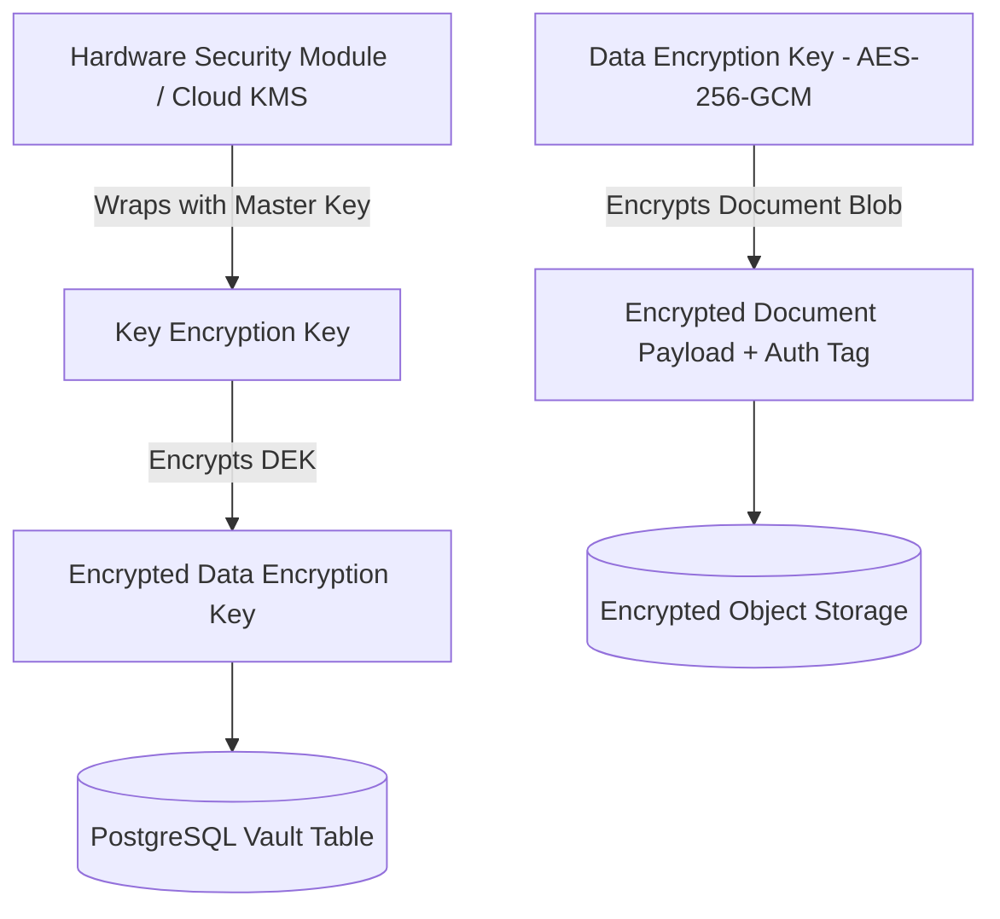

# DOCUMENT SECURITY ARCHITECTURE & AADHAAR EXCLUSION POLICY
# Bhūmi Ledger — India Land Transaction & Registry Platform

**Document Version:** 1.0.0  
**Phase:** Phase 4 (Architecture, Security, Privacy & Regulatory Feasibility Gate — Workstream W02)  
**Authors:** Chief AI Engineering Orchestrator, Department Head of Security (DH-Security), Lead Infrastructure Architect, DH-Legal  
**Status:** Canonical Architecture Specification  
**Jurisdiction Baseline:** Republic of India / Aadhaar Act, 2016 / DPDP Act, 2023 / IT Act, 2000  

---

## 1. Executive Summary & Aadhaar Policy Reassessment

In response to the Project Owner's explicit directive (**C02**), this document establishes the document ingestion security pipeline, cryptographic salt management, and a rigorous statutory reassessment of Aadhaar handling.

### 1.1 Statutory Ground Truth: The Legal Reality of Aadhaar in Private Systems
The previous assumption that Section 29 of the Aadhaar Act merely mandates first-eight-digit masking is an oversimplification. The legal reality is significantly stricter:
1. **Section 29(1) of the Aadhaar Act, 2016:** Strictly prohibits core biometric information from being shared with anyone for any reason whatsoever.
2. **Section 29(3) & (4):** Forbids publishing, displaying, or posting Aadhaar numbers or demographic information to public view.
3. **The Supreme Court Constitutional Benchmark (*Justice K.S. Puttaswamy (Retd.) v. Union of India, (2019) 1 SCC 1*):** The Supreme Court struck down Section 57 of the Aadhaar Act, establishing that **private corporate entities cannot mandate Aadhaar authentication or store Aadhaar numbers** merely for commercial services or private transactions without explicit legislative backing.
4. **UIDAI Enforcement Penalties:** Unauthorized possession, storage, or sharing of Aadhaar records triggers criminal prosecution and civil penalties up to **₹1 Crore per day of non-compliance** under the Aadhaar Amendment Act, 2019.

### 1.2 The Definitive Policy: Complete Exclusion of Aadhaar Collection in MVP
> [!CAUTION]
> **MANDATORY POLICY FOR BHŪMI LEDGER MVP:**
> 1. Bhūmi Ledger **SHALL NOT COLLECT, PROMPT FOR, VERIFY, OR STORE AADHAAR NUMBERS**.
> 2. Aadhaar collection is **NOT legally necessary** for property search, circle rate calculation, pre-registration intent signing, or Form 141 direct tax draft preparation.
> 3. Statutory real estate tax deduction under Section 393(1) of the Income-tax Act, 2025 relies exclusively on the **Permanent Account Number (PAN)** under Section 139A.
> 4. Physical deed registration before the Sub-Registrar (SRO) relies on physical biometric verification conducted directly by government officers at the SRO, not by our software platform.

---

## 2. Document Upload Security & Ingestion Pipeline

To protect the platform against malware, malicious PDFs, and denial-of-service payloads, uploaded documents traverse a hardened 5-stage ingestion pipeline:

```
┌────────────────────────────────────────────────────────────────────────────────────────┐
│                              DOCUMENT INGESTION PIPELINE                               │
├────────────────────────────────────────────────────────────────────────────────────────┤
│ Stage 1: Network & Boundary Filter                                                     │
│ • Payload size capped at 10 MB per file. Rate limit: 5 uploads per IP/wallet per hour. │
│ • TLS 1.3 enforced with strict cipher suites (PFS, AES-256-GCM / ChaCha20-Poly1305).   │
├────────────────────────────────────────────────────────────────────────────────────────┤
│ Stage 2: Deep File Inspection & Type Sniffing                                          │
│ • Magic Byte Verification: Must begin with `%PDF-` (`0x25 0x50 0x44 0x46`).            │
│ • Rejection of disguised executables, macro-enabled formats, or polyglot files.        │
├────────────────────────────────────────────────────────────────────────────────────────┤
│ Stage 3: PDF Sanitization & Malware Scanning                                           │
│ • Stream scanning: Strips embedded executable objects (`/JS`, `/JavaScript`, `/Launch`,│
│   `/EmbeddedFiles`).                                                                   │
│ • Asynchronous scan via ClamAV container before file is committed to storage.          │
├────────────────────────────────────────────────────────────────────────────────────────┤
│ Stage 4: Aadhaar Redaction & PII Masking Filter                                        │
│ • Automated OCR regex scanner detects potential 12-digit Aadhaar patterns.             │
│ • If detected, redaction middleware permanently masks the first 8 digits.              │
├────────────────────────────────────────────────────────────────────────────────────────┤
│ Stage 5: Envelope Encryption & Vault Persistence                                       │
│ • Encrypted at rest using unique Data Encryption Key (DEK) via AES-256-GCM.            │
│ • Stored in isolated, non-public storage volume. Zero direct URL access.               │
└────────────────────────────────────────────────────────────────────────────────────────┘
```

---

## 3. Cryptographic Hash & Salt Management: Client-Side vs. Server-Side Comparison

```
┌────────────────────────────────────────────────────────────────────────────────────────┐
│                        HASHING ARCHITECTURE TRADE-OFF EVALUATION                       │
├───────────────────────────────────┬────────────────────────────────────────────────────┤
│ Dimension                         │ Client-Side Hashing        │ Server-Side Hashing   │
├───────────────────────────────────┼────────────────────────────┼───────────────────────┤
│ **Zero-Trust File Integrity**     │ **SUPERIOR**               │ Moderate              │
│                                   │ File hashed before upload; │ Server could tamper   │
│                                   │ impossible for server to   │ before computing hash.│
│                                   │ forge pre-image hash.      │                       │
├───────────────────────────────────┼────────────────────────────┼───────────────────────┤
│ **Browser Performance & Mobile**  │ Moderate                   │ **SUPERIOR**          │
│                                   │ WebCrypto / WASM hashing   │ Fast execution on     │
│                                   │ of 10MB PDF takes 200ms.   │ high-spec server.     │
├───────────────────────────────────┼────────────────────────────┼───────────────────────┤
│ **Salt Secrecy & Vault Isolation**│ High                       │ **SUPERIOR**          │
│                                   │ Salt generated in memory,  │ Salt managed via HSM/ │
│                                   │ but must be securely stored│ Vault with KMS ACLs.  │
│                                   │ across sessions.           │                       │
├───────────────────────────────────┼────────────────────────────┼───────────────────────┤
│ **OCR / Metadata Extraction**     │ Complex                    │ **SUPERIOR**          │
│                                   │ Heavy OCR libraries in JS  │ Server-side Tesseract │
│                                   │ bloat browser bundle.      │ / PDF parser is robust│
└───────────────────────────────────┴────────────────────────────┴───────────────────────┘
```

### 3.1 Adopted Hybrid Dual-Hash Pattern
1. **Client-Side Integrity Hash:** The citizen's browser computes:
   $$\text{ClientHash} = \text{SHA-256}(\text{RawFileBytes})$$
   This proves that the file uploaded to the backend matches the file on the citizen's local computer.
2. **Server-Side Salted Commitment Hash:** After antivirus scanning and metadata parsing, the secure backend generates a 256-bit CSPRNG `CitizenSalt`, computing:
   $$\text{CommitmentHash} = \text{Keccak-256}(\text{CanonicalExtractBytes} \parallel \text{CitizenSalt})$$
   Only `CommitmentHash` is anchored on the Cancun EVM smart contract, while `CitizenSalt` is stored in an encrypted vault table.

---

## 4. Encryption-at-Rest & Key Management Architecture



### 4.1 Key Rotation & Cryptographic Standards
- **Cipher Suite:** AES-256-GCM (Galois/Counter Mode) with 128-bit authentication tags, providing authenticated encryption with associated data (AEAD).
- **Master Key Rotation:** Rotated every 365 calendar days. Existing Data Encryption Keys are re-wrapped under the new Master Key without decrypting underlying large PDF files.
- **Envelope Hierarchy:** Document payloads are never encrypted directly with the master key; each document has a unique, ephemeral 256-bit symmetric DEK.

---

## 5. Access Control Matrix (RBAC) & Audit Logging

| User Role | Document Ingestion | View Metadata | Download Unredacted PDF | Trigger SRO Pre-Fill | Flag Court Dispute |
| :--- | :--- | :--- | :--- | :--- | :--- |
| **Unauthenticated Public** | Denied | Public Attributes Only | **DENIED** | Denied | Denied |
| **Citizen (Property Owner)**| **Permitted** (Own Parcel) | Full Metadata | **Permitted** (Own Upload) | **Permitted** | Denied |
| **Prospective Buyer** | Denied | Verified Attributes | Denied (Redacted Extract) | **Permitted** | Denied |
| **Licensed Document Writer**| Assisted Mode | Full Metadata | Denied (Requires Consent) | **Permitted** | Denied |
| **Revenue Authority / Admin**| Audit Mode | Full Metadata | **Permitted** (Official Audit)| **Permitted** | **Permitted** |

### 5.1 Immutable Audit Log Schema
Every document access, view, or download generates an immutable event row:
```sql
CREATE TABLE IF NOT EXISTS DOCUMENT_ACCESS_AUDIT_LOG (
    log_id SERIAL PRIMARY KEY,
    document_hash VARCHAR(66) NOT NULL,
    actor_wallet VARCHAR(42) NOT NULL,
    action_type VARCHAR(50) NOT NULL, -- 'INGESTION', 'VIEW', 'DEED_PREFILL', 'ERASURE'
    ip_address_hash VARCHAR(64) NOT NULL,
    user_agent TEXT,
    timestamp TIMESTAMP WITH TIME ZONE DEFAULT CURRENT_TIMESTAMP,
    checksum_chain VARCHAR(64) NOT NULL -- SHA-256(prev_checksum + current_row)
);
```

---
*End of Document Security Architecture Specification.*