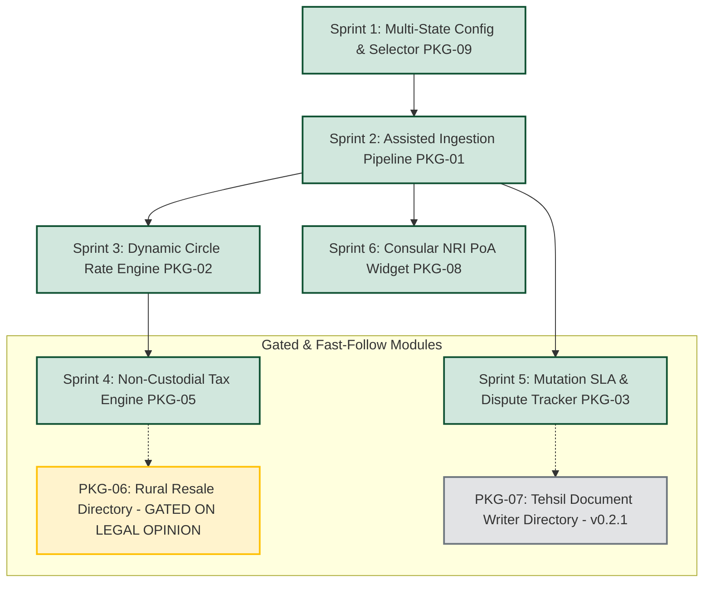

# IMPLEMENTATION SEQUENCE & DEPENDENCY PLAN
# Bhūmi Ledger — India Land Transaction & Registry Platform

**Document Version:** 1.0.0  
**Phase:** Phase 4.1 (Autonomous Validation & Implementation Planning)  
**Authors:** Chief AI Engineering Orchestrator, Lead Full-Stack Architect, Lead DevSecOps Architect, DH-QA  
**Status:** Canonical Implementation Sequence Plan  
**Target Execution:** Phase 5 (Gated Incremental Sprints)  

---

## 1. Executive Summary & Sequential Flow Architecture

This plan establishes the canonical, dependency-ordered implementation sequence for **Phase 5**. Each sprint is strictly scoped, bounded to specific file paths, and protected by regression testing gates and automated rollback checkpoints.



---

## 2. Sprint-by-Sprint Execution Sequence & File Boundaries

### Sprint 1: Multi-State Configuration & State Selector (PKG-09 / PRD-05)
- **Objective:** Establish the top navigation State Selector and dynamic JSON configuration loader.
- **Estimated Effort:** 2.4 Person-Days (2.0d Base + 0.4d Cont.).
- **Assigned Roles:** Senior Frontend Engineer (1.5d), Lead Architect (0.5d), QA (0.4d).
- **Exact File Boundaries:**
  - *New Files to Create:*
    - `frontend/src/config/up.config.json` (UP administrative hierarchy, gazettes, portal links)
    - `frontend/src/config/central.config.json` (Central statutes, IT Act, Income-tax Act citations)
    - `frontend/src/context/StateContext.jsx` (Global state context provider)
    - `frontend/src/components/StateSelector.jsx` (Pill dropdown component with Ashoka emblem)
    - `frontend/src/components/ComingSoonModal.jsx` (Opt-in modal for non-pilot states)
  - *Existing Files to Modify (Narrow Scope):*
    - `frontend/src/App.jsx` (Wrap tree in `StateProvider`; integrate `StateSelector` in top banner)
  - *Prohibited Files:* Zero edits to `contracts/` or `backend/server.js`.
- **Regression Gate:** `npx hardhat test` (57 passing) + `npm test` in `backend/` (27 passing) + Vite production build passes in $< 600\text{ ms}$.
- **Rollback Checkpoint:** `git checkout HEAD -- frontend/src/App.jsx && rm -rf frontend/src/config/ frontend/src/components/StateSelector.jsx`.

---

### Sprint 2: Assisted Citizen Ingestion & Document Verification Pipeline (PKG-01 / PRD-01)
- **Objective:** Secure PDF upload dropzone, magic-byte sniffing, client SHA-256, backend salted Keccak-256, and 16-digit Gata extraction.
- **Estimated Effort:** 6.0 Person-Days (5.0d Base + 1.0d Cont.).
- **Assigned Roles:** Senior Backend Engineer (2.5d), Senior Frontend Engineer (1.5d), GIS Data Analyst (1.0d), QA/Security (1.0d).
- **Exact File Boundaries:**
  - *New Files to Create:*
    - `backend/services/pdfParserService.js` (Isolated regex/stream parser for UP Khatauni PDFs)
    - `backend/services/hashService.js` (CSPRNG salt generation & salted Keccak-256 commitment hashing)
    - `backend/test/ingestion.test.js` (Unit specs for PDF parsing, stale date rejection, magic bytes)
    - `frontend/src/components/DocumentUploadModal.jsx` (Upload dropzone with client-side SHA-256)
  - *Existing Files to Modify:*
    - `backend/routes/documents.js` (Incorporate magic-byte filter, salt vault storage, metadata response)
    - `backend/db.js` (Add `CITIZEN_SALT_VAULT` table and extensible parcel identifier columns)
    - `frontend/src/pages/PublicSearch.jsx` (Display 16-digit Gata Code, ULPIN badge, and legal banner)
- **Regression Gate:** Hardhat 57 passing + all 27 backend tests passing + 8 new ingestion unit specs passing.
- **Rollback Checkpoint:** Revert `backend/routes/documents.js` and drop `CITIZEN_SALT_VAULT` via migration reversal script.

---

### Sprint 3: Dynamic Circle Rate Valuation & Stamp Duty Calculator (PKG-02 / PRD-02)
- **Objective:** Multi-factor statutory fee calculator implementing UP Stamp Valuation Rules 1997.
- **Estimated Effort:** 4.8 Person-Days (4.0d Base + 0.8d Cont.).
- **Assigned Roles:** Senior Backend Engineer (2.0d), Senior Frontend Engineer (1.5d), Legal Analyst (0.5d), QA (0.8d).
- **Exact File Boundaries:**
  - *New Files to Create:*
    - `backend/services/valuationService.js` (Circle rate math, road multipliers, female rebates, Sec 47A)
    - `backend/test/valuation.test.js` (Unit specs for the 4 worked calculation scenarios)
    - `frontend/src/components/ValuationBreakdown.jsx` (Itemized fee breakdown card with source citation)
    - `frontend/src/pages/ValuationCalculator.jsx` (Standalone `/valuation` interactive route)
  - *Existing Files to Modify:*
    - `backend/server.js` (Mount `/api/valuation` route)
    - `frontend/src/App.jsx` (Register `/valuation` route in React Router)
- **Regression Gate:** Invariant assertion that female concession applies strictly to female share; undervaluation emits Section 47A warning. Hardhat 57 passing + backend test suite green.

---

### Sprint 4: Non-Custodial Direct Tax Schedule Engine (PKG-05 / PRD-03)
- **Objective:** 1% TDS calculation under Section 393(1) of Income-tax Act, 2025 and Form 141 (Schedule B) draft exporter.
- **Estimated Effort:** 4.8 Person-Days (4.0d Base + 0.8d Cont.).
- **Assigned Roles:** Senior Backend Engineer (2.0d), Senior Frontend Engineer (1.5d), Tax Specialist (0.5d), QA (0.8d).
- **Exact File Boundaries:**
  - *New Files to Create:*
    - `backend/services/taxService.js` (Section 393(1) threshold checker & rural agricultural exemption logic)
    - `backend/services/form141Generator.js` (PDF/JSON draft schedule generator with PAN masking)
    - `backend/test/tax.test.js` (Unit specs for ₹50L threshold and exemption edge cases)
    - `frontend/src/components/PaymentScheduleModal.jsx` (Settlement breakdown with Form 141 download button)
  - *Existing Files to Modify:*
    - `backend/routes/transfers.js` (Expose `/api/transfers/:id/settlement-schedule` endpoint)
    - `frontend/src/components/InitiateTransferModal.jsx` (Show TDS breakdown preview)
- **Zero-Custody Verification Gate:** Assert zero banking API calls or debit logic. Draft assistance only.

---

### Sprint 5: Mutation Notice SLA & Dispute Injunction Tracker (PKG-03 / PRD-04)
- **Objective:** Rule 34(1) 30-day proclamation objection notice timer, Rule 34(7) SLAs, and 6-tier litigation advisories.
- **Estimated Effort:** 4.8 Person-Days (4.0d Base + 0.8d Cont.).
- **Assigned Roles:** Senior Backend Engineer (2.0d), Senior Frontend Engineer (1.5d), Smart Contract Specialist (0.5d), QA (0.8d).
- **Exact File Boundaries:**
  - *New Files to Create:*
    - `backend/services/mutationService.js` (Proclamation date tracking, 30-day notice countdown, Vaad UP mapping)
    - `frontend/src/components/MutationSlaWidget.jsx` (Visual countdown ring showing days remaining for objections)
    - `frontend/src/components/LitigationAdvisoryBadge.jsx` (Strict 6-tier taxonomy badge with court details)
  - *Existing Files to Modify:*
    - `backend/routes/transfers.js` (Add mutation lifecycle fields)
    - `frontend/src/pages/AuthorityDashboard.jsx` (Incorporate 30-day notice lock before approval)
- **Regression Gate:** Premature mutation approval before 30-day window is strictly blocked by API.

---

### Sprint 6: Consular NRI 90-Day PoA Stamping Countdown (PKG-08)
- **Objective:** Automated statutory 90-day countdown alert widget for foreign instruments under Section 18 Indian Stamp Act.
- **Estimated Effort:** 1.8 Person-Days (1.5d Base + 0.3d Cont.).
- **Assigned Roles:** Senior Frontend Engineer (0.8d), Backend Engineer (0.5d), QA (0.5d).
- **Exact File Boundaries:**
  - *New Files to Create:*
    - `frontend/src/components/NriPoAWidget.jsx` (Section 18 90-day statutory countdown timer)
  - *Existing Files to Modify:*
    - `frontend/src/components/InitiateTransferModal.jsx` (Add optional "Consular Foreign PoA" checkbox)
    - `backend/routes/transfers.js` (Store PoA arrival date and adjudication status)
- **Regression Gate:** Verify countdown triggers strictly on foreign execution and receipt in India; in-person executions bypass widget.

---

## 3. Total Implementation Schedule & Gating Dependencies

```
┌────────────────────────────────────────────────────────────────────────────────────────────────────────────────────────┐
│                                       PHASE 5 MASTER SPRINT TIMELINE                                                   │
├──────────┬─────────────────────────────────────────────┬──────────────┬──────────────────┬─────────────────────────────┤
│ Sprint   │ Package Focus                               │ Reconciled   │ Prerequisites    │ Mandatory Gating Authority  │
│ Number   │                                             │ Person-Days  │ & Dependencies   │ Prior to Sprint Deployment  │
├──────────┼─────────────────────────────────────────────┼──────────────┼──────────────────┼─────────────────────────────┤
│ Sprint 1 │ Multi-State Config & Selector (PKG-09)      │ 2.4 Days     │ Phase 4 Sign-Off │ Lead Frontend & Architect   │
├──────────┼─────────────────────────────────────────────┼──────────────┼──────────────────┼─────────────────────────────┤
│ Sprint 2 │ Assisted Parcel Ingestion Pipeline (PKG-01) │ 6.0 Days     │ Sprint 1 Config  │ DH-Security (ClamAV/Salts)  │
├──────────┼─────────────────────────────────────────────┼──────────────┼──────────────────┼─────────────────────────────┤
│ Sprint 3 │ Dynamic Circle Rate Engine (PKG-02)         │ 4.8 Days     │ Sprint 2 Parser  │ DH-Legal (Gazette check)    │
├──────────┼─────────────────────────────────────────────┼──────────────┼──────────────────┼─────────────────────────────┤
│ Sprint 4 │ Non-Custodial Tax Schedule Engine (PKG-05)  │ 4.8 Days     │ Sprint 3 Figures │ DH-Legal (Form 141 check)   │
├──────────┼─────────────────────────────────────────────┼──────────────┼──────────────────┼─────────────────────────────┤
│ Sprint 5 │ Mutation SLA & Dispute Tracker (PKG-03)     │ 4.8 Days     │ Sprint 2 Parcels │ DH-Legal (Rule 34 check)    │
├──────────┼─────────────────────────────────────────────┼──────────────┼──────────────────┼─────────────────────────────┤
│ Sprint 6 │ Consular NRI 90-Day PoA Widget (PKG-08)     │ 1.8 Days     │ Sprint 4/5 Flows │ DH-Legal (Sec 18 check)     │
├──────────┼─────────────────────────────────────────────┼──────────────┼──────────────────┼─────────────────────────────┤
│ Hardening│ Cross-Cutting Security, QA & Regression Run │ 4.8 Days     │ Sprints 1–6 Done │ Lead QA & Security Reviewer │
├──────────┼─────────────────────────────────────────────┼──────────────┼──────────────────┼─────────────────────────────┤
│ TOTAL    │ Core UP-First MVP Implementation            │ 29.4 Days    │ ~4 Calendar Wks  │ Project Owner Sign-Off Gate │
└──────────┴─────────────────────────────────────────────┴──────────────┴──────────────────┴─────────────────────────────┘
```

---
*End of Implementation Sequence & Dependency Plan.*