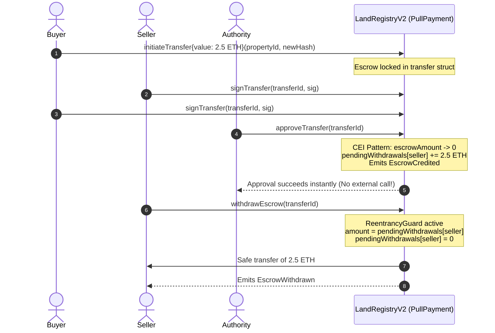

# SMART CONTRACT REFACTORING SPECIFICATION (PULLPAYMENT & LANDREGISTRY V2)
# Bhūmi Ledger — India Land Transaction & Registry Platform

**Document Version:** 1.0.0  
**Phase:** Phase 4 (Architecture, Security, Privacy & Regulatory Feasibility Gate — Workstream W01)  
**Authors:** Chief AI Engineering Orchestrator, Lead Smart Contract Architect, DH-Security, Lead QA Engineer  
**Status:** Canonical Architecture Specification (Design Only — Zero Solidity Code Edits)  
**Target Environment:** Cancun EVM / Solidity ^0.8.24 / OpenZeppelin v5.x  

---

## 1. Executive Summary & Strategic Architectural Trade-Off

This specification delivers the complete architectural design for the **PullPayment Escrow Pattern** and the future **`LandRegistryV2.sol`** smart contract.

### 1.1 The Critical Architectural Dilemma: Is Refactoring Necessary for MVP Release 1?

```
┌────────────────────────────────────────────────────────────────────────────────────────┐
│                        RELEASE TIMING & ARCHITECTURAL COMPARISON                       │
├───────────────────────────────────┬────────────────────────────────────────────────────┤
│ Strategy A: Refactor Immediately  │ Strategy B: Phased Evolution (Recommended)         │
│ (Modify `LandRegistry.sol` Now)   │ (Freeze V1 for MVP Sandbox; Target V2 for Live)    │
├───────────────────────────────────┼────────────────────────────────────────────────────┤
│ • Breaks existing 57 unit tests   │ • Preserves all 57 passing tests completely green  │
│ • Breaks backend indexer ABI      │ • Zero regression risk in working prototype        │
│ • Requires rewrites in frontend   │ • Aligned with Project Owner decision: ZERO live   │
│ • Live citizen funds EXCLUDED in  │   citizen funds in MVP Release 1                   │
│   MVP Release 1 (Testnet mock ETH)│ • V2 contract fully specified and ready for formal │
│ • Unnecessary engineering churn   │   Phase 5 audit and mainnet deployment             │
└───────────────────────────────────┴────────────────────────────────────────────────────┘
```

> [!IMPORTANT]
> **Architectural Recommendation:**
> Because the Project Owner has explicitly ruled out live citizen fund handling for MVP Release 1, **modifying the existing `LandRegistry.sol` contract immediately is unnecessary and counterproductive**. 
> - **MVP Release 1:** Retain the verified, fully passing `LandRegistry.sol` for local Hardhat and public testnet academic demonstrations.
> - **Production Release 2:** Implement `LandRegistryV2.sol` as specified herein, deploying it when formal regulatory authorization for production tokenized or fiat-bridged escrow is granted.

---

## 2. Existing Payment Lifecycle & Vulnerability Analysis (`LandRegistry.sol`)

### 2.1 Current Implementation Behavior
In [`contracts/LandRegistry.sol`](file:///Users/lakshay/Desktop/Projects/Land-registry/contracts/LandRegistry.sol#L281-L322):
- **Buyer Deposit:** `initiateTransfer` accepts native ETH (`msg.value`) and locks it in `transfers[transferId].escrowAmount`.
- **Authority Approval:** `approveTransfer(transferId)` performs a direct push disbursement to the seller:
  ```solidity
  (bool success, ) = payable(request.from).call{value: amount}("");
  if (!success) revert TransferFailed();
  ```
- **Authority Rejection:** `rejectTransfer(transferId, reason)` performs a direct push refund to the buyer:
  ```solidity
  (bool success, ) = payable(request.to).call{value: amount}("");
  if (!success) revert TransferFailed();
  ```

### 2.2 Vulnerability & Failure Modes of Direct Push
1. **Denial of Service (DoS) via Reverting Fallback:** If the seller (or buyer) is a smart contract (e.g., a multisig, DAO, or malicious actor) whose fallback/receive function consumes excess gas or unconditionally reverts, the authority's transaction will revert. This completely blocks administrative approvals and freezes contract state.
2. **Reentrancy Risks:** While the Checks-Effects-Interactions (CEI) pattern is followed, direct external calls to untrusted addresses prior to final execution introduce unnecessary attack surface.
3. **Gas Limit Griefing:** If gas schedules change (EIP-150 / 2929), fixed-gas push transfers can permanently trap funds in the contract.

---

## 3. Proposed `LandRegistryV2.sol` PullPayment Architecture

### 3.1 State Transitions & Accounting Model
Instead of pushing funds directly during administrative approvals, `LandRegistryV2` decouples the authority's state approval from fund disbursement using the **PullPayment** pattern (derived from OpenZeppelin `PullPayment` / `AsyncSend`):



### 3.2 Canonical State & Storage Schema (`LandRegistryV2`)
```solidity
// SPDX-License-Identifier: MIT
pragma solidity ^0.8.24;

import "@openzeppelin/contracts/access/AccessControl.sol";
import "@openzeppelin/contracts/utils/cryptography/EIP712.sol";
import "@openzeppelin/contracts/utils/cryptography/ECDSA.sol";
import "@openzeppelin/contracts/utils/ReentrancyGuard.sol";
import "@openzeppelin/contracts/utils/Pausable.sol";

contract LandRegistryV2 is AccessControl, EIP712, ReentrancyGuard, Pausable {
    bytes32 public constant ADMIN_ROLE = keccak256("ADMIN_ROLE");
    bytes32 public constant REGISTRAR_ROLE = keccak256("REGISTRAR_ROLE");
    bytes32 public constant EMERGENCY_ROLE = keccak256("EMERGENCY_ROLE");

    enum TransferStatus {
        NONE,
        INITIATED,
        SIGNED_BY_PARTIES,
        APPROVED_BY_AUTHORITY,
        REJECTED_BY_AUTHORITY,
        EXECUTED,
        CANCELLED,
        DISPUTED
    }

    struct TransferRequestV2 {
        uint256 propertyId;
        address from; // Seller
        address to;   // Buyer
        bytes32 newDocumentHash;
        bool fromSigned;
        bool toSigned;
        TransferStatus status;
        uint256 escrowAmount;
        uint256 createdAt;
        uint256 expirationTimestamp; // 90-day statutory expiry
    }

    // PullPayment Accounting: Recipient => Available Balance
    mapping(address => uint256) public pendingWithdrawals;
    mapping(uint256 => TransferRequestV2) public transfers;
    
    // Explicit event signatures for indexer compatibility
    event EscrowDeposited(uint256 indexed transferId, address indexed buyer, uint256 amount);
    event EscrowCredited(uint256 indexed transferId, address indexed recipient, uint256 amount);
    event EscrowWithdrawn(address indexed recipient, uint256 amount);
    event EscrowRefundCredited(uint256 indexed transferId, address indexed buyer, uint256 amount);
    event TransferExpired(uint256 indexed transferId);
    event EmergencyFundsRecovered(address indexed token, address indexed to, uint256 amount);

    error NoFundsToWithdraw();
    error TransferNotActive();
    error TransferExpiredError();
    error UnauthorizedCaller();
    error EscrowLockActive();
}
```

### 3.3 Core Function Specifications

#### 1. `approveTransfer(uint256 _transferId)`
- **Access:** `onlyRole(ADMIN_ROLE)`
- **Modifiers:** `whenNotPaused`
- **State Changes:**
  1. Validates that `status == TransferStatus.INITIATED` and dual signatures are present.
  2. Sets `status = TransferStatus.APPROVED_BY_AUTHORITY`.
  3. If `escrowAmount > 0`:
     - Reads `amount = request.escrowAmount`.
     - Sets `request.escrowAmount = 0` (CEI).
     - Increments `pendingWithdrawals[request.from] += amount`.
     - Emits `EscrowCredited(_transferId, request.from, amount)`.
  4. Emits `TransferApproved(_transferId)`.
- **Key Safety Guarantee:** **ZERO external `.call` executed.** Authority approval can never be blocked by a malicious seller contract.

#### 2. `rejectTransfer(uint256 _transferId, string calldata _reason)`
- **Access:** `onlyRole(ADMIN_ROLE)`
- **Modifiers:** `whenNotPaused`
- **State Changes:**
  1. Validates that transfer is pending.
  2. Sets `status = TransferStatus.REJECTED_BY_AUTHORITY`.
  3. If `escrowAmount > 0`:
     - Sets `request.escrowAmount = 0`.
     - Increments `pendingWithdrawals[request.to] += amount` (Credits buyer).
     - Emits `EscrowRefundCredited(_transferId, request.to, amount)`.
  4. Emits `TransferRejected(_transferId, _reason)`.

#### 3. `withdrawEscrow()` (The Pull Mechanism)
- **Access:** Public (Any address with pending balance)
- **Modifiers:** `nonReentrant`, `whenNotPaused`
- **Logic:**
  ```solidity
  function withdrawEscrow() external nonReentrant whenNotPaused {
      uint256 amount = pendingWithdrawals[msg.sender];
      if (amount == 0) revert NoFundsToWithdraw();

      // CEI Pattern: Zero balance before external transfer
      pendingWithdrawals[msg.sender] = 0;

      (bool success, ) = payable(msg.sender).call{value: amount}("");
      if (!success) {
          // Restore balance if call fails
          pendingWithdrawals[msg.sender] = amount;
          revert TransferFailed();
      }

      emit EscrowWithdrawn(msg.sender, amount);
  }
  ```

---

## 4. Handling of Edge Cases: Expired, Cancelled & Disputed Transfers

### 4.1 90-Day Statutory Expiration Window
- **Statutory Context:** Conveyance agreements cannot remain indefinitely open on-chain. If statutory SRO deed execution does not occur within **90 calendar days** from initiation:
- **Function:** `cancelExpiredTransfer(uint256 _transferId)`
  - Callable by Buyer, Seller, or Authority if `block.timestamp > request.expirationTimestamp` and `status == TransferStatus.INITIATED`.
  - Sets `status = TransferStatus.CANCELLED`.
  - Automatically credits `pendingWithdrawals[request.to] += request.escrowAmount` (Full refund to buyer).
  - Emits `TransferExpired(_transferId)`.

### 4.2 Disputed Transfers & Court Injunction Freeze
- If a court order or revenue stay is submitted via `flagProperty`, any pending transfer for that property is automatically transitioned to `TransferStatus.DISPUTED`.
- Escrow funds remain safely locked in contract storage; no withdrawals can be initiated until formal unflagging by an authorized administrative officer.

---

## 5. Security & Threat Model

| Threat Vector | Severity | Mitigation in `LandRegistryV2` |
| :--- | :--- | :--- |
| **Reentrancy on Withdrawal** | High | OpenZeppelin `ReentrancyGuard` (`nonReentrant` modifier) + CEI pattern (balance zeroed before call). |
| **Denial of Service (DoS) on Approvals**| High | Completely eliminated by PullPayment. Approvals execute purely within contract storage. |
| **Gas Griefing / Out of Gas** | Medium | User pays their own gas to withdraw funds; operator/authority gas costs are fixed and deterministic. |
| **Unauthorized Fund Siphoning** | Critical | Strict address-bound accounting: `pendingWithdrawals[msg.sender]` ensures callers can only pull their own credited funds. |
| **Emergency Lockup** | Medium | OpenZeppelin `Pausable` allows `EMERGENCY_ROLE` to pause withdrawals during critical vulnerability detection. |

---

## 6. Migration & Backward Compatibility Strategy

### 6.1 Backend Indexer Compatibility
- The existing SQLite schema (`backend/db.js`) contains:
  - `TRANSFERS.escrow_amount`
  - `AUDIT_EVENTS`
- `LandRegistryV2` preserves existing event names (`EscrowDeposited`, `TransferApproved`, `TransferRejected`) while adding `EscrowCredited` and `EscrowWithdrawn`.
- The indexer (`backend/indexer.js`) will be updated to listen to `EscrowWithdrawn` to update the user's available balance in SQLite without modifying core property models.

### 6.2 Testing Plan for V2 Contract
When authorized for Phase 5, the following test suite will be implemented:
1. `test/pull-payment.test.js` (15 dedicated unit specs asserting reentrancy resistance, DoS elimination, and balance claims).
2. Malicious contract receiver simulations (`RevertingReceiver.sol`, `GasGriefingReceiver.sol`).
3. Slither and Mythril static analysis runs with zero high-severity findings.

---
*End of Smart Contract Refactoring Specification.*