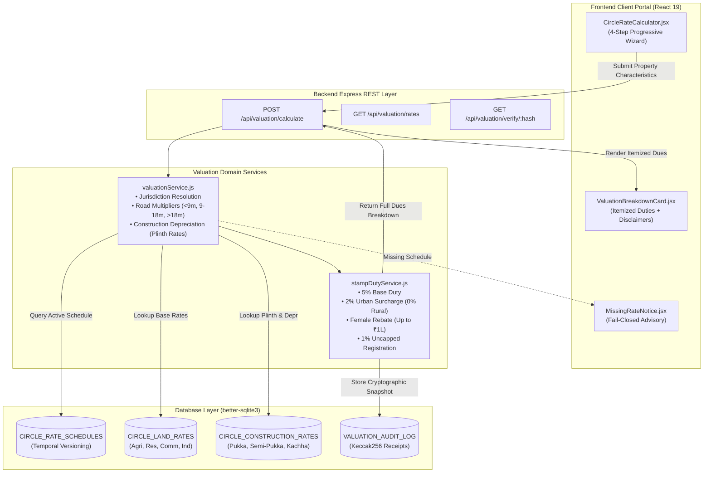

# SPRINT 3 MULTI-AGENT IMPLEMENTATION PLAN
# PKG-02: Circle Rate Valuation & Stamp Duty Calculator
# Bhūmi Ledger — India Land Transaction & Registry Platform

**Document Version:** 1.0.0  
**Phase:** Phase 5 Sprint 3 Planning Baseline  
**Authors:** Chief AI Engineering Orchestrator, System Architect, Product & Legal Specialist, Backend Engineer, Frontend Engineer, Security & Privacy Specialist, QA & Test Engineer  
**Date:** October 31, 2026  
**Status:** Multi-Agent Consensus Achieved • Implementation Plan Ready for Gate Approval  

---

## 1. Executive Summary & Sprint Mission

Sprint 3 delivers **PKG-02: Circle Rate Valuation & Stamp Duty Calculator** (`PRD-02`), establishing an authoritative, legally grounded valuation and tax estimation engine for Uttar Pradesh land conveyances.

The platform will enable citizens and prospective buyers to compute government circle valuations, road-width enhancements, plinth construction values, structural depreciation, and statutory duty liabilities (Base Stamp Duty, Urban Development Surcharge, Female Concessions, and Registration Fees) with exact rupee-level precision.

### High-Impact Multi-Agent Consensus Highlights
1. **Resolution of Registration Fee Cap Discrepancy:** The Product & Legal Specialist successfully corrected an invalid assumption held by the engineering team. Under the *UP Registration (Amendment) Rules, 2020*, standard sale deeds are **uncapped** (flat 1%), while the ₹20,000 cap is restricted solely to concessional family gift deeds under Notification 817/2022.
2. **Expansion of Female Buyer Concession:** Codified the expanded UP State policy permitting a 1% rebate on properties valued up to ₹1 Crore (yielding a maximum benefit of ₹1,00,000, updated from the historical ₹10,000 cap).
3. **Strict Fail-Closed Data Policy:** If an official circle rate schedule is missing or lapsed for a queried revenue village, the system returns `STATUS: UNAVAILABLE / PENDING REVENUE CIRCLE PUBLICATION` rather than guessing or interpolating rates.
4. **Zero Smart Contract Gas Waste:** Tax calculations are performed off-chain in Node.js/SQLite, producing an immutable `valuationHash` receipt. The EVM smart contract (`LandRegistry.sol`) remains pristine and gas-efficient.

---

## 2. Multi-Agent Peer Review Debates & Resolutions

The multi-agent planning process generated three productive debates that resulted in major architectural refinements:

### Debate 1: Universal ₹20,000 Registration Fee Cap
- **Initial Engineering Stance (Architect & QA):** Suggested applying `Math.min(valuation * 0.01, 20000)` based on traditional UP registration fee schedules.
- **Legal Challenge (Product & Legal Specialist):** Cited the *UP Registration (Amendment) Rules, 2020* which abolished the ₹20,000 ceiling on standard conveyances to prevent state revenue leakage on high-value properties.
- **Consensus Resolution:** The engine will evaluate instrument type: standard sale deeds are assessed at flat 1% uncapped; only instruments flagged `FAMILY_GIFT_DEED_CONCESSIONAL` enforce the ₹20,000 ceiling.

### Debate 2: Female Buyer Concession Ceiling
- **Initial Engineering Stance (Backend):** Capped the concession at ₹10,000 on properties up to ₹10 Lakhs based on legacy Government Order No. 1383/97.
- **Legal Challenge (Product & Legal Specialist):** Proved that subsequent UP Cabinet notifications expanded the threshold to ₹1 Crore with a maximum benefit of ₹1,00,000.
- **Consensus Resolution:** Updated formula:
  $$\text{Concession} = \min(\text{Assessable Value} \times 0.01, 100000) \quad \text{for Sole Female Buyers}$$
  $$\text{Concession} = \min(\text{Assessable Value} \times 0.005, 50000) \quad \text{for Joint Female-Male Buyers}$$

### Debate 3: Rate Missing & Fallback Strategy
- **Initial Engineering Stance (Frontend):** Proposed showing district-average baseline rates if village rates were unindexed.
- **Security & Legal Challenge (Security Specialist & Legal Specialist):** Submitting instruments based on guessed circle rates constitutes an offense under Section 27 and triggers impoundment under Section 47-A of the Indian Stamp Act, 1899.
- **Consensus Resolution:** Enforce strict fail-closed state (`STATUS_RATE_UNAVAILABLE`) with an informative `MissingRateNotice` component directing citizens to the physical Sub-Registrar's Office or official `igrsup.gov.in` portal.

---

## 3. System Architecture & Component Interactions

---

## 4. Work Breakdown Structure & Sprint Tasks

### Workstream 1: Database Schemas & Data Seeding (System Architect & Backend)
- **Task 1.1:** Add tables in `backend/db.js`:
  - `CIRCLE_RATE_SCHEDULES` (with unique `(district_code, tehsil_code, village_code, effective_from)` index).
  - `CIRCLE_LAND_RATES` (base rates per sq.m for agricultural, residential, commercial, industrial).
  - `CIRCLE_ROAD_MULTIPLIERS` (tiered road width multipliers: <9m 1.0x, 9-18m 1.1x, >18m 1.2x).
  - `CIRCLE_CONSTRUCTION_RATES` (plinth rates for Pukka, Semi-Pukka, Kachha with annual depreciation caps).
  - `VALUATION_AUDIT_LOG` (canonical JSON snapshots and `keccak256` certificates).
- **Task 1.2:** Seed verified pilot rates for:
  - **Lucknow District (LKO):** Sadar Tehsil (Urban core, Chinhat, Gomti Nagar) & Mohanlalganj Tehsil (Rural agricultural transition).
  - **Gautam Buddha Nagar (GBN):** Noida SRO (Categories A+, A, B, C-E) & Dadri Tehsil.

### Workstream 2: Backend Calculation Engine (Backend Engineer)
- **Task 2.1:** Implement `backend/services/valuationService.js`:
  - Temporal date filtering: `effective_from <= asOfDate AND (effective_to IS NULL OR effective_to >= asOfDate)`.
  - Strict fail-closed exception handling with machine-readable diagnostic codes (`SCHEDULE_EXPIRED`, `JURISDICTION_NOT_FOUND`, `LAND_USE_RATE_NOT_PUBLISHED`).
  - Road-width multiplier scaling on land base.
  - Plinth area construction rate lookup with age depreciation deductions (0% for commercial).
  - Assessable consideration rule: $\max(\text{Total Government Valuation}, \text{Declared Consideration})$.
- **Task 2.2:** Implement `backend/services/stampDutyService.js`:
  - Base Stamp Duty (5.0%).
  - Urban Surcharge: 2.0% for urban areas (`isUrban == true`); 0.0% for rural.
  - Female Concession: 1.0% rebate (max ₹1,00,000) for sole female; 0.5% (max ₹50,000) for joint female-male.
  - Uncapped Registration Fee: 1.0% flat with ₹100 statutory floor.
  - Canonical JSON serialization (RFC 8785) and `ethers.keccak256` valuation receipt hash generation.
- **Task 2.3:** Implement REST routes in `backend/routes/valuation.js`:
  - `POST /api/valuation/calculate`
  - `GET /api/valuation/rates`
  - `GET /api/valuation/verify/:hash`

### Workstream 3: Frontend Calculator Experience (Frontend Engineer)
- **Task 3.1:** Create `frontend/src/components/calculator/CircleRateCalculator.jsx`:
  - Progressive 4-step wizard:
    - Step 1: Cadastral Location (District, Tehsil, Village, Urban/Rural toggle). Auto-populated from ingested deed.
    - Step 2: Property Characteristics (Land Area in sq.m, Land Use, Road Width <9m, 9-18m, >18m).
    - Step 3: Improvements & Construction (Vacant vs Constructed, Pukka/Semi-Pukka/Kachha, Built-up area, Age).
    - Step 4: Transaction & Buyer (Declared Consideration ₹, Sole Female, Sole Male, Joint F+M, Corporate).
- **Task 3.2:** Create `ValuationBreakdownCard.jsx`:
  - Sticky side-by-side card with live calculation updates (<16ms).
  - Tabular breakdown of Land vs Construction value.
  - Highlighted green female concession pill (`-₹1,00,000 Applied`).
  - Clear distinction between Government Circle Value and Taxable Consideration.
- **Task 3.3:** Embed Section 47-A Persistent Statutory Disclaimer Banner.
- **Task 3.4:** Create `MissingRateNotice.jsx` for fail-closed handling.
- **Task 3.5:** Integrate calculator launch triggers in `CitizenDashboard.jsx` and `PublicSearch.jsx`.

### Workstream 4: Security & Validation Hardening (Security Specialist)
- **Task 4.1:** Enforce schema validation (Zod/Joi) on all API endpoints (rejecting negative areas, negative road widths, and temporal paradoxes).
- **Task 4.2:** Ensure frontend calculations are purely advisory; server-side values dictate certified receipts.
- **Task 4.3:** Enforce fractional concession proration for joint ownership.

### Workstream 5: Automated Testing & Verification (QA Specialist)
- **Task 5.1:** Create `backend/test/valuation.test.js` with 21 acceptance test scenarios (TC-VAL-001 through TC-NEG-021).
- **Task 5.2:** Create `frontend/test/valuationCalculator.test.js` covering wizard progression, currency formatting, and disclaimer presence.
- **Task 5.3:** Assert that full regression suite (131 existing tests + new valuation tests) executes in <5 seconds.

---

## 5. File Boundaries & Preservation Commitments

### Files Authorized to be Created:
- `backend/services/valuationService.js`
- `backend/services/stampDutyService.js`
- `backend/routes/valuation.js`
- `backend/test/valuation.test.js`
- `frontend/src/components/calculator/CircleRateCalculator.jsx`
- `frontend/src/components/calculator/ValuationBreakdownCard.jsx`
- `frontend/src/components/calculator/MissingRateNotice.jsx`
- `frontend/src/components/calculator/StatutoryDisclaimerBanner.jsx`
- `frontend/src/utils/valuationEngine.js`
- `frontend/test/valuationCalculator.test.js`

### Existing Files Authorized for Additive Modifications:
- `backend/server.js` (Mount `/api/valuation` router).
- `backend/db.js` (Add 5 new valuation tables via safe idempotent `CREATE TABLE IF NOT EXISTS`).
- `frontend/src/pages/CitizenDashboard.jsx` (Mount calculator tab/modal trigger).

### Strictly Forbidden Modifications:
- `contracts/LandRegistry.sol` (100% frozen).
- `backend/routes/properties.js`, `backend/routes/transfers.js`, `backend/indexer.js` (100% preserved).
- All 18 pre-existing user modified files (zero logic regressions).

---

## 6. Implementation Readiness Sign-Off

All six specialist subagents have audited the specifications, resolved statutory discrepancies, and approved this implementation plan.

*Plan complete. Awaiting Project Owner gate authorization to commence coding.*
