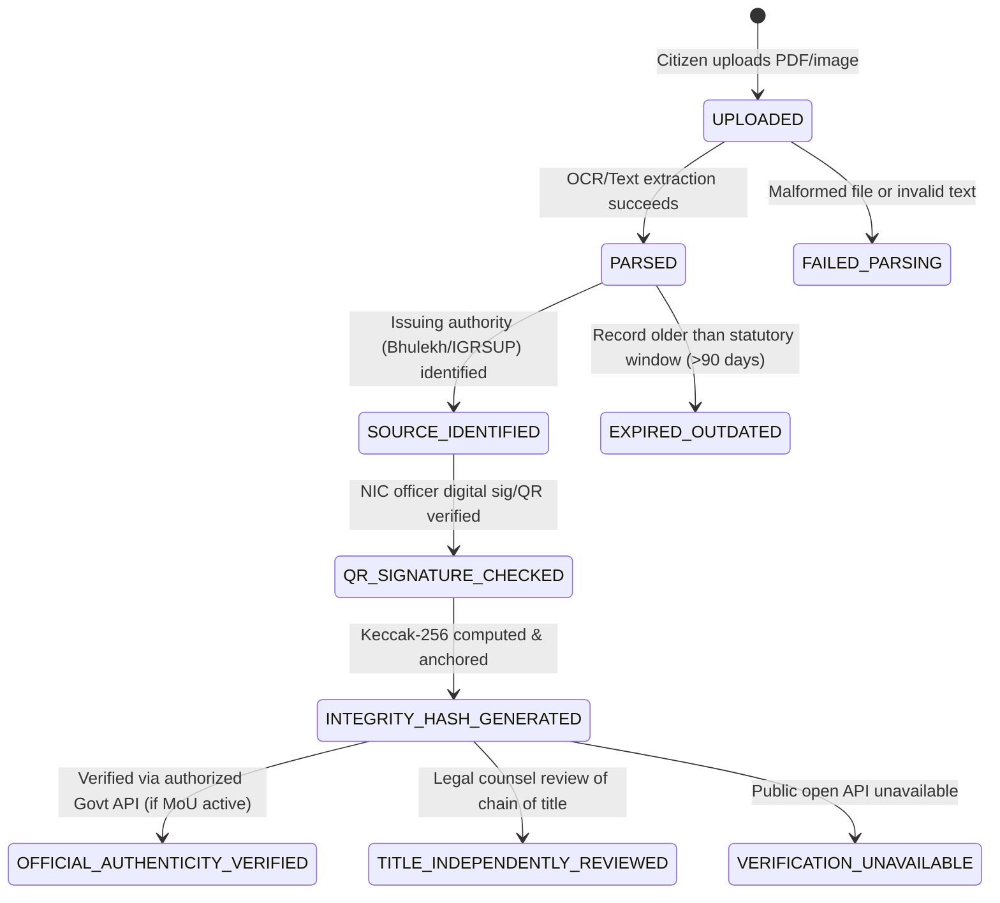

# DATA MODEL & CANONICAL ENTITY GLOSSARY
# Bhūmi Ledger — India Land Transaction & Registry Platform

**Document Version:** 1.0.0  
**Phase:** Phase 3 (Product Definition & Data Architecture)  
**Authors:** Chief AI Engineering Orchestrator, Department Head of Architecture (DH-Arch), Department Head of Engineering (DH-Eng)  
**Status:** Approved for Project Owner Review  
**Jurisdiction Baseline:** Republic of India / State of Uttar Pradesh (Pilot State)  

---

## 1. Executive Summary & Parcel Identification Ground Truth

This document establishes the canonical data entities, lifecycle state machines, and relational schemas for Bhūmi Ledger, with strict adherence to Indian statutory and administrative nomenclature.

### 1.1 Critical Ground Truth: ULPIN vs. UPIC in Uttar Pradesh

```
┌────────────────────────────────────────────────────────────────────────────────────────┐
│                        PARCEL IDENTIFIERS IN UTTAR PRADESH                             │
├───────────────────────────────────┬────────────────────────────────────────────────────┤
│ Identifier 1: 16-Digit Computerized│ Identifier 2: 14-Character ULPIN                   │
│ Land Parcel Code (UPIC / Gata Code)│ (Bhu-Aadhaar)                                      │
├───────────────────────────────────┼────────────────────────────────────────────────────┤
│ • Authority: Board of Revenue, UP │ • Authority: DoLR / NIC (Central DILRMP Standard)  │
│ • Portal: `upbhulekh.gov.in`      │ • Format: 14-character alphanumeric code           │
│ • Format: 16 numeric digits       │ • Derivation: WGS-84 geodesic parcel polygon       │
│ • Structure:                      │ • Structure: Derived from lat/long coordinates of  │
│   - District Code:  2 digits      │   parcel vertices (e.g., `UP09LK41200001`)         │
│   - Tehsil Code:    4 digits      │ • Availability: Phased rollout across UP districts;│
│   - Village Code:   6 digits      │   available where cadastral GIS mapping is done    │
│   - Gata / Parcel:  4 digits      │ • Role: National unique spatial parcel identifier  │
│ • Availability: Ubiquitous across │                                                    │
│   all 75 digitized UP districts   │                                                    │
└───────────────────────────────────┴────────────────────────────────────────────────────┘
```

> [!IMPORTANT]
> The 16-digit Computerized Gata Code and the 14-character ULPIN are **distinct, non-interchangeable identifiers**. The platform must capture both: the 16-digit Gata Code is mandatory for all rural UP records, while the 14-character ULPIN is captured where available and marked as `PENDING_GEOREFERENCING` where cadastral GIS survey is ongoing.

---

## 2. Canonical Lifecycle State Machines

### 2.1 Multi-Stage Document Verification Lifecycle



| Lifecycle Status Code | Display Label | Statutory & Technical Meaning |
| :--- | :--- | :--- |
| `UPLOADED` | Document Uploaded | Raw file received and stored in AES-256-GCM encrypted document vault. |
| `PARSED` | Metadata Extracted | Structured parcel identifiers (Khasra, Gata, names, area) parsed from document stream. |
| `SOURCE_IDENTIFIED` | Source Identified | Originating portal or department (e.g. UP Board of Revenue Bhulekh) recognized. |
| `QR_SIGNATURE_CHECKED` | Digital Signature Checked | Official NIC public-key digital signature or 2D security QR code validated. |
| `INTEGRITY_HASH_GENERATED`| Integrity Hash Anchored | Keccak-256 cryptographic hash computed over canonical document bytes. |
| `OFFICIAL_AUTHENTICITY_VERIFIED` | Authenticity Verified | Direct cryptographic match confirmed via authorized government database gateway. |
| `TITLE_INDEPENDENTLY_REVIEWED` | Title Reviewed | Certified advocate or revenue officer has independently audited title history. |
| `EXPIRED_OUTDATED` | Record Outdated | Document date exceeds statutory freshness window (e.g., Khatauni older than 3 months). |
| `VERIFICATION_UNAVAILABLE` | Verification Unavailable | Government department does not provide an external verification endpoint. |

---

### 2.2 Litigation, Dispute & Injunction Taxonomy

```
┌────────────────────────────────────────────────────────────────────────────────────────┐
│                        LITIGATION & ENCUMBRANCE TAXONOMY                               │
├─────────────────────────┬──────────────────────────────────────────────────────────────┤
│ 1. Pending Litigation   │ Court case instituted; no restraining orders issued.         │
│                         │ Platform Action: Informational notification with case code. │
├─────────────────────────┼──────────────────────────────────────────────────────────────┤
│ 2. Revenue Disputes     │ Contested mutation before Tehsildar (Sec 34/35 UP Rev Code). │
│                         │ Platform Action: Warning badge; 30-day notice active.       │
├─────────────────────────┼──────────────────────────────────────────────────────────────┤
│ 3. Lis Pendens          │ Sec 52 Transfer of Property Act 1882. Transfer is subordinate│
│                         │ to final court decree; transfer is NOT void ab initio.       │
│                         │ Platform Action: Mandatory statutory disclaimer & risk prompt│
├─────────────────────────┼──────────────────────────────────────────────────────────────┤
│ 4. Court Injunctions /  │ Temporary prohibitory injunction under Order 39 CPC or       │
│    Stay Orders          │ revenue stay under Sec 212 UP Rev Code. Transfer restrained. │
│                         │ Platform Action: Transaction locked (`isFrozen = true`).     │
├─────────────────────────┼──────────────────────────────────────────────────────────────┤
│ 5. Statutory Transfer   │ Inherent legal bars (Sec 89 ceiling > 5.0586 ha, Sec 98 SC/ST│
│    Restrictions         │ transfer without DM permit, Sec 77/78 non-transferable land).│
│                         │ Platform Action: Listing rejected as statutorily void.       │
├─────────────────────────┼──────────────────────────────────────────────────────────────┤
│ 6. Internal Platform    │ Heuristic alerts (e.g., mismatch in seller name vs RoR).     │
│    Warnings             │ Platform Action: Internal warning; NEVER called a court freeze│
└─────────────────────────┴──────────────────────────────────────────────────────────────┘
```

---

## 3. Relational Database Schema & Data Dictionary

```sql
-- 1. UP Administrative Hierarchy
CREATE TABLE IF NOT EXISTS UP_DISTRICTS (
    district_code VARCHAR(2) PRIMARY KEY, -- e.g., '09' for Lucknow
    district_name_en VARCHAR(100) NOT NULL,
    district_name_hi VARCHAR(100) NOT NULL
);

CREATE TABLE IF NOT EXISTS UP_TEHSILS (
    tehsil_code VARCHAR(6) PRIMARY KEY, -- e.g., '090142'
    district_code VARCHAR(2) REFERENCES UP_DISTRICTS(district_code),
    tehsil_name_en VARCHAR(100) NOT NULL,
    tehsil_name_hi VARCHAR(100) NOT NULL
);

CREATE TABLE IF NOT EXISTS UP_VILLAGES (
    village_code VARCHAR(12) PRIMARY KEY, -- e.g., '090142142851'
    tehsil_code VARCHAR(6) REFERENCES UP_TEHSILS(tehsil_code),
    village_name_en VARCHAR(100) NOT NULL,
    village_name_hi VARCHAR(100) NOT NULL,
    has_bhu_naksha_gis BOOLEAN DEFAULT FALSE
);

-- 2. Enhanced Land Parcels
CREATE TABLE IF NOT EXISTS PARCELS (
    parcel_id SERIAL PRIMARY KEY,
    computerized_gata_code VARCHAR(16) UNIQUE NOT NULL, -- 16-digit UP revenue code
    ulpin VARCHAR(14) UNIQUE, -- 14-char Bhu-Aadhaar (NULL if pending)
    district_code VARCHAR(2) REFERENCES UP_DISTRICTS(district_code),
    tehsil_code VARCHAR(6) REFERENCES UP_TEHSILS(tehsil_code),
    village_code VARCHAR(12) REFERENCES UP_VILLAGES(village_code),
    khasra_number VARCHAR(50) NOT NULL,
    total_area_sqm NUMERIC(12, 4) NOT NULL,
    total_area_hectares NUMERIC(10, 4) NOT NULL,
    land_tenure_class VARCHAR(50) NOT NULL, -- e.g. 'BHUMIDHAR_TRANSFERABLE'
    road_type_multiplier VARCHAR(30) DEFAULT 'STANDARD', -- 'NH', 'SH', 'INTERIOR'
    current_owner_wallet VARCHAR(42) NOT NULL,
    deed_document_hash VARCHAR(66) NOT NULL,
    is_verified BOOLEAN DEFAULT FALSE,
    is_frozen BOOLEAN DEFAULT FALSE,
    freeze_reason_category VARCHAR(50), -- 'COURT_INJUNCTION', 'STATUTORY_BAR', etc.
    freeze_reference_case VARCHAR(100),
    created_at TIMESTAMP WITH TIME ZONE DEFAULT CURRENT_TIMESTAMP
);

-- 3. Document Verification Lifecycle & Provenance
CREATE TABLE IF NOT EXISTS DOCUMENT_PROVENANCE (
    document_id SERIAL PRIMARY KEY,
    document_hash VARCHAR(66) UNIQUE NOT NULL, -- Keccak-256
    parcel_id INTEGER REFERENCES PARCELS(parcel_id),
    document_type VARCHAR(50) NOT NULL, -- 'KHATAUNI_ROR', 'REGISTERED_DEED', 'E_CHALLAN'
    file_reference_uri TEXT NOT NULL,
    issuing_authority VARCHAR(100) NOT NULL, -- 'UP_BOARD_OF_REVENUE', 'IGRSUP'
    verification_status VARCHAR(50) NOT NULL DEFAULT 'UPLOADED',
    digital_signature_present BOOLEAN DEFAULT FALSE,
    issuing_date DATE,
    statutory_disclaimer_accepted BOOLEAN NOT NULL DEFAULT FALSE,
    uploaded_by_wallet VARCHAR(42) NOT NULL,
    uploaded_at TIMESTAMP WITH TIME ZONE DEFAULT CURRENT_TIMESTAMP
);

-- 4. Dynamic Circle Rate Valuation Matrix
CREATE TABLE IF NOT EXISTS UP_CIRCLE_RATES (
    rate_id SERIAL PRIMARY KEY,
    village_code VARCHAR(12) REFERENCES UP_VILLAGES(village_code),
    land_classification VARCHAR(50) NOT NULL, -- 'AGRICULTURAL', 'RESIDENTIAL', 'COMMERCIAL'
    rate_per_hectare NUMERIC(15, 2), -- For rural agricultural
    rate_per_sqm NUMERIC(15, 2),     -- For urban/residential
    highway_multiplier_pct NUMERIC(5, 2) DEFAULT 15.00, -- e.g. +15% on SH/NH
    corner_plot_multiplier_pct NUMERIC(5, 2) DEFAULT 10.00,
    effective_from DATE NOT NULL,
    gazette_reference VARCHAR(100) NOT NULL
);

-- 5. Conveyance & Dual-Rail Settlement Schedule
CREATE TABLE IF NOT EXISTS CONVEYANCE_TRANSACTIONS (
    transaction_id SERIAL PRIMARY KEY,
    parcel_id INTEGER REFERENCES PARCELS(parcel_id),
    seller_wallet VARCHAR(42) NOT NULL,
    buyer_wallet VARCHAR(42) NOT NULL,
    buyer_gender VARCHAR(10) NOT NULL, -- 'FEMALE', 'MALE', 'JOINT'
    agreed_consideration NUMERIC(15, 2) NOT NULL,
    minimum_circle_rate_valuation NUMERIC(15, 2) NOT NULL,
    assessed_stamp_duty NUMERIC(15, 2) NOT NULL,
    statutory_registration_fee NUMERIC(15, 2) NOT NULL,
    tds_section_393_amount NUMERIC(15, 2) NOT NULL, -- 1% if >= 50L
    net_payable_to_seller NUMERIC(15, 2) NOT NULL,
    eip712_seller_signature TEXT,
    eip712_buyer_signature TEXT,
    transfer_status VARCHAR(50) NOT NULL DEFAULT 'INITIATED',
    mutation_proclamation_issued_at TIMESTAMP WITH TIME ZONE,
    mutation_objection_deadline TIMESTAMP WITH TIME ZONE,
    created_at TIMESTAMP WITH TIME ZONE DEFAULT CURRENT_TIMESTAMP
);
```

---
*End of Data Model & Canonical Entity Glossary.*