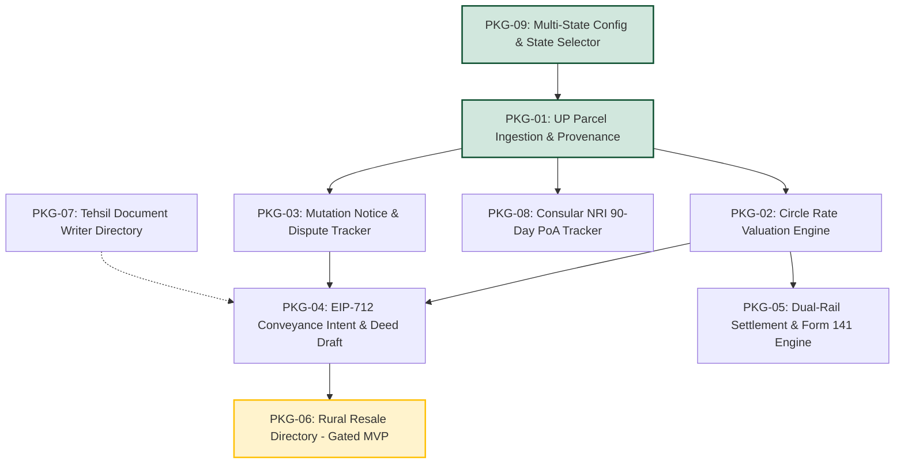

# MVP DEPENDENCY, LEGAL BLOCKER & RISK MATRIX
# Bhūmi Ledger — India Land Transaction & Registry Platform

**Document Version:** 1.0.0  
**Phase:** Phase 3 (Product Definition & Risk Governance)  
**Authors:** Chief AI Engineering Orchestrator, Department Head of Legal (DH-Legal), Department Head of Security (DH-Security)  
**Status:** Approved for Project Owner Review  
**Jurisdiction Baseline:** Republic of India / State of Uttar Pradesh (Pilot State)  

---

## 1. Executive Summary & Dependency Architecture

This matrix details the inter-package dependency directed acyclic graph (DAG), regulatory gating checkpoints, and technical risk mitigations governing the Uttar Pradesh pilot release.



---

## 2. Statutory Legal Blockers & Mandatory Compliance Checkpoints

| Blocker ID | Statute / Regulation | Statutory Requirement | System Implementation & Risk Mitigation | Gating Authority |
| :--- | :--- | :--- | :--- | :--- |
| **BLK-LEG-01** | **RERA Act, 2016** (Section 2(zm) & Section 9) | Platforms facilitating project sales must register as Real Estate Agents. Standalone rural agricultural land is exempt under Section 3. | Public matching and transaction commission workflows are **LOCKED** until formal legal opinion is obtained. Informational rural plot directory only. | DH-Legal & External Counsel |
| **BLK-LEG-02** | **Registration Act, 1908** (Section 17 & Section 32/33) | Title transfer in immovable property requires physical/biometric deed registration before Sub-Registrar. | Platform displays persistent legal disclaimers: on-chain signatures represent pre-registration intent under Sec 10A IT Act; deed registration at SRO remains mandatory. | DH-Legal |
| **BLK-LEG-03** | **Indian Stamp Act, 1899** (Section 18) | Foreign instruments (consular PoA) must be stamped within 3 months of arrival in India. | Automated 90-day countdown timer alert integrated into conveyance workflow; warns parties of Collectorate penalty adjudication. | DH-Eng & DH-Legal |
| **BLK-LEG-04** | **Income-tax Act, 2025** (Section 393(1) & Form 141) | 1% statutory TDS on transactions $\ge ₹50$ lakhs remitted via Form 141 (Schedule B). | Engine automatically computes 1% TDS and generates pre-filled Form 141 schedule; zero live tax deduction/filing executed on platform. | DH-Tax & DH-Eng |
| **BLK-INT-01** | **Information Technology Act, 2000** (Section 43 & Section 66) | Unauthorized access, data extraction, or automated bot scraping of government systems is illegal. | Absolute prohibition on scraping `upbhulekh.gov.in` or `igrsup.gov.in`. System relies strictly on citizen-provided certified PDFs. | DH-Security |
| **BLK-DAT-01** | **DPDP Act, 2023 & Aadhaar Act, 2016** (Section 29) | Prohibits public exposure of personal data, storage of raw Aadhaar numbers, or immutable PII on ledgers. | Zero PII on-chain. Masked Aadhaar handling (last 4 digits only). Off-chain data encrypted with AES-256-GCM. Hashes salted to prevent rainbow linkability. | DH-Security |
| **BLK-FIN-01** | **RBI / FEMA Regulations on VDA & Escrow** | Domestic real estate cannot be settled in cryptocurrency. Nodal escrow requires RBI Payment Aggregator licensing. | Crypto escrow strictly isolated to Hardhat / testnets for academic demonstration. Dual-rail fiat adapter designed as planning schedule only. | DH-Legal & Project Owner |

---

## 3. Comprehensive Risk Mitigation Matrix

```
┌────────────────────────────────────────────────────────────────────────────────────────────────────────────────────────┐
│                                                 RISK MITIGATION MATRIX                                                 │
├────────┬─────────────────────────┬──────────────┬─────────────┬────────────────────────────────────────────────────────┤
│ Risk ID│ Risk Description        │ Pre-Mitig    │ Post-Mitig  │ Implemented Technical & Architectural Mitigations      │
│        │                         │ Severity     │ Severity    │                                                        │
├────────┼─────────────────────────┼──────────────┼─────────────┼────────────────────────────────────────────────────────┤
│ RSK-01 │ Smart Contract Escrow   │ HIGH         │ LOW         │ Refactor from push (`.call{value}`) to OpenZeppelin    │
│        │ Reentrancy / DoS        │              │             │ `PullPayment` pattern (`pendingWithdrawals`).          │
├────────┼─────────────────────────┼──────────────┼─────────────┼────────────────────────────────────────────────────────┤
│ RSK-02 │ DPDP Hash Linkability   │ HIGH         │ LOW         │ Salt canonical document pre-images with citizen random │
│        │ on Public Ledger        │              │             │ salt before hashing; commit only salted Keccak-256.    │
├────────┼─────────────────────────┼──────────────┼─────────────┼────────────────────────────────────────────────────────┤
│ RSK-03 │ Stale Co-Tenure Data in │ MEDIUM       │ LOW         │ Khatauni records older than 90 days automatically      │
│        │ Uploaded Khatauni PDF   │              │             │ flagged as `EXPIRED_OUTDATED`; fresh upload required.  │
├────────┼─────────────────────────┼──────────────┼─────────────┼────────────────────────────────────────────────────────┤
│ RSK-04 │ Disputed Parcel Listing │ MEDIUM       │ LOW         │ Integrate Vaad UP revenue case status checks; enforce  │
│        │ Under Lis Pendens       │              │             │ Section 52 Transfer of Property Act risk disclaimers.  │
├────────┼─────────────────────────┼──────────────┼─────────────┼────────────────────────────────────────────────────────┤
│ RSK-05 │ Circle Rate Valuation   │ MEDIUM       │ LOW         │ Fetch rates from village collectorate gazette; display │
│        │ Discrepancy at SRO      │              │             │ statutory notice that Sub-Registrar has final authority│
├────────┼─────────────────────────┼──────────────┼─────────────┼────────────────────────────────────────────────────────┤
│ RSK-06 │ Event Indexer Desync    │ MEDIUM       │ LOW         │ Implement persistent `SYNC_STATE` block tracking in    │
│        │ in Node.js Backend      │              │             │ SQLite with automatic reorganization recovery.         │
└────────┴─────────────────────────┴──────────────┴─────────────┴────────────────────────────────────────────────────────┘
```

---
*End of MVP Dependency, Legal Blocker & Risk Matrix.*