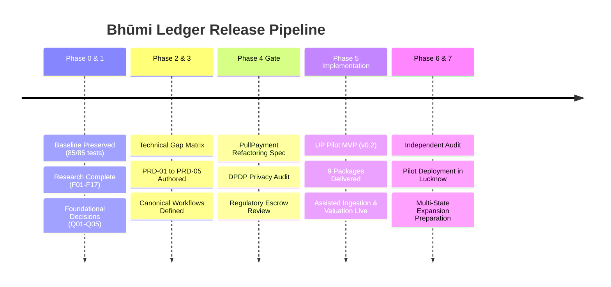

# MVP SCOPE, RELEASE MATRIX & ENGINEERING ESTIMATES
# Bhūmi Ledger — India Land Transaction & Registry Platform

**Document Version:** 1.0.0  
**Phase:** Phase 3 (Product Definition & Scope Governance)  
**Authors:** Chief AI Engineering Orchestrator, Department Head of Product (DH-Product), Department Head of Architecture (DH-Arch), Department Head of Engineering (DH-Eng)  
**Status:** Approved for Project Owner Review  
**Jurisdiction Baseline:** Republic of India / State of Uttar Pradesh (Pilot State)  

---

## 1. Executive Summary & Package Classification

In response to the Project Owner's explicit directive (*"The report proposes nine packages but only five PRDs. Clearly classify all nine... Do not silently drop packages"*), this document formally reconciles all nine packages formulated in Phase 2 with the five canonical PRDs, mapping each package to its definitive release tier, legal gating status, and engineering resource breakdown.

---

## 2. Definitive Nine-Package Classification Matrix

```
┌────────────────────────────────────────────────────────────────────────────────────────────────────────────────────────┐
│                                       PACKAGE CLASSIFICATION & GOVERNANCE MATRIX                                       │
├────────┬─────────────────────────────────────────────┬───────────────────────────┬──────────────┬──────────────────────┤
│ Pkg ID │ Package Name                                │ Canonical PRD Mapping     │ Release Tier │ Governance Status    │
├────────┼─────────────────────────────────────────────┼───────────────────────────┼──────────────┼──────────────────────┤
│ PKG-01 │ UP Parcel Ingestion & Document Provenance   │ PRD-01 (Direct Scope)     │ MVP (v0.2)   │ APPROVED FOR MVP     │
├────────┼─────────────────────────────────────────────┼───────────────────────────┼──────────────┼──────────────────────┤
│ PKG-02 │ Circle Rate Engine & Stamp Duty Calculator  │ PRD-02 (Direct Scope)     │ MVP (v0.2)   │ APPROVED FOR MVP     │
├────────┼─────────────────────────────────────────────┼───────────────────────────┼──────────────┼──────────────────────┤
│ PKG-03 │ Mutation Notice & Dispute Injunction Tracker│ PRD-04 (Direct Scope)     │ MVP (v0.2)   │ APPROVED FOR MVP     │
├────────┼─────────────────────────────────────────────┼───────────────────────────┼──────────────┼──────────────────────┤
│ PKG-04 │ EIP-712 Intent & Draft Deed Preparation     │ PRD-01 + PRD-02 + Journey │ MVP (v0.2)   │ APPROVED FOR MVP     │
├────────┼─────────────────────────────────────────────┼───────────────────────────┼──────────────┼──────────────────────┤
│ PKG-05 │ Dual-Rail Settlement & Form 141 Tax Engine  │ PRD-03 (Draft-Assistance) │ MVP (v0.2)   │ APPROVED (CALC ONLY) │
├────────┼─────────────────────────────────────────────┼───────────────────────────┼──────────────┼──────────────────────┤
│ PKG-06 │ Rural Resale Directory with RERA Safeguards │ Integrated in Journey     │ Gated MVP    │ DEPENDENT ON LEGAL   │
├────────┼─────────────────────────────────────────────┼───────────────────────────┼──────────────┼──────────────────────┤
│ PKG-07 │ Tehsil Document Writer Directory            │ Integrated in Journey     │ Fast-Follow  │ INFORMATIONAL ONLY   │
├────────┼─────────────────────────────────────────────┼───────────────────────────┼──────────────┼──────────────────────┤
│ PKG-08 │ Consular NRI 90-Day PoA Stamping Countdown  │ PRD-01 Sub-Module         │ MVP (v0.2)   │ APPROVED FOR MVP     │
├────────┼─────────────────────────────────────────────┼───────────────────────────┼──────────────┼──────────────────────┤
│ PKG-09 │ Multi-State Config & State Selector         │ PRD-05 (Direct Scope)     │ MVP (v0.2)   │ APPROVED FOR MVP     │
└────────┴─────────────────────────────────────────────┴───────────────────────────┴──────────────┴──────────────────────┘
```

### Detailed Governance Justification per Package:

1. **PKG-01 (Parcel Ingestion & Document Provenance):**
   - *Status:* **INCLUDED IN INITIAL MVP.**
   - *Mapping:* Fully specified in [`PRD-01`](file:///Users/lakshay/Desktop/Projects/Land-registry/Docs/prds/PRD-01-up-parcel-ingestion-and-document-provenance.md). Ingests certified Khatauni PDFs, captures both 16-digit computerized Gata codes and 14-character ULPINs, and anchors Keccak-256 integrity hashes.
2. **PKG-02 (Circle Rate Valuation & Stamp Duty Calculator):**
   - *Status:* **INCLUDED IN INITIAL MVP.**
   - *Mapping:* Fully specified in [`PRD-02`](file:///Users/lakshay/Desktop/Projects/Land-registry/Docs/prds/PRD-02-circle-rate-valuation-and-stamp-duty-calculator.md). Implements dynamic, multi-factor UP Stamp Rules 1997 formulas, Female buyer concessions, and 2% infrastructure surcharges.
3. **PKG-03 (Mutation Notice & Dispute Injunction Tracker):**
   - *Status:* **INCLUDED IN INITIAL MVP.**
   - *Mapping:* Fully specified in [`PRD-04`](file:///Users/lakshay/Desktop/Projects/Land-registry/Docs/prds/PRD-04-mutation-notice-sla-and-dispute-injunction-tracker.md). Tracks Rule 34(1) 30-day proclamation notices, Rule 34(7) SLAs, and distinguishes internal warnings from court injunctions.
4. **PKG-04 (EIP-712 Intent & Draft Deed Preparation):**
   - *Status:* **INCLUDED IN INITIAL MVP.**
   - *Mapping:* Handled across PRD-01 (deed generation), PRD-02 (financial figures), and the [End-to-End User Journey](file:///Users/lakshay/Desktop/Projects/Land-registry/Docs/prds/UP_MVP_END_TO_END_USER_JOURNEY.md). Reuses the fully passing `signTransfer` smart contract engine with enhanced legal disclaimers.
5. **PKG-05 (Dual-Rail Settlement & Form 141 Tax Engine):**
   - *Status:* **INCLUDED IN INITIAL MVP (CALCULATION & DRAFT-ASSISTANCE ONLY).**
   - *Mapping:* Fully specified in [`PRD-03`](file:///Users/lakshay/Desktop/Projects/Land-registry/Docs/prds/PRD-03-dual-rail-settlement-and-form-141-tax-engine.md). Preserves local/testnet EVM escrow; computes 1% TDS under Section 393(1) of the Income-tax Act, 2025; outputs Form 141 (Schedule B) draft schedules. **Zero live banking or automated money transfers.**
6. **PKG-06 (Rural Resale Directory with RERA Safeguards):**
   - *Status:* **DEPENDENT ON QUALIFIED LEGAL REVIEW (GATED MVP).**
   - *Mapping:* In response to Project Owner decision on Q-05, this feature is NOT granted an assumed exemption. The informational directory of rural agricultural plots is drafted, but public buyer-seller matching workflows are locked behind formal legal opinion certifying compliance with Section 2(zm) and Section 9 of RERA Act, 2016.
7. **PKG-07 (Tehsil Document Writer Directory):**
   - *Status:* **FAST-FOLLOW INFORMATIONAL RELEASE (v0.2.1).**
   - *Mapping:* Formatted as a lightweight, read-only directory component (`TehsilDirectory.jsx`) integrated with Lucknow Tehsil Collectorate fee transparency schedules.
8. **PKG-08 (Consular NRI 90-Day PoA Tracker):**
   - *Status:* **INCLUDED IN INITIAL MVP.**
   - *Mapping:* Packaged as a specialized compliance widget inside PRD-01 and the conveyance flow, alerting parties to Section 18 Indian Stamp Act deadlines.
9. **PKG-09 (Multi-State Config & State Selector):**
   - *Status:* **INCLUDED IN INITIAL MVP.**
   - *Mapping:* Fully specified in [`PRD-05`](file:///Users/lakshay/Desktop/Projects/Land-registry/Docs/prds/PRD-05-multi-state-configuration-and-state-selector.md). Delivers the global State Selector navigation and dynamic config abstraction (`up.config.json`).

---

## 3. Rigorous Engineering Estimates Breakdown

*Estimates are calculated based on senior engineering person-days, separating reused code from net-new development. These estimates represent realistic engineering planning baselines, not commercial delivery guarantees.*

### 3.1 Person-Day Effort by Role & Component

| Component / Task Area | Reused Baseline Code | New Development Required | Eng Roles Assigned | Person-Days (Base) | Contingency (20%) | Total Estimated Days |
| :--- | :--- | :--- | :--- | :--- | :--- | :--- |
| **PKG-01: Parcel Ingestion & Provenance (PRD-01)** | `routes/documents.js`, `db.js`, Keccak-256 utils | Certified PDF parser, ULPIN/Gata extractor, 9-stage verification state machine | Backend (2.5d), Frontend (1.5d), GIS Data (1.0d) | 5.0 Days | 1.0 Day | **6.0 Days** |
| **PKG-02: Circle Rate Valuation Engine (PRD-02)** | None (Net-new module) | Multi-factor UP Stamp Rules engine, road multipliers, female buyer concession logic | Backend (2.0d), Frontend (1.5d), Legal Analyst (0.5d) | 4.0 Days | 0.8 Day | **4.8 Days** |
| **PKG-03: Mutation Notice & Dispute Tracker (PRD-04)** | `flagProperty` in contract, `audit.js` | 30-day proclamation timer, Vaad UP case code mapping, 6-tier litigation taxonomy | Backend (2.0d), Frontend (1.5d), Smart Contract (0.5d) | 4.0 Days | 0.8 Day | **4.8 Days** |
| **PKG-04: EIP-712 Pre-Reg Intent & Deed Draft** | `signTransfer` in contract, `SignTransferModal.jsx` | Standardized statutory deed draft generator, SRO appointment pre-fill data exporter | Backend (1.5d), Frontend (1.0d) | 2.5 Days | 0.5 Day | **3.0 Days** |
| **PKG-05: Dual-Rail Settlement & Form 141 (PRD-03)** | `marketplace-escrow.test.js`, EVM Escrow state | Section 393(1) 1% TDS calculator, Form 141 draft generator, `IPaymentEscrowAdapter` | Backend (2.0d), Frontend (1.5d), Tax Specialist (0.5d) | 4.0 Days | 0.8 Day | **4.8 Days** |
| **PKG-06: Rural Resale Directory & RERA Gates** | `Marketplace.jsx`, `ListPropertyModal.jsx` | Bhumidhar transferable verification check, ceiling affidavit, RERA disclaimers | Frontend (1.5d), Backend (1.0d) | 2.5 Days | 0.5 Day | **3.0 Days** |
| **PKG-07: Tehsil Document Writer Directory** | None | Read-only directory view, search by Tehsil, statutory fee table | Frontend (1.0d), Backend (0.5d) | 1.5 Days | 0.3 Day | **1.8 Days** |
| **PKG-08: Consular NRI 90-Day PoA Tracker** | None | Section 18 countdown timer widget, Collectorate stamping checklist | Frontend (0.8d), Backend (0.5d) | 1.3 Days | 0.3 Day | **1.6 Days** |
| **PKG-09: Multi-State Config & State Selector (PRD-05)**| Top banner in `App.jsx` | Interactive `StateSelector` dropdown, `up.config.json` loader, "Coming Soon" modal | Frontend (1.5d), Architecture (0.5d) | 2.0 Days | 0.4 Day | **2.4 Days** |
| **Cross-Cutting: QA, Security & Invariant Testing** | 85 passing tests baseline | New unit specs for valuation, PDF ingestion, TDS calculation, end-to-end integration | QA Lead (3.0d), Security Eng (1.5d) | 4.5 Days | 0.9 Day | **5.4 Days** |
| **TOTAL AGGREGATE EFFORT** | **High Reuse** | **Focused Scope** | **Cross-Functional Team** | **30.8 Days** | **6.6 Days** | **37.6 Days** |

---

### 3.2 Role Allocation Matrix (Person-Days)

```
┌────────────────────────────────────────────────────────────────────────────────────────┐
│                              ENGINEERING ROLE BREAKDOWN                                │
├───────────────────────────────────┬───────────────┬────────────────────────────────────┤
│ Engineering Role                  │ Person-Days   │ Primary Responsibilities           │
├───────────────────────────────────┼───────────────┼────────────────────────────────────┤
│ Senior Backend Engineer (Node/API)│ 11.5 Days     │ PDF parser, valuation engine, tax  │
│ Senior Frontend Engineer (React)  │ 10.3 Days     │ Dashboards, state selector, UI     │
│ Smart Contract / Cryptography Eng │  2.0 Days     │ Invariant checks, EIP-712 types    │
│ Data Sourcing & GIS Specialist    │  2.0 Days     │ UP circle rates, village codes     │
│ Lead QA & Security Engineer       │  5.4 Days     │ Integration tests, DPDP audit      │
│ Legal & Tax Review Specialist     │  1.5 Days     │ RERA opinion, Form 141 accuracy    │
│ Project Management & Contingency  │  4.9 Days     │ Coordination & risk buffering      │
├───────────────────────────────────┼───────────────┼────────────────────────────────────┤
│ TOTAL RESOURCE ESTIMATE           │ 37.6 Days     │ ~5-6 Calendar Weeks (3 Dev Team)   │
└───────────────────────────────────┴───────────────┴────────────────────────────────────┘
```

---

## 4. Release Phase Milestones



---
*End of MVP Scope, Release Matrix & Engineering Estimates.*