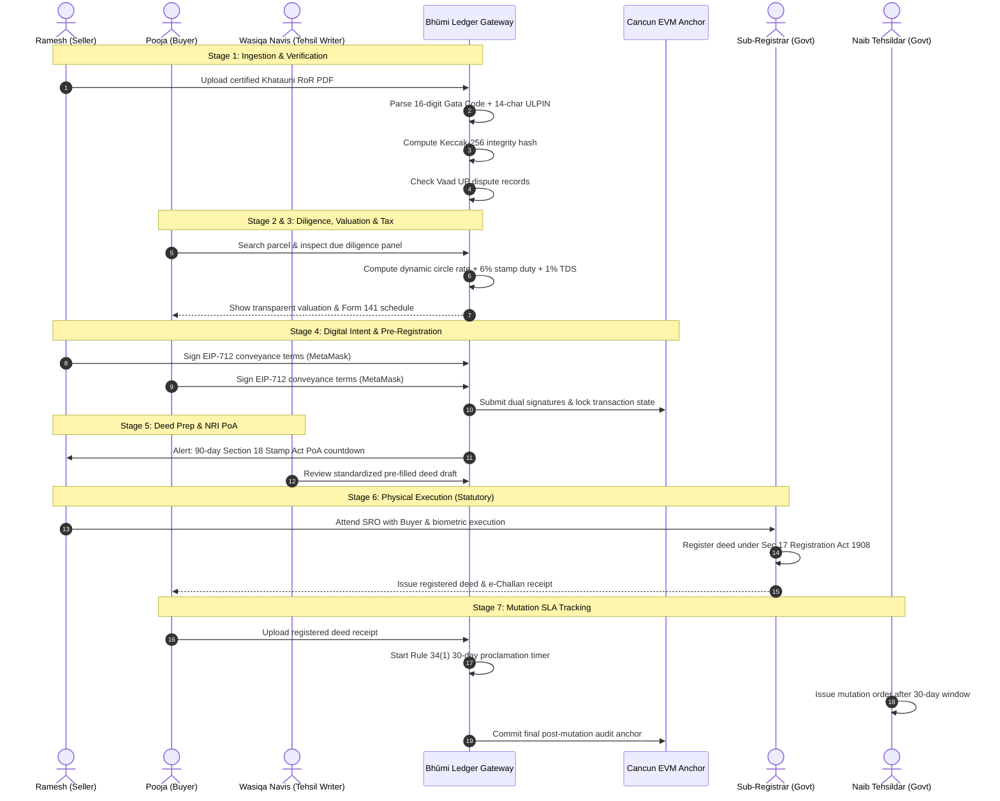

# UTTAR PRADESH MVP END-TO-END USER JOURNEY
# Bhūmi Ledger — India Land Transaction & Registry Platform

**Document Version:** 1.0.0  
**Phase:** Phase 3 (Product Definition & Canonical Workflows)  
**Authors:** Chief AI Engineering Orchestrator, Department Head of Product (DH-Product), Department Head of Legal (DH-Legal), Department Head of Architecture (DH-Arch)  
**Status:** Approved for Project Owner Review  
**Jurisdiction Baseline:** Republic of India / State of Uttar Pradesh (Pilot Districts: Lucknow & Gautam Buddha Nagar)  

---

## 1. Executive Overview & Journey Narrative

The **Bhūmi Ledger Uttar Pradesh MVP** is an integrated, legally informed, dual-rail land transaction and registry facilitation portal. It connects five primary stakeholders into a single transparent, tamper-evident workflow:

```
┌────────────────────────────────────────────────────────────────────────────────────────┐
│                                 THE FIVE ACTORS                                        │
├─────────────────────┬─────────────────────┬────────────────────┬───────────────────────┤
│ 1. The Citizen      │ 2. The Citizen      │ 3. The Licensed    │ 4. The Revenue / SRO  │
│    Seller (Ramesh)  │    Buyer (Pooja)    │    Facilitator     │    Authority (Naib    │
│    Rural Landholder │    Purchaser        │    (Wasiqa Navis / │    Tehsildar / SRO    │
│    in Lucknow Tehsil│    in Lucknow Urban │    Advocate)       │    Registrar)         │
├─────────────────────┴─────────────────────┴────────────────────┴───────────────────────┤
│ 5. The Remote NRI Family Member (Vikram) — Executing Special PoA from London, UK       │
└────────────────────────────────────────────────────────────────────────────────────────┘
```

The user journey spans **seven sequential, legally grounded stages**, taking a transaction from initial parcel ingestion to post-registration mutation tracking, without violating statutory boundaries or claiming automated legal guarantees.

---

## 2. The Seven-Stage Lifecycle Walkthrough

```
┌────────────────────────────────────────────────────────────────────────────────────────┐
│                        THE 7-STAGE UTTAR PRADESH USER JOURNEY                          │
├─────────┬──────────────────────────┬───────────────────────────────────────────────────┤
│ Stage 1 │ Parcel Search & Ingestion│ Ingests certified Khatauni RoR & maps 16-digit    │
│         │                          │ computerized Gata code + 14-char ULPIN (if any)   │
├─────────┼──────────────────────────┼───────────────────────────────────────────────────┤
│ Stage 2 │ Diligence & Encumbrance  │ Checks Vaad UP disputes, Lis Pendens, 30-day notice│
│         │ Discovery                │ windows, and Section 89 ceiling compliance (<5ha) │
├─────────┼──────────────────────────┼───────────────────────────────────────────────────┤
│ Stage 3 │ Dynamic Valuation & Tax  │ Multi-factor circle rate calculation, 7%/6% stamp │
│         │ Assessment               │ duty breakdown, and Section 393(1) 1% TDS split   │
├─────────┼──────────────────────────┼───────────────────────────────────────────────────┤
│ Stage 4 │ Pre-Registration Bilateral│ EIP-712 digital intent signing (Sec 10A IT Act)   │
│         │ Conveyance Agreement     │ locking sandbox escrow & generating draft deed    │
├─────────┼──────────────────────────┼───────────────────────────────────────────────────┤
│ Stage 5 │ Statutory Deed Prep &    │ Pre-filled deed export, Tehsil document writer    │
│         │ NRI Stamping Window      │ verification, and 90-day consular PoA countdown   │
├─────────┼──────────────────────────┼───────────────────────────────────────────────────┤
│ Stage 6 │ Physical / Biometric SRO │ Citizen schedules appointment on IGRUP; executes  │
│         │ Execution                │ registered deed before Sub-Registrar              │
├─────────┼──────────────────────────┼───────────────────────────────────────────────────┤
│ Stage 7 │ Post-Registration        │ Uploads registered deed e-Challan; system triggers│
│         │ Mutation Tracking        │ 30-day Rule 34(1) proclamation notice tracking    │
└─────────┴──────────────────────────┴───────────────────────────────────────────────────┘
```

---

### Stage 1: Parcel Search & Ingestion (Seller & Buyer Entry)
- **Actor:** Ramesh (Seller) / Pooja (Buyer).
- **Interface:** Public Registry Search (`/`) with State Selector set to **Uttar Pradesh**.
- **Action:**
  1. Ramesh navigates to the UP Land Registry Portal.
  2. He selects his administrative hierarchy: **District:** Lucknow ➔ **Tehsil:** Mohanlalganj ➔ **Village:** Mohanlalganj (Code: 142851).
  3. He enters his **16-digit Computerized Land Parcel Code** (`0914285100000412`) or searches by his ancestral **Gata Number** (`412`).
  4. The platform checks local database records. If the record is new, Ramesh uploads his official digitally signed **Khatauni (RoR) PDF** downloaded from `upbhulekh.gov.in`.
  5. The platform parser extracts:
     - 16-digit Computerized Gata Code: `0914285100000412`
     - 14-character ULPIN / Bhu-Aadhaar: `UP09LK41200001` (flagged as `AVAILABLE` or `PENDING_GEOREFERENCING`)
     - Recorded Tenure Holder: Ramesh Kumar, s/o Ram Prasad (Bhumidhar with transferable rights)
     - Total Area: `1.2400 Hectares`
     - Document Verification Status: `Integrity Hash Generated` (`0x8a9f...`)
- **Statutory Notice Displayed:** *"Cryptographic hash verifies file integrity against tampering. Statutory proof of title is governed solely by revenue records and registered deeds."*

---

### Stage 2: Due Diligence & Encumbrance Discovery (Buyer Verification)
- **Actor:** Pooja (Prospective Buyer).
- **Action:**
  1. Pooja reviews the parcel record. She inspects the **Multi-Tier Due Diligence Panel**:
     - *Tenure Classification:* `Bhumidhar with Transferable Rights` (Valid for sale under Section 75/76 UP Revenue Code).
     - *Land Ceiling Check:* Current holding (`1.24 ha`) is within the Section 89 limit (`5.0586 ha`).
     - *Revenue Court Dispute Status (Vaad UP):* The system checks the computerized case database (`vaad.up.nic.in`). Status: `No Active Revenue Dispute Found` for Gata 412.
     - *Litigation & Injunction Status:* No stay orders reported under Order 39 CPC or Section 212 UP Revenue Code.
     - *Lis Pendens Warning:* Explains Section 52 Transfer of Property Act implications in plain language.
     - *RERA Exemption Badge:* Indicates that standalone rural agricultural resale is exempt from Section 3 project registration, with statutory disclaimers.

---

### Stage 3: Dynamic Circle Rate Valuation & Tax Assessment
- **Actors:** Ramesh (Seller) and Pooja (Buyer).
- **Interface:** Statutory Valuation Calculator (`/valuation`).
- **Action:**
  1. The parties enter the agreed commercial price: `₹75,00,000` (75 Lakhs).
  2. The **Dynamic Valuation Engine** computes the statutory baseline using the Lucknow District Collectorate Circle Rate Gazette (effective 2025–2026):
     - Locality: Mohanlalganj Rural Agricultural.
     - Base Agricultural Rate: `₹45,00,000 per Hectare`.
     - Land Area: `1.2400 Hectares`.
     - Road Multiplier: Property abuts a State Highway (SH-25) ➔ **+15% Multiplier applied**.
     - Minimum Circle Rate Valuation: $1.24 \times ₹45,00,000 \times 1.15 = \mathbf{₹64,17,000}$.
  3. **Valuation Determination:** Since commercial price ($₹75,00,000$) > circle rate ($₹64,17,000$), statutory duty is assessed on **₹75,00,000**.
  4. **Stamp Duty Breakdown:**
     - Base UP Stamp Duty (Male standard: 5%): ₹3,75,000.
     - Infrastructure / Local Body Surcharge (2%): ₹1,50,000.
     - **Female Purchaser Concession (Pooja as sole buyer):** 1% rebate applied (up to statutory limit) ➔ Net Stamp Duty: **6% = ₹4,50,000**.
     - Registration Fee (1%): **₹75,000**.
  5. **Direct Tax Deduction (Income-tax Act, 2025):**
     - Since consideration $\ge ₹50,00,000$, Section 393(1) applies.
     - **1% Statutory TDS:** ₹75,000.
     - Pre-filled **Form 141 (Schedule B)** deduction schedule generated.
     - Net payable to Seller at closing: **₹74,25,000**.

---

### Stage 4: Pre-Registration Bilateral Conveyance Agreement (EIP-712 Intent Signing)
- **Actors:** Ramesh (Seller) and Pooja (Buyer).
- **Action:**
  1. The parties formulate a digital *Agreement for Sale* under Section 10A of the IT Act, 2000.
  2. Pooja connects her Web3 wallet and deposits testnet ETH (or views the regulated bank escrow payment schedule).
  3. Ramesh and Pooja sign the structured conveyance parameters via **MetaMask (EIP-712 Typed Data v4)**:
     - Property ID, 16-digit Gata Code, consideration price, 1% TDS allocation, and 90-day closing window.
  4. The smart contract verifies the signatures via `ecrecover`, flips `fromSigned = true` and `toSigned = true`, and emits `TransferSigned`.
  5. The agreement is cryptographically locked, preventing unilateral backing out during deed preparation.

---

### Stage 5: Statutory Deed Preparation, Tehsil Facilitation & NRI Stamping
- **Actors:** Ramesh, Pooja, Facilitator (Wasiqa Navis), and Vikram (Remote NRI Co-Owner in London).
- **Action:**
  1. **Consular NRI Handling:** Co-owner Vikram resides in the UK. He executes a *Special Power of Attorney (PoA)* before the Indian High Commission in London appointing Ramesh as his attorney.
  2. Ramesh enters the PoA arrival date into Bhūmi Ledger. The system initiates the **90-Day Statutory Countdown Timer** under Section 18 of the Indian Stamp Act, 1899, alerting Ramesh to adjudicate stamp duty at the Lucknow Collectorate before the deadline.
  3. **Tehsil Facilitation:** Ramesh connects with Mohammad Aslam, a licensed Tehsil document writer (*Wasiqa Navis*, License #LKO/2018/042) selected from the platform's transparent Tehsil directory.
  4. The platform generates an official, pre-filled **Sale Deed Draft (बैनामा)** formatted to UP Registration Department standards, incorporating boundary coordinates, circle rate calculations, and Form 141 TDS schedules.

---

### Stage 6: Physical & Biometric SRO Deed Execution
- **Actors:** Ramesh (Seller/Attorney), Pooja (Buyer), Two Witnesses, and Sub-Registrar (SRO).
- **Action:**
  1. The platform generates pre-filled links redirecting Pooja to `igrsup.gov.in` to book an in-person SRO appointment at Sub-Registrar Office Mohanlalganj.
  2. The parties attend the SRO office in person.
  3. The Sub-Registrar inspects physical identity documents, captures biometrics, verifies the adjudicated consular PoA, and collects statutory stamp duty and registration fees via state treasury e-Challan.
  4. The Sub-Registrar registers the deed under Section 17 of the Registration Act, 1908, issuing a registered Deed Number: `Book 1, Volume 4120, Pages 101–130, Deed #2026/0412`.

---

### Stage 7: Post-Registration Mutation Tracking & Ledger Anchoring
- **Actors:** Pooja (New Owner), Ramesh (Former Owner), and Naib Tehsildar (Revenue Officer).
- **Action:**
  1. Pooja uploads the registered Deed e-Challan and registration receipt to Bhūmi Ledger.
  2. The system updates the transfer lifecycle state to `STATUTORY_DEED_REGISTERED`.
  3. Under Section 34 of the UP Revenue Code, 2006, the platform tracks the revenue mutation filing.
  4. **The 30-Day Proclamation Countdown:** The system initiates the statutory 30-day objection notice window under **Rule 34(1) of UP Revenue Code Rules, 2016** (R.C. Form-12).
  5. If no objections are raised during the 30-day window, the Tehsildar enters the undisputed mutation order within the 45-day SLA (Rule 34(7)).
  6. The revenue record (Khatauni) on UP Bhulekh reflects Pooja as the new Bhumidhar.
  7. Bhūmi Ledger updates its internal registry, commits the post-mutation state hash to the EVM anchor, and closes the transaction loop.

---

## 3. Journey Flow Diagram



---
*End of Uttar Pradesh MVP End-to-End User Journey.*