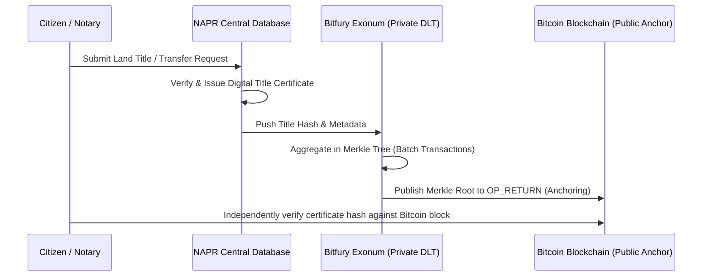
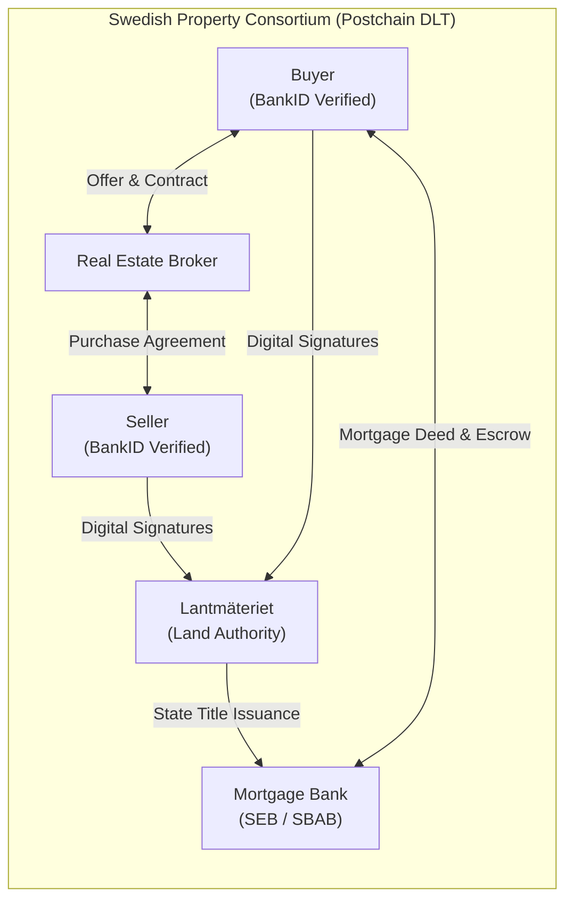
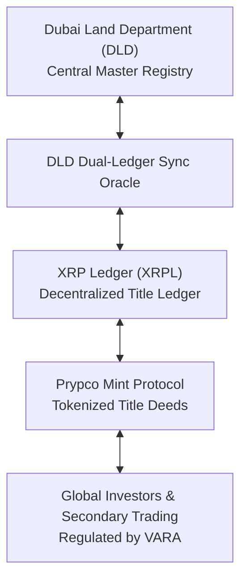

# Global Blockchain Land Registry Implementations: Comparative Analysis, Architectural Paradigms, and Lessons for Real-World Adoption

**Document:** `Docs/research/01-global-implementations.md`  
**Author:** Principal Blockchain Architect & Web3 Systems Researcher  
**Status:** Comprehensive Research Report  
**Focus Areas:** Country Case Studies, Consensus Models, Legal-Technical Interfaces, and Benchmark Projects

---

## Executive Summary

Land administration is foundational to economic sovereignty, capital formation, and civil stability. Globally, an estimated 70% of the world's population lacks access to formal, legally registered land titles (World Bank), locking up over $9 trillion in dead capital (Hernando de Soto). While blockchain technology is widely heralded as a panacea for land fraud, double-selling, and bureaucratic opacity, real-world implementations have revealed a stark dichotomy between theoretical promise and administrative reality.

This research report investigates major international blockchain land titling initiatives, analyzes their consensus frameworks and legal-technical interfaces, benchmarks prominent commercial and open-source solutions, and extracts architectural principles to inform our platform.

```
                      GLOBAL DLT SPECTRUM IN LAND REGISTRIES
┌─────────────────────────┬─────────────────────────┬─────────────────────────┐
│   Public / Tokenized    │    Hybrid / Anchored    │   Private Consortium    │
│  (Dubai XRPL / Propy)   │    (Georgia Bitfury)    │   (Sweden ChromaWay)    │
├─────────────────────────┼─────────────────────────┼─────────────────────────┤
│ • Native asset transfer │ • Private ledger speed  │ • Multi-stakeholder BFT │
│ • Public verification   │ • Bitcoin immutability  │ • Strict data privacy   │
│ • Secondary liquidity   │ • Zero gas for citizens │ • Bank/Broker workflows │
│ • High regulatory need  │ • Audit-only role       │ • Regulatory alignment  │
└─────────────────────────┴─────────────────────────┴─────────────────────────┘
```

---

## 1. Global Case Studies: Implementations & Pilots

### 1.1 Republic of Georgia & Bitfury: The Anchored Audit Trail
In 2016, Georgia's **National Agency of Public Registry (NAPR)** partnered with **Bitfury Group** to launch one of the earliest and most celebrated government blockchain implementations.



#### Architecture & Technical Mechanics
- **Core Framework:** Bitfury's **Exonum** framework—a private, permissioned Byzantine Fault Tolerant (BFT) distributed ledger operated across NAPR government nodes.
- **Public Anchoring:** To achieve absolute immutability without subjecting citizens to public gas fees or exposing private data, the system utilized **cryptographic anchoring**. Title hashes were pooled into **Merkle Trees**, and the Merkle root was periodically committed to the **Bitcoin blockchain** (via `OP_RETURN` transactions).
- **Independent Verification:** A citizen holding a digital certificate (containing parcel ID, owner data, and previous hash) could hash the file and verify that the hash existed within the Merkle tree anchored on Bitcoin, proving the government had not silently altered the record post-issuance.

#### Operational Scale & Results
- By 2018, over **1.5 million land titles** were hashed and anchored on Bitcoin.
- Registration turnaround times were reduced from days to under 3 minutes for digital verifications.
- Transaction operational costs dropped by more than 90%.

#### Critical Insights & Limitations
- **Not a Standalone Registry:** The blockchain did *not* replace the legacy database; rather, it functioned as an **immutable, read-only audit layer** atop NAPR's existing centralized relational database.
- **Institutional Prerequisite:** Georgia’s success was heavily predicated on the fact that the country had already eliminated 95%+ of land corruption *prior* to blockchain adoption through sweeping institutional reforms (World Bank Ease of Doing Business rank #6 in property registration). The blockchain did not clean up the data; it secured data that was already clean.

---

### 1.2 Sweden (Lantmäteriet) & ChromaWay: The Consortium Workflow
Between 2016 and 2018, Sweden’s land mapping and registration authority, **Lantmäteriet**, partnered with technology firm **ChromaWay**, telecommunications giant **Telia**, real estate agency **Svensk Fastighetsförmedling**, and major commercial banks (**SBAB**, **SEB**) to pilot a comprehensive blockchain conveyance system.



#### Architecture & Technical Mechanics
- **Underlying Technology:** ChromaWay's **Postchain**—a consortium relational blockchain architecture where distributed ledger logic is married with PostgreSQL relational database engines, allowing complex SQL queries over blockchain state.
- **Digital Identity Integration:** Integrated with Sweden’s national digital identity infrastructure (**BankID** and **Telia secure ID**), ensuring every smart contract action was cryptographically bound to a legally validated citizen.
- **Multi-Stakeholder State Machine:** The entire conveyance workflow (33 discrete manual steps involving offers, mortgage approvals, purchase agreements, tax clearances, and deed issuance) was modeled as an orchestrated smart contract state machine.

#### Operational Scale & Findings
- The pilot demonstrated that end-to-end property conveyance time could be compressed from **4 months down to a few days or hours**.
- Independent economic modeling by Kairos Future estimated recurring taxpayer and industry savings exceeding **€100 million annually** through the elimination of paperwork, manual verification, and title insurance overhead.

#### Critical Bottlenecks & The Legal Roadblock
- Despite flawless technical execution, the system could not be launched into production due to **statutory legal incompatibility**.
- **Section 4:1 of the Swedish Land Code (Jordabalken)** explicitly mandated that purchase contracts for real property must be executed in physical paper format with handwritten ("wet-ink") signatures. Sweden's parliament chose not to amend the statutory requirement immediately, proving that **technological readiness without statutory reform results in stranded innovation**.

---

### 1.3 United Arab Emirates / Dubai Land Department (DLD): Operational Tokenization
Dubai has established itself as the global pioneer in transitioning blockchain land records from experimental sandboxes into full-fledged commercial infrastructure.



#### Architecture & Technical Mechanics
- **Evolution:** Launched initially in 2017 as a private Hyperledger-based pilot, DLD transitioned in 2024–2026 to an active real estate tokenization ecosystem anchored on the **XRP Ledger (XRPL)** and enterprise smart contracts.
- **Dual-Ledger Synchronization:** The system employs a state-synchronized dual-ledger pattern: legal ownership remains officially acknowledged within DLD’s central registry, while fractional and whole-title cryptographic tokens are issued on-chain (via platforms like **Prypco Mint**).
- **Regulatory Sandboxing (VARA):** Operated in lockstep with the **Virtual Assets Regulatory Authority (VARA)**, which established a clear legal taxonomy recognizing tokenized title deeds as valid fractional ownership instruments.

#### Key Success Drivers
- **Top-Down Political Mandate:** Backed directly by the Dubai Future Foundation and the executive leadership of the emirate.
- **Single Jurisdiction Advantage:** Dubai operates as a unified administrative enclave without fragmented federal/state/municipal jurisdictional battles.

---

### 1.4 Honduras & Factom: The Cautionary Tale
In 2015, the government of Honduras signed a widely publicized agreement with Austin-based **Factom** and software provider **Epigraph** to migrate the country’s embattled property title registry onto a blockchain. Within months, the project stalled completely and was abandoned.

#### Root Causes of Failure
1. **The "Garbage In, Garbage Out" (GIGO) Trap:** Honduras suffered from endemic land fraud, overlapping ancestral titles, forged deeds, and unauthorized expropriations by powerful officials. Attempting to commit flawed, disputed paper records onto an immutable ledger would have **permanently solidified illegal land seizures**, triggering civil unrest.
2. **Entrenched Political Sabotage:** Corrupt bureaucrats and politically connected elites who profited from the opacity of the paper registry actively undermined data access and stalled implementation.
3. **Absence of Cadastral Infrastructure:** Fewer than 15% of land parcels in the country had surveyed, digital GIS boundaries. There was no clean base dataset to import.

---

### 1.5 Comparative Synthesis of Global Implementations

| Metric | Republic of Georgia | Sweden (Lantmäteriet) | Dubai (DLD) | Honduras (Factom) |
|---|---|---|---|---|
| **Timeline** | 2016–2018 (Active) | 2016–2018 (Piloted) | 2017–2026 (Operational) | 2015 (Abandoned) |
| **Network Type** | Private + Public Anchor | Private Consortium | Hybrid / Public DLT | Public Anchoring |
| **Core DLT Stack** | Bitfury Exonum + Bitcoin | Postchain (ChromaWay) | Hyperledger / XRPL | Factom Ledger |
| **Legal Role of DLT** | Verifiable Audit Trail | Smart Contract Workflow | Tokenized Legal Title | Proposed Master Registry |
| **Identity Layer** | National Citizen Registry | BankID / Telia Secure ID | UAE PASS / VARA KYC | Incomplete / Fragmented |
| **Primary Outcome** | 1.5M+ records anchored | Proved 80% step reduction | Active live tokenization | Complete project collapse |
| **Critical Bottleneck** | Central DB remains master | Statutory paper deed law | Secondary market liquidity | Corrupt data & political block |

---

## 2. Technical & Governance Analysis Points

### 2.1 Consensus & Network Models: The Trilemma of Land Systems

```
                     PUBLIC vs. PRIVATE vs. HYBRID FOR LAND
       Public (Ethereum / L2)              Private (Hyperledger Fabric)
       ┌────────────────────────┐          ┌────────────────────────┐
       │ • Censorship resistant │          │ • Strict privacy (GDPR)│
       │ • High public audit    │          │ • Zero citizen gas fee │
       │ • Volatile gas costs   │          │ • Centralized control  │
       │ • Privacy challenges   │          │ • Vulnerable to cartel │
       └────────────────────────┘          └────────────────────────┘
                    ▲                                  ▲
                    └───────────────┬──────────────────┘
                                    │
                         Hybrid / Anchored Model
                               (Recommended)
                         ┌────────────────────────┐
                         │ • Private BFT execution│
                         │ • Public state roots   │
                         │ • Zero fee interaction │
                         │ • Cryptographic audit  │
                         └────────────────────────┘
```

1. **Public Permissionless Blockchains (Ethereum, Polygon, Arbitrum):**
   - *Advantages:* Absolute decentralization, global interoperability, composability with DeFi/escrow protocols, and impossible for a corrupt regime to rewrite history.
   - *Liabilities:* Volatile transaction costs (gas), public exposure of sensitive wealth data (violating European GDPR or privacy rights), and low public tolerance for paying crypto gas to execute civil deeds.
2. **Private / Permissioned Blockchains (Hyperledger Fabric, Corda, Exonum):**
   - *Advantages:* High throughput (1,000+ TPS), zero transaction fees for citizens, complete data privacy, and deterministic sub-second finality.
   - *Liabilities:* If all validator nodes are operated by government ministries, the network lacks true censorship resistance. A rogue or authoritarian administration could collude across nodes to rewrite the state history.
3. **Hybrid Anchoring Framework (The Optimal Compromise):**
   - Execute day-to-day transactions and detailed PII off-chain or on a sovereign permissioned layer, then batch and anchor cryptographic state roots (Merkle roots) into a public, decentralized blockchain (e.g., Ethereum or Bitcoin).
   - This provides **zero-cost citizen interactions** with **uncompromising global mathematical proof of non-alteration**.

---

### 2.2 The Legal-Technical Interface: The "Physical Oracle" Conundrum

The most profound philosophical challenge in blockchain land registries is the tension between **algorithmic immutability** ("code is law") and **physical sovereign reality** ("law is sovereign").

```
             THE CODE-VS-LAW REAL-WORLD RESOLUTION PIPELINE
┌─────────────────────────┐     Court Decree /      ┌─────────────────────────┐
│     Physical World      │ ─── Adverse Possession ─▶  Administrative Key     │
│ (Civil Court Injunction)│     Eminent Domain      │ (Registrar / Multi-Sig) │
└─────────────────────────┘                         └─────────────────────────┘
                                                                 │
                                                    Executes On-Chain State Override
                                                                 ▼
                                                    ┌─────────────────────────┐
                                                    │   Immutable EVM Ledger  │
                                                    │  Logs Judicial Action   │
                                                    │  Updates Title Pointer  │
                                                    └─────────────────────────┘
```

#### Why Pure "Code is Law" Fails for Land:
1. **Adverse Possession & Squatters' Rights:** In common law jurisdictions, open and continuous possession of land for a statutory period (e.g., 12 years in India, 10–12 years in the UK) extinguishes the original owner's title by law, transferring it to the possessor without any cryptographic transaction.
2. **Inheritance & Intestate Succession:** When an owner dies without leaving private keys, the land does not vanish; it vests in statutory legal heirs. A purely cryptographic system would permanently lock the land as dead capital.
3. **Judicial Injunctions & Fraud Rectification:** If a court determines a conveyance was executed under physical coercion, duress, or fraud, the judge must have the power to overturn the transaction.
4. **Eminent Domain & Land Acquisition:** Sovereign states retain the constitutional power to expropriate private land for public infrastructure (railways, highways, defense).

#### The Architectural Solution:
A production land registry smart contract **cannot treat property as an ERC-20 bearer asset**. It must implement an **administrative intervention architecture**:
- **Administrative Freezing:** The ability for authorized regulatory keys to flag and freeze an asset under active dispute (as implemented in our `LandRegistry.sol`).
- **Cryptographically Auditable Judicial Overrides:** Court orders must be executable on-chain via dedicated administrative roles (`ADMIN_ROLE` or judicial multi-sig), but every such override must emit an indelible event log capturing the decree reference, judicial signer, and reason. Immutability is preserved not by blocking legal intervention, but by **making administrative intervention completely transparent and impossible to conceal**.

---

### 2.3 The Three Core Real-World Bottlenecks

#### 1. Identity Verification & The Private Key Paradox
- In Web3, whoever holds the private key owns the asset. In real estate, this rule is catastrophic.
- If a rural farmer or elderly homeowner loses their 12-word seed phrase, or is phished via a malicious browser popup, **they cannot lose their home**.
- **Solution:** Land registries require **Account Abstraction (ERC-4337)**, integrating government digital IDs (e.g., BankID, Aadhaar, UAE PASS) with social recovery guardians (family members + municipal registrar) rather than naked private keys.

#### 2. Legacy Data Ingestion ("Garbage In, Garbage Out")
- Blockchains only guarantee that data written to the chain has not been tampered with *after* it was written. They provide zero guarantee that the data was accurate *before* it was written.
- Ingesting un-surveyed, overlapping, or disputed legacy paper deeds into a smart contract merely transforms offline fraud into immutable on-chain fraud.
- **Solution:** A mandatory **Provisional Verification Phase** (as modeled in our `isVerifiedByAuthority = false` gate), where titles undergo biometric due diligence and public notice periods before graduating to immutable verified status.

#### 3. Evidentiary Recognition Under Evidence Acts
- In common law jurisdictions (e.g., India's Indian Evidence Act, Section 65B), electronic records are admissible only when accompanied by certified officer affidavits.
- Smart contract executions must produce structured, human-readable legal artifacts (such as EIP-712 typed receipts or PDF conveyance deeds) that satisfy statutory civil evidence requirements.

---

## 3. Benchmarking Open-Source & Commercial Web3 Land Registries

We have benchmarked four prominent Web3 land registry projects to understand industry best practices, architecture patterns, and systemic gaps:

```
┌─────────────────────────────────────────────────────────────────────────────┐
│                          PROJECT BENCHMARK MATRIX                           │
├──────────────┬──────────────────┬──────────────────┬────────────────────────┤
│ Project      │ Architectural    │ Core Strengths   │ Key Limitations        │
│              │ Pattern          │                  │                        │
├──────────────┼──────────────────┼──────────────────┼────────────────────────┤
│ Propy        │ Public EVM +     │ Automated escrow;│ High gas on L1; relies │
│              │ NFT Deed Wrapper │ legally binding  │ on traditional US title│
│              │ (Ethereum/Base)  │ in US/Europe     │ companies for closing  │
├──────────────┼──────────────────┼──────────────────┼────────────────────────┤
│ ChromaWay    │ Consortium       │ Complex SQL over │ Proprietary RDBMS/DLT; │
│ Postchain    │ Relational DLT   │ blockchain state;│ limited public Web3    │
│              │ (PostgreSQL/DLT) │ BankID workflow  │ developer ecosystem    │
├──────────────┼──────────────────┼──────────────────┼────────────────────────┤
│ Bitfury      │ Private BFT with │ Zero-fee citizen │ Read-only audit log;   │
│ Exonum       │ Bitcoin Public   │ checks; proven   │ no on-chain smart      │
│              │ Hash Anchoring   │ at 1.5M+ scale   │ contract conveyance    │
├──────────────┼──────────────────┼──────────────────┼────────────────────────┤
│ OpenLaw /    │ Ethereum Smart   │ Natural language │ Complex legal wrappers;│
│ ConsenSys    │ Legal Contracts  │ contract binding;│ high setup overhead;   │
│ Real Estate  │ (ERC-721 + Legal)│ ricardian deeds  │ stalled open-source dev│
└──────────────┴──────────────────┴──────────────────┴────────────────────────┘
```

### 3.1 Propy (Commercial / Open-Source Modules)
- **Architecture:** Built on Ethereum and Layer-2 (Base), Propy utilizes an automated escrow engine and an NFT-based deed architecture.
- **Conveyance Engine:** Combines a traditional web listing platform with a smart contract escrow that locks buyer fiat/crypto funds until notary/title officer attestations are written to the contract.
- **Strengths:** Achieved real-world legal recognition across US jurisdictions (Florida, California); pioneered residential real estate NFT sales.
- **Weaknesses:** Tailored specifically to the Anglo-American title insurance system; does not address state-run Torrens registries or developing nation land disputes.

### 3.2 ChromaWay Postchain (Consortium Framework)
- **Architecture:** Marries relational database engines (PostgreSQL) with Byzantine fault tolerant consensus. Nodes run standard SQL database queries with cryptographic transaction validation.
- **Strengths:** Solves the blockchain indexing problem natively; eliminates the need for separate indexers like The Graph or custom SQLite daemons. Highly performant for complex spatial/cadastral SQL queries.
- **Weaknesses:** Closed consortium model; not easily composable with the broader public Web3 developer ecosystem or standard EVM tooling (Hardhat, Foundry).

### 3.3 Bitfury Exonum (Anchored Framework)
- **Architecture:** Rust-based permissioned framework with anchoring modules that serialize block headers into Bitcoin transactions via cryptographic Merkle trees.
- **Strengths:** Unrivaled cryptographic security by leaning on Bitcoin's proof-of-work; zero cost for end citizens querying their land certificates.
- **Weaknesses:** Passive registry; does not automate escrow payments, digital signature transfers, or autonomous mutation workflows on-chain.

### 3.4 OpenLaw / ConsenSys (Smart Legal Contracts)
- **Architecture:** Ricardian contract framework executing Ethereum smart contracts upon execution of natural language legal agreements.
- **Strengths:** Directly bridges legal prose with smart contract execution parameters.
- **Weaknesses:** Fragile dependency on legal contract templates; high friction for non-technical civil registrars.

---

## 4. Key Architectural Lessons for Our Project

From this global research, five definitive design principles emerge for our Land Registry codebase:

1. **Retain the Dual-Storage Paradigm:** Never store physical deeds on-chain. Continue using content-addressable keccak256 hashing where only the 32-byte cryptographic fingerprint is committed to EVM state.
2. **Mandate Off-Chain Structured Consent (EIP-712):** Swedish BankID and Propy both demonstrated that raw transaction signing is insufficient for legal evidence. EIP-712 typed structured signatures guarantee that the signer saw and approved the exact parcel ID, deed hash, and transfer terms.
3. **Preserve Administrative Dispute & Freeze Capabilities:** Complete immutability without administrative intervention is a fatal flaw in civil administration. Our contract's `flagProperty` and `unflagProperty` methods reflect real-world jurisprudence.
4. **Decouple Fast Queries from Ledger Settlement:** Sweden and Bitfury both proved that end-users cannot wait for blockchain block confirmations to search property records. Our dual-phase SQLite indexer mirrors global best practice.
5. **Prepare for Legacy Data Gaps:** Any real-world adoption requires accommodating unverified historical records through multi-stage verification gates rather than assuming clean genesis state.
