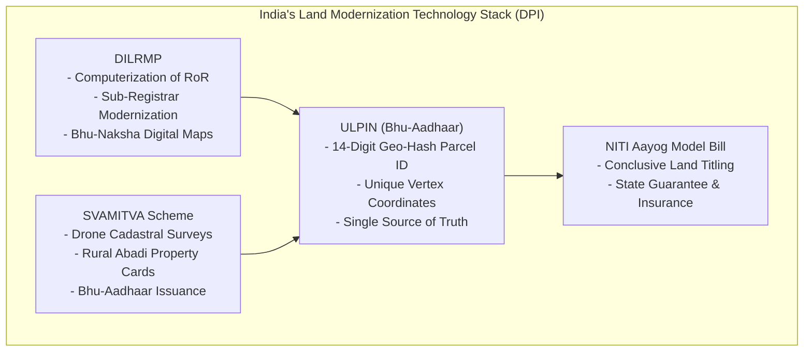
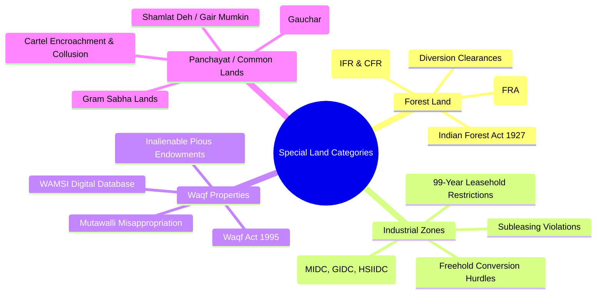

# The Indian Land Registry Ecosystem: Structural Dilemmas, Fraud Vectors, Sectoral Dissections, and Digital Public Infrastructure

**Document:** `Docs/research/02-indian-land-system-analysis.md`  
**Author:** Principal Blockchain Architect & Web3 Systems Researcher  
**Status:** In-Depth Research Report & Domain Analysis  
**Jurisdiction:** Republic of India (Union & State Cadastral Frameworks)

---

## Executive Summary

Land administration in India represents one of the most complex, litigious, and economically encumbered socio-legal systems in the world. According to the landmark DAKSH "Access to Justice" survey, **land and property disputes account for approximately 66% of all civil litigation in Indian courts**, consuming an average of 20 to 30 years per case to achieve finality. Research by the Centre for Policy Research (CPR) Land Rights Initiative indicates that land-related disputes encumber over $200 billion worth of investments, stalling critical infrastructure and shaving an estimated **1.3% off India’s annual Gross Domestic Product (GDP)**.

The fundamental culprit is not merely obsolete paperwork, but an **archaic statutory structural fracture dating back to the British colonial era**: the separation between **Deed Registration** (under the Registration Act of 1908) and **Title Mutation** (under state-level Land Revenue Codes).

This report presents an exhaustive architectural and legal analysis of the Indian land registry ecosystem, categorizes its rural, urban, and special sectors, reviews government Digital Public Infrastructure (DPI) initiatives, and provides the foundation for our blockchain land registry design.

---

## 1. The Core Legal Structural Fracture: Presumptive vs. Conclusive Title

```
               THE DUAL-RECORD FRACTURE OF INDIAN LAND
┌──────────────────────────────────────┐  ┌──────────────────────────────────────┐
│  Deed Registration (Registration)    │  │     Title Mutation (Revenue)         │
├──────────────────────────────────────┤  ├──────────────────────────────────────┤
│ • Registration Act, 1908             │  │ • State Land Revenue Codes           │
│ • Sub-Registrar of Assurances (SRO)  │  │ • Tehsildar / Patwari / Lekhpal      │
│ • Registers the TRANSACTION (Deed)   │  │ • Maintains Record of Rights (RoR)   │
│ • Presumptive Title only             │  │ • Purely for FISCAL (tax) purposes   │
│ • Caveat Emptor (Buyer Beware)       │  │ • DOES NOT confer or prove title     │
│ • State assumes ZERO liability       │  │ • No title guarantee by Government   │
└──────────────────────────────────────┘  └──────────────────────────────────────┘
                   ▲                                         ▲
                   │                                         │
                   └───────────────────┬─────────────────────┘
                                       │
                              NO ATOMIC LINKAGE!
                     Transactions can be registered at SRO
                     while never reflected in Revenue RoR
```

### 1.1 The Registration Act, 1908 & Presumptive Titling
Under the colonial **Registration Act, 1908**, the government merely registers the **execution of a deed or instrument of transfer** (e.g., Sale Deed, Gift Deed, Mortgage Deed).
- **No Guarantee of Title:** The Sub-Registrar does *not* verify whether the seller actually holds legal ownership of the property. The act of registration merely records that two parties entered into an agreement on a specific date and paid the requisite stamp duty.
- **The Principle of *Caveat Emptor* (Buyer Beware):** The state offers zero warranty of title. If a buyer purchases a parcel from a fraudster presenting forged papers, the registered deed confers no legal rights over the true owner.
- **Presumptive Nature:** Title in India is therefore strictly **presumptive**. Ownership is presumed based on possession and historical paper chains, which can be challenged in a civil court at any time.

### 1.2 State Land Revenue Codes & Mutation
Concurrently, the maintenance of land records falls under the purview of state **Revenue Departments** governed by individual state enactments (e.g., *Uttar Pradesh Revenue Code, 2006*, *Maharashtra Land Revenue Code, 1966*, *Karnataka Land Revenue Act, 1964*).
- **The Record of Rights (RoR):** Known regionally as *Jamabandi* (Punjab/Haryana), *7/12 Extract* (Maharashtra/Gujarat), *RTC / Pahani* (Karnataka), *Khatauni* (UP), or *Patta* (Tamil Nadu).
- **Mutation (*Dakhil Kharij* / *Pherphar*):** The administrative process of updating the RoR when land changes hands.
- **The Settled Judicial Doctrine:** The Supreme Court of India has reiterated in dozens of landmark rulings (notably *Suraj Lamp & Industries Pvt. Ltd. v. State of Haryana (2012)* and *Sawarni v. Inder Kaur (1996)*):
  > *"Mutation of land in revenue records does not create or extinguish the title over the land, nor has it any presumptive value on the title. It only enables the person in whose favor mutation is ordered to pay the land revenue."*

### 1.3 The Disconnection: The Anatomy of Indian Land Fraud
Because the Department of Stamps & Registration (Sub-Registrar) and the Department of Revenue (Tehsildar) operate in administrative silos with historically disconnected databases:
1. A property owner executes a sale deed at the Sub-Registrar office to Buyer A.
2. Mutation at the Tehsildar office takes anywhere from 45 days to several years due to bureaucratic delays, manual field verifications, and rent-seeking.
3. During this interim window, the original owner takes advantage of the fact that the Revenue RoR still displays their name, and sells the exact same property to Buyer B at another Sub-Registrar office.
4. Both Buyer A and Buyer B hold genuine, government-stamped, officially registered sale deeds for the exact same parcel. The outcome: **a 25-year civil lawsuit in District Court**.

---

## 2. Common Fraud Vectors & Judicial Pathology

```
                   PRIMARY FRAUD VECTORS IN INDIAN REALTY
┌─────────────────────────┬─────────────────────────┬─────────────────────────┐
│   Duplicate Sales       │   Benami Transactions   │   Forged GPA Sales      │
├─────────────────────────┼─────────────────────────┼─────────────────────────┤
│ Registering same parcel │ Purchasing property in  │ Using General Power of  │
│ to multiple buyers      │ name of proxy / straw   │ Attorney to bypass      │
│ before mutation sync.   │ man to conceal black    │ registration & stamp    │
│                         │ money or avoid ceilings │ duty (Suraj Lamp case)  │
├─────────────────────────┼─────────────────────────┼─────────────────────────┤
│   Inheritance Fraud     │   Encroachment & Land   │   Unauthorized Layouts  │
│ (Fauti / Virasat)       │   Grabbing              │ (Dual Khata Scams)      │
├─────────────────────────┼─────────────────────────┼─────────────────────────┤
│ Falsifying family trees │ Encroaching government, │ Subdividing agricultural│
│ to exclude female heirs │ panchayat, or Waqf land │ land into unapproved    │
│ or deceased relatives.  │ with fabricated patta.  │ residential plots.      │
└─────────────────────────┴─────────────────────────┴─────────────────────────┘
```

### 2.1 Benami Transactions & The Benami Act
Under the **Prohibition of Benami Property Transactions Act, 1988 (as amended in 2016)**, a transaction is *Benami* where a property is transferred to, or is held by, a person, but the consideration for such property has been provided by another person, effectively concealing the true beneficial owner.
- Used extensively to park illicit wealth, evade income tax, and bypass agricultural land ceiling caps.
- Traditional registries have zero visibility into beneficial ownership because they register whoever holds the Aadhaar/PAN card at the signing desk.

### 2.2 GPA / Agreement to Sell / Will Transfers (The GPA Scam)
For decades across urban centers like Delhi, properties were transferred via an informal triad: **General Power of Attorney (GPA) + Agreement to Sell (ATS) + Will**.
- Buyers utilized this mechanism to evade high stamp duty rates and transfer leasehold properties without municipal clearance.
- In 2012, the Supreme Court in *Suraj Lamp & Industries v. State of Haryana* outlawed this practice, declaring that immovable property can only be legally transferred through a registered deed of conveyance. Nonetheless, millions of urban units remain trapped in legal limbo with invalid GPA paperwork.

### 2.3 Inheritance Exclusion & Succession Fraud
In ancestral properties governed by the *Hindu Succession Act, 1956 (amended 2005)*, all daughters and sons hold equal coparcenary rights from birth.
- When the patriarch dies, male heirs frequently collude with local revenue officials (*Patwaris* / *Lekhpals*) during the *Virasat* (succession) mutation to register the land exclusively under male names, omitting female co-owners.
- Decades later, when the property is sold, the omitted daughters or their heirs file partition suits (*Batwara*), invalidating the sale and freezing development.

---

## 3. Government Initiatives: Digital India & Cadastral Modernization

India has embarked on ambitious Digital Public Infrastructure (DPI) initiatives to bring order to land records. Understanding these programs is critical for building a compatible blockchain solution.



### 3.1 DILRMP (Digital India Land Records Modernization Programme)
Launched in 2008 as the National Land Records Modernization Programme (NLRMP) and revamped as DILRMP:
- **Pillar 1:** Computerization of textual land records (Record of Rights).
- **Pillar 2:** Digitization of spatial cadastral maps (**Bhu-Naksha**), geo-referencing village boundary maps.
- **Pillar 3:** Computerization of Sub-Registrar Offices (SROs) and modernizing the integration between revenue and registration databases.
- *Status:* Textual records are 94%+ computerized nationwide, but spatial-textual integration remains severely fragmented across states.

### 3.2 The SVAMITVA Scheme: Unlocking Rural Abadi Land
Launched by the Ministry of Panchayati Raj in 2020:
- **Target Area:** The inhabited village areas known as **Abadi** or *Lal Dora* (in North India). Historically, British and post-independence revenue surveys mapped agricultural fields for tax purposes, but completely ignored inhabited village village sites (*Abadi*). As a consequence, rural homes had **zero formal legal records or property deeds for over a century**.
- **Methodology:** High-resolution **drone surveys** using Continuously Operating Reference Stations (CORS) network to map village household boundaries within centimeters of accuracy.
- **Deliverable:** Issuance of formal **Property Cards** (*Svamitva Cards* / *Bhu-Aadhaar*), enabling rural citizens to legally prove ownership, secure bank mortgage credit, and monetize their residential property.

### 3.3 ULPIN (Unique Land Parcel Identification Number) / Bhu-Aadhaar
ULPIN is the **"Aadhaar for Land"**:
- A **14-digit alphanumeric identification number** assigned uniquely to every surveyed land parcel in India.
- **Spatial Generation Formula:** Derived from the precise international **Electronic Cadastral Data Collection (ECDC)** geodetic coordinates (latitude and longitude) of the parcel’s polygon boundary vertices.
- **Interoperability:** Designed as the single digital bridge connecting:
  - Department of Revenue (RoR)
  - Department of Registration (Deeds)
  - Municipal Property Tax Records
  - Banking & Mortgage Liens
  - Court Dispute Registries

### 3.4 The NITI Aayog Model Bill on Conclusive Land Titling (2020)
NITI Aayog drafted the *Model Conclusive Land Titling Bill* to transition India from its presumptive deed system to a **Conclusive Title (Torrens) System**:
- Proposes a **Title Registration Officer (TRO)** to investigate and settle claims.
- The state provides a **guaranteed title**, backed by an **Indemnity / Title Insurance Fund**.
- *Constitutional Impasse:* Under the Seventh Schedule of the Constitution of India, **Land is Entry 18 and Entry 45 in the State List (List II)**. The central government cannot legislate land reform directly; each individual state legislature must enact its own law. Progress has been halting due to state government fears of incurring massive fiscal liability under the state guarantee fund.

---

## 4. Sectoral Breakdown: Rural, Urban, and Special Categories

```
┌─────────────────────────────────────────────────────────────────────────────┐
│                     SECTORAL PROPERTY CHARACTERISTICS                       │
├─────────────────┬──────────────────────────┬────────────────────────────────┤
│ Segment         │ Administrative Hierarchy │ Primary Vulnerability Vectors  │
├─────────────────┼──────────────────────────┼────────────────────────────────┤
│ Rural           │ District Collector ➔     │ Inheritance without mutation,  │
│ (Agricultural)  │ Tehsildar ➔ Patwari      │ physical boundary encroachment,│
│                 │ (Revenue Department)     │ discretionary NA conversion    │
├─────────────────┼──────────────────────────┼────────────────────────────────┤
│ Urban           │ Municipal Corporation    │ Undivided Share (UDS) fraud,   │
│ (High-Rise &    │ (BBMP / BMC / MCD)       │ unauthorized layouts (B-Khata),│
│ Plotted)        │ + RERA Authority         │ dual property tax ID tracking  │
├─────────────────┼──────────────────────────┼────────────────────────────────┤
│ Special         │ Forest Dept, Waqf Board, │ Encroachment of common lands,  │
│ (Forest, Waqf,  │ SIDC / Industrial Corps, │ alienation bans violated,      │
│ Panchayat)      │ Gram Sabha               │ 99-year leasehold disputes     │
└─────────────────┴──────────────────────────┴────────────────────────────────┘
```

### 4.1 Rural Land (Agricultural Ecosystem)

#### Administrative Workflow & Bureaucratic Hegemony
The rural land administration is intensely hierarchical:
$$\text{District Collector (DM)} \longrightarrow \text{Sub-Divisional Magistrate (SDM)} \longrightarrow \text{Tehsildar} \longrightarrow \text{Naib-Tehsildar} \longrightarrow \text{Kanungo / Revenue Inspector} \longrightarrow \text{Patwari / Lekhpal / Talathi}$$

The **Patwari / Lekhpal** remains the supreme grassroots arbiter:
- Conducts the biannual **Girdawari** (harvest/crop inspection).
- Maintains the **Khasra** (plot register detailing soil type, crop, irrigation, and tenant).
- Holds discretionary power over boundary demarcation and mutation entries.

#### Core Rural Bottlenecks:
1. **Inheritance Backlogs (*Fauti* / *Virasat*):** When a farmer dies, formal mutation is delayed for years. Family members subdivide the land informally on the ground without updating revenue records. Decades later, records list deceased ancestors as owners.
2. **Boundary Demarcation (*Nishan-dehi*):** Boundaries are physically marked by earthen mounds (*Mendh*) or stones. Monsoons, canal work, and deliberate encroachment trigger violent neighbor disputes. Without georeferenced satellite coordinates, boundary arbitration takes decades in revenue courts.
3. **Non-Agricultural (NA) Conversion:** Converting agricultural land for commercial or residential use requires discretionary permission under state revenue codes, acting as an engine of administrative bribery.

---

### 4.2 Urban Land (High-Rise Apartments, Plotted Layouts, & Municipalities)

Urban real estate introduces distinct complexities fundamentally alien to rural agricultural systems:

#### 1. The High-Rise Conundrum: Undivided Share of Land (UDS)
In modern Indian metropolitan cities (Mumbai, Bengaluru, Delhi-NCR, Hyderabad, Chennai), the vast majority of real estate transactions involve **apartments in multi-story high-rise developments**.
- Legally, an apartment buyer does not own physical soil. They own:
  1. The **super built-up area / carpet area** of their individual flat.
  2. An **Undivided Share of Land (UDS)**—a fractional, unpartitionable percentage of the underlying master land plot upon which the building stands.
- **The Systematic UDS Fraud:**
  - In traditional Sub-Registrar offices, registrations are recorded as flat units. **There is no automated registry check on cumulative UDS!**
  - Unscrupulous builders frequently over-allocate UDS—selling 120% or 150% of the underlying land plot across multiple buyers.
  - If the high-rise is later damaged, demolished, or redeveloped, buyers discover that their cumulative registered fractional land shares exceed the physical area of the parcel.

#### 2. The Dual-Register Regime (e.g., Bengaluru's A-Khata vs. B-Khata)
- Municipal corporations (such as Bruhat Bengaluru Mahanagara Palike - BBMP) maintain separate property registers.
- **A-Khata:** Fully approved properties with valid building plan sanctions, layout approvals, and title clearances.
- **B-Khata:** Properties built on unauthorized revenue layouts, lacking conversion or layout permissions, yet registered by the municipality purely to collect **Property Tax**.
- Citizens routinely confuse paying property tax (holding a B-Khata or PID) with holding legal ownership title.

#### 3. RERA (Real Estate Regulatory Authority)
- Enacted under the *Real Estate (Regulation and Development) Act, 2016*.
- Mandates that developers register all commercial and residential projects, deposit 70% of buyer collections into a dedicated project escrow bank account, and adhere to strict delivery timelines.
- Gaps persist in tracking secondary-market apartment conveyances and linking RERA project approvals directly to the Sub-Registrar deed registry.

---

### 4.3 Special & Sensitive Land Categories



#### 1. Forest Lands & Tribal Rights
- Governed by the *Indian Forest Act, 1927*, *Forest (Conservation) Act, 1980 (amended 2023)*, and the *Scheduled Tribes and Other Traditional Forest Dwellers (Recognition of Forest Rights) Act, 2006 (FRA)*.
- FRA recognizes **Individual Forest Rights (IFR)** for tribal dwellings and **Community Forest Rights (CFR)** for minor forest produce and grazing.
- In practice, corporate developments and revenue authorities frequently encroach on FRA-designated lands due to an absence of spatial demarcation in the revenue cadastral map.

#### 2. Industrial Zones (SIDC / Industrial Development Corporations)
- State entities (e.g., MIDC in Maharashtra, GIDC in Gujarat, HSIIDC in Haryana, KIADB in Karnataka) acquire vast land tracts and allot industrial plots on **99-year leaseholds**, not freehold.
- Transfers require formal "No Objection Certificates" (NOCs) and mortgage consent from the SIDC. Sub-leasing or transferring without SIDC approval triggers automatic lease termination and government repossession.

#### 3. Waqf Properties
- Dedicated Islamic charitable endowments governed by the *Waqf Act, 1995*.
- Administered by State Waqf Boards and managed locally by *Mutawallis* (custodians).
- Under Islamic jurisprudence and statutory law, **Waqf property is inalienable and permanently dedicated to God**; it can never be sold, mortgaged, or transferred.
- Despite this absolute statutory prohibition, thousands of Waqf parcels across India have been fraudulently sold to third parties using forged revenue entries. The **Waqf Management System of India (WAMSI)** was initiated to digitize these parcels, but gaps in GIS mapping continue to enable encroachment.

#### 4. Panchayat & Government Common Lands (*Shamlat Deh* / *Gair Mumkin*)
- Village common lands (*Shamlat Deh* in Punjab/Haryana, *Gauchar* in Gujarat/Rajasthan, *Gair Mumkin Pahar* in hill states) belong to the village community / Gram Sabha for collective grazing, water bodies, and cremation grounds.
- Real estate mafias routinely collude with local revenue officials to partition and regularize these common lands into private agricultural or residential holdings.

---

## 5. Architectural Implications for our Web3 Land Registry

The unique dynamics of the Indian land administration ecosystem dictate specific, non-negotiable architectural requirements for our smart contract and backend design:

1. **Mandate Dual-Identifier Support (ULPIN + GeoJSON Polygon):**
   - Property registration must accept the **14-digit ULPIN / Bhu-Aadhaar** alongside a cryptographic hash of the boundary polygon vertices (`locationHash`), establishing compatibility with the national DPI roadmap.
2. **Support Fractional High-Rise Undivided Share of Land (UDS):**
   - The contract architecture must allow a parent parcel (e.g., plot with 1,000 sq m) to track child unit tokens (apartments) with strict cumulative UDS validation ($$ \sum \text{UDS}_i \le 100\% $$).
3. **Bridge Registration and Mutation Atomically:**
   - Instead of a disconnected two-tier bureaucracy, smart contract conveyance (`executeTransfer`) must atomically settle both the deed transfer AND the mutation record in a single transaction, eliminating the double-sale interim window.
4. **Integrate Judicial Injunction / Encumbrance Freezing:**
   - Our contract's `flagProperty` mechanism directly reflects the legal necessity of accommodating civil court stay orders, bank mortgage liens, and revenue caveats.
5. **Mitigate Benami Transactions via Sovereign Identity Binding:**
   - Wallets must be bindable to verifiable credentials (e.g., DigiLocker / Aadhaar XML proofs) to prevent phantom buyers while preserving cryptographic privacy.
