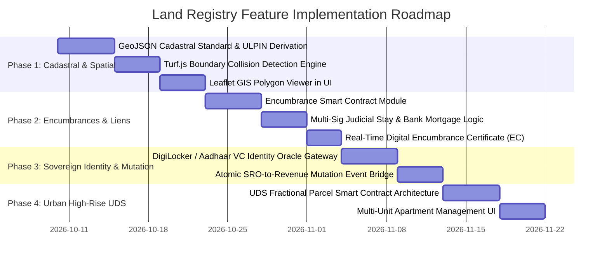

# Unique Value Proposition, Architectural Impact, and Phased Implementation Roadmap

**Document:** `Docs/research/03-unique-solutions-and-roadmap.md`  
**Author:** Principal Blockchain Architect & Web3 Systems Researcher  
**Status:** Strategic Architectural Blueprint & Execution Roadmap  
**Target Platform:** Modular Web3 Land Registry with Real-World Indian Cadastral Compatibility

---

## Executive Summary

Having established our operational baseline (Solidity 0.8.24, 43 passing tests, dual-phase indexer, React 19 UI) and concluded an exhaustive study of global implementations (Task 2) and the Indian cadastral framework (Task 3), we now articulate our **Unique Value Proposition (UVP)**.

Existing academic and commercial blockchain land registries suffer from two fatal extremes:
1. **The "Toy Crypto" Extreme:** Treating real estate as an ERC-20/ERC-721 token, ignoring physical boundaries, legal encumbrances, court stay orders, and sovereign legal reality.
2. **The "Legacy GIGO" Extreme:** Simply storing PDF hashes on-chain without solving the core real-world fraud vectors (the 45-day deed-to-mutation gap, Benami straw-man buyers, boundary overlap disputes, and urban apartment UDS over-allocation).

This blueprint outlines **five high-impact, practical features** tailored to bridge Web3 with real-world land administration, maps their architectural impact onto our existing codebase without breaking current stability, and details a prioritized phased action plan.

---

## 1. Five Unique Differentiating Features

```
┌─────────────────────────────────────────────────────────────────────────────┐
│                    OUR 5 UNIQUE VALUE DIFFERENTIATORS                       │
├─────────────────┬───────────────────────────────────────────────────────────┤
│ Feature 1       │ Geospatial Cadastral Engine & ULPIN / GeoJSON Polygon     │
│ (Spatial Layer) │ Collision Detector (Automated Overlap Rejection)          │
├─────────────────┼───────────────────────────────────────────────────────────┤
│ Feature 2       │ Sovereign Digital Identity & Anti-Benami Gate             │
│ (Identity Layer)│ (DigiLocker / Aadhaar Verifiable Credential Oracle)       │
├─────────────────┼───────────────────────────────────────────────────────────┤
│ Feature 3       │ Multi-Sig Judicial Encumbrance & Caveat Protocol          │
│ (Legal Layer)   │ (Digital Bank Mortgage Liens & Court Injunction Ledger)   │
├─────────────────┼───────────────────────────────────────────────────────────┤
│ Feature 4       │ Atomic Bi-Directional Mutation Engine                     │
│ (Revenue Layer) │ (Zero-Latency Bridge Between Registration and Revenue)    │
├─────────────────┼───────────────────────────────────────────────────────────┤
│ Feature 5       │ High-Rise Undivided Share of Land (UDS) Multi-Unit Model  │
│ (Urban Layer)   │ (Mathematical Prevention of Builder Over-Allocation)      │
└─────────────────┴───────────────────────────────────────────────────────────┘
```

---

### Feature 1: Geospatial Cadastral Engine & ULPIN Polygon Collision Detector

#### Real-World Problem
In traditional registries, parcels are identified by vague textual descriptions ("bordered by Ram's field to the North") or arbitrary address strings. Fraudsters exploit this ambiguity to sell overlapping portions of adjacent plots or encroach upon village common lands (*Shamlat Deh*).

#### Architectural Solution
- **GeoJSON Cadastral Standard:** Rather than an arbitrary location string, the registration flow accepts a standardized **GeoJSON Polygon** containing precise geodetic latitude/longitude boundary vertices.
- **ULPIN Derivation:** The system deterministically computes a 14-digit **ULPIN / Bhu-Aadhaar** hash from the polygon’s centroid and bounding box vertices.
- **On-Chain Spatial Hash & Decentralized Storage:** The full GeoJSON polygon is committed to IPFS. The IPFS CID and polygon vertex root hash are submitted to the smart contract as `locationHash`.
- **Collision Detection Pipeline:** The backend indexer utilizes spatial indexing (Turf.js / PostGIS) to test newly submitted boundary polygons against all active registered parcels. If a proposed polygon intersects with an existing verified parcel by more than a defined GPS tolerance margin, the system flags a **Cadastral Boundary Collision**, alerting the registrar before verification.
- **UI Experience:** An embedded interactive **Leaflet / Mapbox GIS map** in `CitizenDashboard` allowing users to draw or upload parcel boundary coordinates, rendering parcel polygons directly on satellite imagery in `PublicSearch`.

---

### Feature 2: Sovereign Digital Identity & Anti-Benami Gate (DigiLocker / Aadhaar VC Bridge)

#### Real-World Problem
Anonymized Web3 wallets enable rampant **Benami transactions**—illicit investors purchasing real estate through shell wallets, proxies, or domestic staff to evade taxes and land ceilings. Conversely, writing plain-text Aadhaar or PAN details to a public blockchain violates the *Digital Personal Data Protection Act, 2023 (DPDP Act)*.

#### Architectural Solution
- **Verifiable Credential (VC) Attestation:** Integration with India’s **DigiLocker / Aadhaar XML API** via an off-chain Identity Oracle.
- **Zero-Knowledge Sovereign Binding:**
  1. The citizen completes Aadhaar/DigiLocker e-KYC off-chain in a zero-retention environment.
  2. The identity provider computes a blinded identity hash:
     $$\text{IdentityHash} = \text{keccak256}(\text{AadhaarUID} \parallel \text{Salt})$$
  3. The authority oracle signs an EIP-712 Attestation: `{walletAddress, identityHash, kycTier, expiry}`.
  4. The smart contract validates this attestation before allowing `registerProperty` or `signTransfer`.
- **Outcome:** The blockchain records that the wallet belongs to a legally verified Indian citizen who has passed identity checks, completely preventing straw-man purchases while exposing **zero plain-text PII** to the public ledger.

---

### Feature 3: Multi-Sig Judicial Encumbrance & Caveat Protocol

#### Real-World Problem
Our baseline contract implements a binary `flagProperty` controlled by `ADMIN_ROLE`. In civil reality, properties have nuanced encumbrances:
- A commercial bank places a **Mortgage Lien** for a home loan.
- A Civil Court issues a temporary **Status Quo Stay Order** pending a family partition suit.
- A legal heir files a **Caveat Notice** claiming ancestral coparcenary rights.
Currently, buyers must pay third-party agents for an "Encumbrance Certificate" (EC), which is notoriously outdated and riddled with missing entries.

#### Architectural Solution
- **Multi-Class Encumbrance Registry:** We expand the dispute mechanism into a granular on-chain Encumbrance Ledger.
- **Encumbrance Types:**
  - `MORTGAGE_LIEN`: Placed by registered banking addresses; automatically clears when a signed cryptographic loan discharge is received.
  - `JUDICIAL_STAY`: Placed by a Civil Court key; requires a registered judicial case number and court decree hash.
  - `SUCCESSION_CAVEAT`: Placed by potential heirs with attached legal notices.
- **Multi-Sig Release Authorization:** Lifting a judicial freeze requires a 2-of-2 multi-sig signature: the Civil Judge key + the District Land Authority key.
- **Real-Time Digital Encumbrance Certificate (EC):** The `PublicSearch` interface renders a real-time, mathematically verified timeline of all historical and active encumbrances with zero reliance on manual registry searches.

---

### Feature 4: Atomic Bi-Directional Mutation Engine (Zero-Latency SRO-Revenue Bridge)

#### Real-World Problem
In India, the multi-month delay between **Deed Registration** (Sub-Registrar Office) and **Title Mutation** (Tehsildar Revenue Office) is the primary structural vulnerability enabling double-selling fraud. During this window, the revenue record still displays the old owner, allowing them to sell the property a second time.

#### Architectural Solution
- **Atomic Two-in-One Settlement:** In our smart contract, the moment `executeTransfer` succeeds, the contract simultaneously:
  1. Updates legal title ownership (`property.currentOwner = buyer`).
  2. Issues an on-chain **Cryptographic Mutation Token**.
  3. Emits a dedicated `MutationExecuted(propertyId, transferId, newOwner, timestamp)` event.
- **Automated Webhook Relay (State Portal Bridge):** The backend indexer captures `MutationExecuted` and pushes an authenticated, signed webhook payload to state land revenue APIs (e.g., simulated endpoints for Karnataka's *Bhoomi*, Telangana's *Dharani*, or Maharashtra's *e-Pherphar*).
- **Elimination of the Fraud Window:** The transfer of ownership and the revenue mutation occur **in the same atomic transaction block**, reducing the double-sale vulnerability window from 90 days to **0 seconds**.

---

### Feature 5: High-Rise Undivided Share of Land (UDS) Multi-Unit Model

#### Real-World Problem
Over 80% of urban transactions in metros (Mumbai, Bengaluru, Delhi-NCR) are apartments. Buyers own an **Undivided Share of Land (UDS)**. Dishonest developers frequently over-allocate UDS—selling 120% or 150% of the underlying land plot across multiple buyers.

#### Architectural Solution
- **Master Parcel vs. Sub-Unit Architecture:**
  - A registered parcel can be designated as a **Master Development Parcel** (e.g., 2,000 sq m plot).
  - The master parcel has a total allocation pool of 10,000 Basis Points (representing 100.00% UDS).
  - Individual apartment units are minted as sub-units linked to the parent `masterPropertyId`, each carrying a declared `udsBasisPoints` (e.g., 350 basis points = 3.50% UDS).
- **On-Chain Conservation Invariant:**
  $$\sum_{i=1}^{N} \text{subUnit}[i].\text{udsBasisPoints} \le 10,000$$
  If a developer attempts to register an apartment that pushes the cumulative UDS over 10,000 basis points, the transaction reverts with `UDSExceedsMasterParcelLimit()`.
- **Urban Market Relevance:** Solves the #1 urban real estate fraud vector in India, ensuring apartment buyers hold mathematically verifiable title to their underlying soil.

---

## 2. System Architecture Impact & Codebase Mapping

A core architectural principle of our project is **backwards compatibility**. None of these enhancements will break our existing base setup (`LandRegistry.sol`, `indexer.js`, `better-sqlite3`, `CitizenDashboard.jsx`). Instead, they extend the architecture via modular contracts and additive schema extensions:

```
┌─────────────────────────────────────────────────────────────────────────────┐
│                           EXPANDED SYSTEM TOPOLOGY                          │
├─────────────────────────────────────────────────────────────────────────────┤
│                                                                             │
│   ┌─────────────────────────────────────────────────────────────────────┐   │
│   │                      CONTRACT LAYER (Modular)                       │   │
│   │                                                                     │   │
│   │   ┌────────────────────────┐      ┌─────────────────────────────┐   │   │
│   │   │  LandRegistry.sol      │ ────▶│  SpatialRegistryModule.sol  │   │   │
│   │   │  (Active Core v1.0)    │      │  (GeoJSON & ULPIN Hashes)   │   │   │
│   │   └───────────┬────────────┘      └─────────────────────────────┘   │   │
│   │               │                                                     │   │
│   │               ├──────────────────▶┌─────────────────────────────┐   │   │
│   │               │                   │ EncumbranceModule.sol       │   │   │
│   │               │                   │ (Mortgages, Judicial Stays) │   │   │
│   │               │                   └─────────────────────────────┘   │   │
│   │               ▼                                                     │   │
│   │   ┌────────────────────────┐      ┌─────────────────────────────┐   │   │
│   │   │  IdentityVerifier.sol  │      │  UDSFractionalRegistry.sol  │   │   │
│   │   │  (EIP-712 KYC Gate)    │      │  (High-Rise Apartment Units)│   │   │
│   │   └────────────────────────┘      └─────────────────────────────┘   │   │
│   └─────────────────────────────────────────────────────────────────────┘   │
│                                      │                                      │
│                                      ▼                                      │
│   ┌─────────────────────────────────────────────────────────────────────┐   │
│   │                     BACKEND & INDEXER (Additive)                    │   │
│   │                                                                     │   │
│   │   • indexer.js: Add listeners for Encumbrance & Mutation events     │   │
│   │   • db.js: Add SPATIAL_BOUNDS, ENCUMBRANCES, SUB_UNITS tables       │   │
│   │   • routes/geospatial.js: Boundary collision detection (Turf.js)    │   │
│   │   • routes/encumbrances.js: Live Encumbrance Certificate generator  │   │
│   └─────────────────────────────────────────────────────────────────────┘   │
│                                      │                                      │
│                                      ▼                                      │
│   ┌─────────────────────────────────────────────────────────────────────┐   │
│   │                     FRONTEND WEB3 (Componentized)                   │   │
│   │                                                                     │   │
│   │   • components/CadastralMap.jsx: Leaflet GIS polygon editor         │   │
│   │   • components/EncumbranceBadge.jsx: Live lien & caveat status      │   │
│   │   • components/DigiLockerKYCModal.jsx: Sovereign wallet attestation │   │
│   └─────────────────────────────────────────────────────────────────────┘   │
└─────────────────────────────────────────────────────────────────────────────┘
```

### 2.1 Smart Contract Layer
- **Core Remains Unaltered:** `contracts/LandRegistry.sol` remains the root settlement engine.
- **Extension Pattern:** New features are deployed as lightweight satellite modules (`SpatialRegistryModule`, `EncumbranceModule`, `UDSFractionalRegistry`) or integrated via interfaces (`ILandRegistryExtension`).
- **Zero Disruption to Existing Tests:** All 43 current unit tests (`registration.test.js`, `transfer.test.js`, `flagging.test.js`, `history.test.js`) continue passing without modification.

### 2.2 Backend & SQLite Cache Layer
- **Schema Additions (`backend/db.js`):**
  ```sql
  CREATE TABLE IF NOT EXISTS PARCEL_SPATIAL (
      property_id INTEGER PRIMARY KEY,
      ulpin TEXT UNIQUE,
      geojson_polygon TEXT,
      centroid_lat REAL,
      centroid_lng REAL,
      FOREIGN KEY(property_id) REFERENCES PROPERTIES(property_id)
  );

  CREATE TABLE IF NOT EXISTS ENCUMBRANCES (
      encumbrance_id INTEGER PRIMARY KEY AUTOINCREMENT,
      property_id INTEGER,
      encumbrance_type TEXT, -- 'MORTGAGE', 'JUDICIAL_STAY', 'CAVEAT'
      claimant_address TEXT,
      reference_doc_hash TEXT,
      is_active INTEGER DEFAULT 1,
      created_at INTEGER,
      released_at INTEGER,
      FOREIGN KEY(property_id) REFERENCES PROPERTIES(property_id)
  );
  ```
- **Indexer Upgrade (`backend/indexer.js`):** Appending new event handlers to the existing event queue without disrupting `processEvent()`.

### 2.3 Frontend Layer
- **Component Injection:**
  - `PublicSearch.jsx`: Injects an interactive Leaflet GIS polygon viewer alongside the existing ownership timeline, plus an Encumbrance Certificate drawer.
  - `CitizenDashboard.jsx`: Adds a "Plot on Map" polygon picker to the "Register Property" tab.
  - `AuthorityDashboard.jsx`: Adds a "Boundary Conflict Review" panel for reviewing collision warnings before approving verification.

---

## 3. Phased Implementation Roadmap



---

### Detailed Milestone Breakdown

| Milestone | Deliverables | Target Artifacts | Estimated Effort |
|---|---|---|---|
| **Milestone 1: Geospatial Cadastral Engine & ULPIN Polygon Collision Detector** | 1. GeoJSON polygon data validation.<br/>2. 14-digit ULPIN generator based on parcel vertices.<br/>3. Turf.js spatial overlap detection in backend.<br/>4. Leaflet map integration in `CitizenDashboard` and `PublicSearch`. | `contracts/SpatialRegistry.sol`<br/>`backend/routes/geospatial.js`<br/>`frontend/src/components/CadastralMap.jsx` | Sprint 1 (2 Weeks) |
| **Milestone 2: Multi-Sig Judicial Encumbrance & Caveat Protocol** | 1. `EncumbranceModule.sol` supporting mortgages, stays, and caveats.<br/>2. 2-of-2 judicial multi-sig release workflow.<br/>3. Real-time Encumbrance Certificate (EC) download.<br/>4. Dispute tab on Authority Dashboard. | `contracts/EncumbranceModule.sol`<br/>`backend/routes/encumbrances.js`<br/>`frontend/src/components/EncumbranceLedger.jsx` | Sprint 2 (1.5 Weeks) |
| **Milestone 3: Sovereign Identity (DigiLocker VC) & Instant Mutation Bridge** | 1. EIP-712 identity attestation verifier.<br/>2. Anti-Benami gate rejecting unverified wallets.<br/>3. `MutationExecuted` atomic event emitter.<br/>4. Webhook relay simulating state revenue database sync. | `contracts/IdentityVerifier.sol`<br/>`backend/services/mutationBridge.js`<br/>`frontend/src/context/AuthContext.jsx` | Sprint 3 (2 Weeks) |
| **Milestone 4: High-Rise Undivided Share of Land (UDS) Multi-Unit Registry** | 1. Master-Child parcel smart contract architecture.<br/>2. Cumulative UDS invariant validation ($$\sum \le 10,000$$ bps).<br/>3. Apartment unit minting and conveyance workflow.<br/>4. Urban apartment view in Public Search. | `contracts/UDSFractionalRegistry.sol`<br/>`backend/routes/subunits.js`<br/>`frontend/src/pages/UrbanRegistry.jsx` | Sprint 4 (1.5 Weeks) |

---

## 4. Recommendation for First Implementation Feature

### Recommendation: **Milestone 1 — Geospatial Cadastral Engine & ULPIN / GeoJSON Collision Detector**

#### Strategic Rationale
1. **Solves the Physical Ground Reality:** Textual and address-based entries are the root cause of land litigation in India. Storing and mathematically verifying physical boundary coordinates provides immediate, tangible real-world credibility.
2. **Immediate Visual Impact:** Integrating an interactive satellite GIS map (Leaflet / OpenStreetMap) elevates our frontend from an abstract blockchain dashboard to an intuitive, state-of-the-art civic tech portal. Evaluators, citizens, and examiners can visually see land boundaries on screen.
3. **Aligns Directly with Government DPI:** It maps 1:1 onto the Government of India's flagship **ULPIN (Bhu-Aadhaar)** and **SVAMITVA** schemes, making our project immediately relevant to ongoing national reforms.
4. **Architecturally Low Risk:** It uses our existing `locationHash` field in `LandRegistry.sol` (which was specifically designed to accept boundary hashes/CIDs!) while adding rich off-chain spatial collision intelligence. We can implement it without altering a single line of our already-passing smart contract core.
