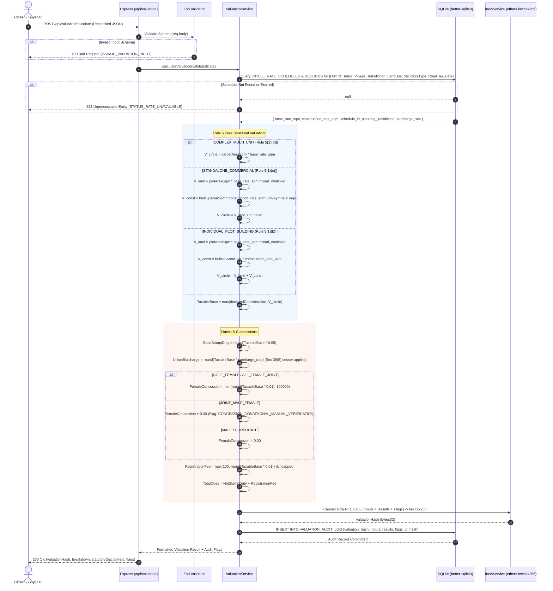

# PKG-02: ARCHITECTURE DESIGN SPECIFICATION (RECONCILED)
**Bhūmi Ledger — Sovereign Land Conveyance & Registry Engine**  
**Document Reference:** `PKG02_ARCHITECTURE_DESIGN.md`  
**Phase:** Phase 5 Sprint 3 (PKG-02: Circle Rate Valuation & Stamp Duty Calculator)  
**Authors:** System Architect Specialist, Security & Privacy Specialist, Chief AI Engineering Orchestrator  
**Status:** **APPROVED RECONCILED ARCHITECTURAL BASELINE (PRE-IMPLEMENTATION GATE)**  
**Target Milestone:** Milestone 5.8 / Sprint 3  
**Date:** November 1, 2026  

---

## 1. Architectural Tenets & Reconciled System Context

The PKG-02 Valuation Engine is the fiscal calculation and audit layer of Bhūmi Ledger. It enables real-time, deterministic computation of minimum statutory circle rate valuations and government levies under the **Indian Stamp Act, 1899**, **UP Stamp (Valuation of Property) Rules, 1997**, and relevant planning legislation.

### Core Architecture Tenets:
1. **Statutory Planning Authority Taxonomy**: Replaces simplistic urban/rural booleans with a 6-tier jurisdiction model reflecting enabling surcharge statutes.
2. **Section 39(1) Surcharge & Section 39(5) Statutory Cesser Engine**: Models dynamic Section 39(1) baseline surcharge (2.0%) with gazetted enhancement capability (up to 5.0%), and executes the Section 39(5) cesser clause extinguishing conflicting municipal or housing board levies in development areas.
3. **Rule 5 Pure Structural Valuation**: Eliminates synthetic age depreciation curves and unverified floor discounts from the automated engine; separates (b) non-commercial covered, (c) single-unit commercial covered, and (d) multi-unit complex carpet valuations.
4. **Strict Tax Exemption Gating for Female Purchasers**: Under settled strict tax interpretation (*Dilip Kumar* doctrine), automated 1% concession up to ₹1 Crore (max ₹1 Lakh benefit) is restricted to sole/all-female buyers; joint male-female purchases receive ₹0.00 automated deduction and emit `CONCESSION_CONDITIONAL_MANUAL_VERIFICATION` for manual SRO adjudication.
5. **January 8, 2026 Family Gift Deed Concession**: Codifies Notification No. 01/2026/26/XCIV-2-2026-700(29)-2021 (flat ₹5,000 duty, ₹1,000 fee, ₹20,000 capped registration fee, 5-year lock-in, natural persons only). Proposed Indian Stamp Bill 2024/2026 has zero legal effect in UP.
6. **Strict Fail-Closed Data Gating**: If no verified active schedule matches the jurisdiction, land classification, or property category, the engine returns **HTTP 422 `STATUS_RATE_UNAVAILABLE`**.
7. **Cryptographic Non-Repudiable Receipts**: Canonical JSON serialization (RFC 8785) hashed via Cancun EVM-compatible `keccak256` producing an immutable `valuationHash` audit receipt.
8. **Strict Operational Boundaries**:
   - Zero smart contract modifications: [`contracts/LandRegistry.sol`](file:///Users/lakshay/Desktop/Projects/Land-registry/contracts/LandRegistry.sol) remains untouched.
   - Zero payment custody: The engine is purely advisory and fiscal; it does not process payments or escrow funds.

---

## 2. Versioned Database Architecture (`better-sqlite3`)

```
┌────────────────────────────────────────────────────────────────────────┐
│                        CIRCLE_RATE_SCHEDULES                           │
│   (State, District, Tehsil, Village, Jurisdiction, Gazette, Dates)     │
└───────────────────────────────────┬────────────────────────────────────┘
                                    │ 1 : N
                                    ▼
┌────────────────────────────────────────────────────────────────────────┐
│                         CIRCLE_RATE_RECORDS                            │
│   (Land Use, Structure Type, Road Tier, Base Rate, Construction Rate)  │
└────────────────────────────────────────────────────────────────────────┘

┌────────────────────────────────────────────────────────────────────────┐
│                         VALUATION_AUDIT_LOG                            │
│   (Tamper-Evident Receipts + Flags + Keccak256 valuationHash)          │
└────────────────────────────────────────────────────────────────────────┘
```

### 2.1 Table DDL Specifications

```sql
-- ============================================================================
-- 1. High-Level Gazette & Jurisdictional Validity Schedules
-- ============================================================================
CREATE TABLE IF NOT EXISTS CIRCLE_RATE_SCHEDULES (
    schedule_id INTEGER PRIMARY KEY AUTOINCREMENT,
    schedule_code TEXT UNIQUE NOT NULL,               -- e.g. 'UP-LKO-SDR-VL042-2026-V1'
    state_code TEXT NOT NULL DEFAULT 'UP',            -- State ISO code
    district TEXT NOT NULL,                           -- e.g. 'Lucknow', 'Gautam Buddha Nagar'
    tehsil TEXT NOT NULL,                             -- e.g. 'Sadar', 'Dadri'
    village_code TEXT NOT NULL,                       -- LGD 6-digit revenue village code
    village_name TEXT NOT NULL,                       -- e.g. 'Chinhat', 'Sector 62'
    planning_jurisdiction TEXT NOT NULL CHECK(planning_jurisdiction IN (
        'DEVELOPMENT_AUTHORITY',
        'INDUSTRIAL_DEVELOPMENT_AUTHORITY',
        'AVAS_VIKAS_PARISHAD',
        'SPECIAL_AREA_DEVELOPMENT_AUTHORITY',
        'MUNICIPAL_BOARD_WITH_128A',
        'MUNICIPAL_BOARD_STANDARD',
        'RURAL_GRAM_PANCHAYAT'
    )),
    enabling_statute TEXT NOT NULL CHECK(enabling_statute IN (
        'UP_URBAN_PLANNING_ACT_1973_SEC_39',
        'UP_INDUSTRIAL_AREA_DEV_ACT_1976_SEC_11B',
        'UP_SADA_ACT_1986_SEC_34',
        'UP_AVAS_VIKAS_ACT_1965_SEC_62',
        'UP_MUNICIPALITIES_ACT_1916_SEC_128A',
        'NONE'
    )),
    authority_code TEXT NOT NULL,                     -- e.g. 'LDA', 'NOIDA', 'GNIDA', 'YEIDA', 'KDA', 'GDA', 'RURAL'
    territorial_notification_ref TEXT NOT NULL,       -- Gazette notification establishing cadastral boundaries
    displaced_statutory_levies TEXT,                  -- Comma-separated list of local taxes extinguished (e.g. 'MUNICIPAL_172,AVAS_62')
    statutory_rate_ceiling REAL NOT NULL DEFAULT 0.05 CHECK(
        statutory_rate_ceiling >= 0.0 AND statutory_rate_ceiling <= 0.05
    ),
    applicable_additional_duty_rate REAL NOT NULL DEFAULT 0.0 CHECK(
        applicable_additional_duty_rate >= 0.0 AND applicable_additional_duty_rate <= 0.05
    ),
    effective_from INTEGER NOT NULL,                  -- UNIX timestamp (inclusive start)
    effective_to INTEGER,                             -- UNIX timestamp (inclusive end, NULL = active)
    gazette_reference TEXT NOT NULL,                  -- e.g. 'DM/LKO/REV/2026/842-A'
    source_url TEXT NOT NULL,                         -- Official IGRSUP / NIC portal link
    verified_at INTEGER NOT NULL,                     -- UNIX timestamp when schedule was verified
    status TEXT NOT NULL CHECK(status IN ('DRAFT', 'SCHEDULED', 'ACTIVE', 'SUPERSEDED', 'REVOKED')),
    created_at INTEGER NOT NULL,
    CHECK(effective_to IS NULL OR effective_to > effective_from)
);

CREATE INDEX IF NOT EXISTS idx_schedules_lookup 
    ON CIRCLE_RATE_SCHEDULES(district, tehsil, village_code, planning_jurisdiction, status);

CREATE INDEX IF NOT EXISTS idx_schedules_temporal 
    ON CIRCLE_RATE_SCHEDULES(effective_from, effective_to);


-- ============================================================================
-- 2. Granular Structure-Type & Road-Tier Unit Rates
-- ============================================================================
CREATE TABLE IF NOT EXISTS CIRCLE_RATE_RECORDS (
    record_id INTEGER PRIMARY KEY AUTOINCREMENT,
    schedule_id INTEGER NOT NULL REFERENCES CIRCLE_RATE_SCHEDULES(schedule_id) ON DELETE CASCADE,
    land_use TEXT NOT NULL CHECK(land_use IN ('agricultural', 'residential', 'commercial', 'industrial', 'institutional')),
    structure_type TEXT NOT NULL DEFAULT 'INDIVIDUAL_PLOT_BUILDING' CHECK(structure_type IN (
        'INDIVIDUAL_PLOT_BUILDING',
        'STANDALONE_COMMERCIAL',
        'COMPLEX_MULTI_UNIT'
    )),
    road_tier TEXT NOT NULL DEFAULT 'STANDARD' CHECK(road_tier IN (
        'INTERNAL_LT_9M',
        'ROAD_9M_TO_18M',
        'ROAD_GT_18M_HIGHWAY',
        'STANDARD'
    )),
    base_rate_sqm REAL NOT NULL CHECK(base_rate_sqm >= 0),
    construction_rate_sqm REAL NOT NULL DEFAULT 0.0 CHECK(construction_rate_sqm >= 0),
    UNIQUE(schedule_id, land_use, structure_type, road_tier)
);

CREATE INDEX IF NOT EXISTS idx_rate_records_lookup 
    ON CIRCLE_RATE_RECORDS(schedule_id, land_use, structure_type, road_tier);


-- ============================================================================
-- 3. Non-Repudiable Valuation Audit Trail & Calculation Receipt Vault
-- ============================================================================
CREATE TABLE IF NOT EXISTS VALUATION_AUDIT_LOG (
    valuation_id INTEGER PRIMARY KEY AUTOINCREMENT,
    valuation_hash TEXT NOT NULL UNIQUE,              -- 0x-prefixed 32-byte keccak256 hash
    inputs_json TEXT NOT NULL,                        -- Canonical RFC 8785 JSON of validated inputs
    result_json TEXT NOT NULL,                        -- Canonical RFC 8785 JSON of calculation results
    rate_schedule_id INTEGER NOT NULL REFERENCES CIRCLE_RATE_SCHEDULES(schedule_id),
    planning_jurisdiction TEXT NOT NULL,
    additional_duty_statutory_ref TEXT NOT NULL,
    conditional_flags TEXT DEFAULT '[]',              -- JSON array of operational audit flags
    calculated_at INTEGER NOT NULL,                   -- UNIX timestamp
    ip_hash TEXT NOT NULL,                            -- Salted SHA-256 hashed client IP (zero PII)
    CHECK(length(valuation_hash) = 66 AND valuation_hash LIKE '0x%')
);

CREATE UNIQUE INDEX IF NOT EXISTS idx_valuation_audit_hash 
    ON VALUATION_AUDIT_LOG(valuation_hash);

CREATE INDEX IF NOT EXISTS idx_valuation_audit_time 
    ON VALUATION_AUDIT_LOG(calculated_at);
```

---

## 3. Reconciled Calculation Flow & Schedule Resolution

### 3.1 Input Validation Schema (Zod)

```typescript
import { z } from 'zod';

export const ReconciledValuationRequestSchema = z.object({
  stateCode: z.literal('UP').default('UP'),
  district: z.string().trim().min(2).max(50),
  tehsil: z.string().trim().min(2).max(50),
  villageCode: z.string().trim().regex(/^\d{6}$/, 'Village code must be a 6-digit revenue code'),
  
  // Reconciled Planning Authority Jurisdiction (replaces isUrban)
  planningJurisdiction: z.enum([
    'DEVELOPMENT_AUTHORITY',
    'AVAS_VIKAS_PARISHAD',
    'SPECIAL_AREA_DEVELOPMENT_AUTHORITY',
    'MUNICIPAL_BOARD_WITH_128A',
    'MUNICIPAL_BOARD_STANDARD',
    'RURAL_GRAM_PANCHAYAT'
  ]),

  landUse: z.enum([
    'agricultural',
    'residential',
    'commercial',
    'industrial',
    'institutional'
  ]),

  structureType: z.enum([
    'INDIVIDUAL_PLOT_BUILDING',
    'STANDALONE_COMMERCIAL',
    'COMPLEX_MULTI_UNIT'
  ]).default('INDIVIDUAL_PLOT_BUILDING'),

  roadTier: z.enum([
    'INTERNAL_LT_9M',
    'ROAD_9M_TO_18M',
    'ROAD_GT_18M_HIGHWAY',
    'STANDARD'
  ]).default('STANDARD'),

  plotAreaSqm: z.number().nonnegative('Plot area cannot be negative').default(0),
  builtUpAreaSqm: z.number().nonnegative('Built-up area cannot be negative').default(0),
  carpetAreaSqm: z.number().nonnegative('Carpet area cannot be negative').default(0),
  declaredConsideration: z.number().nonnegative('Declared consideration cannot be negative'),

  isCornerPlot: z.boolean().default(false),

  // Buyer Category & Strict Tax Treatment
  buyerCategory: z.enum([
    'SOLE_FEMALE',
    'SOLE_MALE',
    'ALL_FEMALE_JOINT',
    'JOINT_MALE_FEMALE',
    'CORPORATE_ENTITY'
  ]),
  femaleSharePercentage: z.number().min(0).max(100).optional(),

  transactionDate: z.number().int().positive().default(() => Math.floor(Date.now() / 1000))
}).refine(data => {
  if (data.structureType === 'COMPLEX_MULTI_UNIT' && data.carpetAreaSqm <= 0) {
    return false;
  }
  if (data.structureType !== 'COMPLEX_MULTI_UNIT' && data.plotAreaSqm <= 0) {
    return false;
  }
  return true;
}, {
  message: 'Complex multi-unit structures require positive carpetAreaSqm; individual plots require positive plotAreaSqm.',
  path: ['structureType']
});
```

---

## 4. Sequence Diagram: Reconciled End-to-End Calculation Flow



---

## 5. Security & Privacy Guarantees (DPDP Act 2023)

1. **Zero-PII Audit Vault**:
   - `VALUATION_AUDIT_LOG` records strictly cadastral parameters, land area, financial calculations, and cryptographic hashes.
   - **Zero Aadhaar numbers, PANs, citizen names, or mobile numbers are ever stored in valuation tables.**
   - Client IPs are hashed using SHA-256 with an ephemeral daily salt before storage.
2. **Deterministic Tamper-Resistant Receipts**:
   - Both inputs and calculated outputs are serialized into canonical sorted-key JSON (RFC 8785).
   - Hashed using Cancun EVM-compatible `keccak256`.
3. **Staleness Bounds**:
   - Every schedule has a maximum validity ceiling of 365 calendar days from `effective_from`. Expired schedules reject automatically with HTTP 422.

---

## 6. Integration Boundaries & Isolation

```
┌────────────────────────────────────────────────────────────────────────┐
│                        SMART CONTRACT LAYER                            │
│                        (LandRegistry.sol)                              │
│   • Frozen & untouched.                                                │
│   • No tax rules or circle rate calculations on-chain.                 │
│   • Pure non-custodial ownership and escrow ledger.                    │
└───────────────────────────────────┬────────────────────────────────────┘
                                    │ Zero Direct Integration
┌───────────────────────────────────▼────────────────────────────────────┐
│                    OFF-CHAIN VALUATION ENGINE (PKG-02)                 │
│                                                                        │
│   • Advisory calculation and fiscal audit REST service.                │
│   • Reads: PARCEL_EXTRACTION_METADATA (Gata, Area, Tehsil)             │
│   • Reads: PROPERTIES (Registered property price references)           │
│   • Writes: VALUATION_AUDIT_LOG (Audit receipts exclusively)           │
│   • Zero payment custody, zero fiat/crypto fund handling               │
└────────────────────────────────────────────────────────────────────────┘
```

*This reconciled architectural specification is approved and frozen for PKG-02.*
