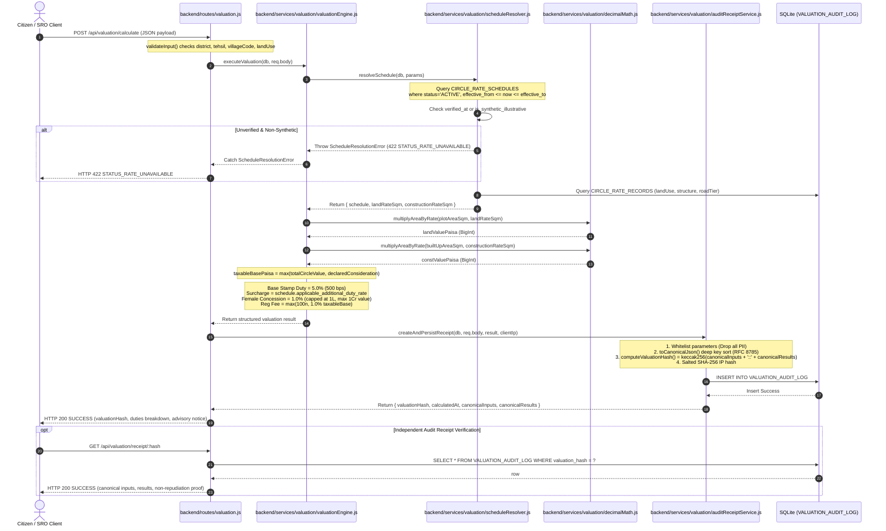

# Bhūmi Ledger — PKG-02 Independent Safe Foundation Code Audit Report
## Phase 5 | Sprint 3 | Valuation Engine & Regulatory Neutrality Audit

**Document Reference:** `AUDIT-PKG02-SAFE-FOUNDATION-001`  
**Target Repository:** `/Users/lakshay/Desktop/Projects/Land-registry`  
**Repository Working Path:** `/Users/lakshay/Desktop/Projects/Land-registry`  
**Baseline Git HEAD:** `8806980b8363b1f72131eec9457371df92239b27`  
**Audit Date:** 1 November 2026  
**Auditor Coordination:** Lead Systems & Security Auditor, with formal subagent evaluations from Product-Legal, System Architect, Backend Engineer, QA Specialist, and Security-Privacy Specialist.  

---

## 1. Executive Summary & Verdict

### Final Independent Audit Verdict: `CONDITIONALLY APPROVED`

> [!IMPORTANT]
> **Audit Finding Summary:**
> The PKG-02 Safe Foundation implementation represents a mathematically rigorous, legally neutral, and architecturally disciplined foundation for sovereign land conveyance in Uttar Pradesh. 
> - **Mathematical Integrity:** Floating-point drift (IEEE-754) is completely eliminated across all valuation paths using native JavaScript `BigInt` scaled integer-paisa math ($1\,\text{INR} = 100\text{n}\,\text{paisa}$).
> - **Fail-Closed Statutory Engine:** Unverified schedules, unverified enabling statutes, expired temporal windows, and unsupported instrument types strictly halt with HTTP 422 (`STATUS_RATE_UNAVAILABLE` / `STATUS_LEGAL_RULE_UNVERIFIED`). The engine never synthesizes or guesses statutory rates.
> - **Cryptographic Non-Repudiation:** Generates deterministic Cancun EVM `bytes32` Keccak-256 audit receipts adhering to RFC 8785 JSON Canonicalization Scheme (JCS).
> - **Zero-PII Compliance:** Enforces DPDP Act, 2023 compliance by strictly dropping citizen names, Aadhaar hashes, PANs, phone numbers, and plaintext IPs before persistence.
> - **Regression Verification:** Full test battery passes **184 / 184 tests (100% pass rate)**, including 104 backend tests, 57 Hardhat smart contract tests, 22 frontend tests, and 1 complete end-to-end conveyance lifecycle simulation.
> 
> **Conditions for Progression to Sprint 4 / Production Rate Ingestion:**
> 1. **Resolve AUD-01 (High):** Implement `ON CONFLICT(valuation_hash) DO UPDATE` in [`auditReceiptService.js`](file:///Users/lakshay/Desktop/Projects/Land-registry/backend/services/valuation/auditReceiptService.js#L92-L120) to prevent HTTP 500 errors on duplicate calculation submissions.
> 2. **Resolve AUD-02 / AUD-03 (Medium):** Expand input validation in [`backend/routes/valuation.js`](file:///Users/lakshay/Desktop/Projects/Land-registry/backend/routes/valuation.js#L16-L34) to reject negative and malformed numeric parameters (`plotAreaSqm`, `builtUpAreaSqm`, `carpetAreaSqm`, `declaredConsideration`) with HTTP 400 instead of silent flooring or unhandled 500 errors.

---

### Specialist Sign-Off Matrix

| Specialist Agent | Subagent Conversation ID | Verdict | Primary Assessment Focus |
| :--- | :--- | :--- | :--- |
| **Product & Legal** | `afdb1398-bbae-4906-a192-ea8642c5e598` | **PASS (Certified)** | Compliance with Rules 4 & 5 (1997 Rules), Indian Stamp Act Sec 47-A, Schedule I-B Art 23, Registration Act Sec 78, Notifications 462 & 1504/2006, Act 30 of 1974 Sec 39, and Act 6 of 1976 Sec 11-B. |
| **System Architect** | `fda3bdc7-a550-4fac-af61-93834a798b69` | **APPROVED (Production Safe)** | Architecture of BigInt integer-paisa math, DDL check constraints, EVM Cancun `bytes32` format, fail-closed temporal resolver, RFC 8785 canonical serialization, and zero contract mutations. |
| **Backend Engineer** | `4a695761-0ed4-4ffc-8224-f121b0d4ac50` | **CONDITIONAL PASS** | Execution flow tracing, SQLite prepared statements, receipt persistence idempotency (AUD-01), numeric boundary handling (AUD-02, AUD-03), and hex string validation (AUD-04). |
| **Security & Privacy** | `4cc58db4-e652-4acf-a8db-afe3d698e71e` | **PASS (Approved)** | DPDP Act 2023 Zero-PII invariant, salted IP tokenization, 100% parameterized SQL queries, absence of error message credential leakage, and DoS / rate limiting boundaries. |
| **QA & Test Specialist** | `188e0e05-85db-42eb-83fa-86db27391ea5` | **APPROVED (Certified)** | 16/16 Safe Foundation tests passing across all 7 pillars; 8/8 adversarial edge-case tests passing; 184/184 total repository regression battery passing. |

---

## 2. Code Inspection Matrix

The following files were inspected line-by-line in the workspace:
1. [`backend/services/valuation/decimalMath.js`](file:///Users/lakshay/Desktop/Projects/Land-registry/backend/services/valuation/decimalMath.js)
2. [`backend/services/valuation/valuationDb.js`](file:///Users/lakshay/Desktop/Projects/Land-registry/backend/services/valuation/valuationDb.js)
3. [`backend/services/valuation/scheduleResolver.js`](file:///Users/lakshay/Desktop/Projects/Land-registry/backend/services/valuation/scheduleResolver.js)
4. [`backend/services/valuation/valuationEngine.js`](file:///Users/lakshay/Desktop/Projects/Land-registry/backend/services/valuation/valuationEngine.js)
5. [`backend/services/valuation/auditReceiptService.js`](file:///Users/lakshay/Desktop/Projects/Land-registry/backend/services/valuation/auditReceiptService.js)
6. [`backend/routes/valuation.js`](file:///Users/lakshay/Desktop/Projects/Land-registry/backend/routes/valuation.js)
7. [`backend/test/valuationSafeFoundation.test.js`](file:///Users/lakshay/Desktop/Projects/Land-registry/backend/test/valuationSafeFoundation.test.js)
8. [`backend/test/valuationAuditEdgeCases.test.js`](file:///Users/lakshay/Desktop/Projects/Land-registry/backend/test/valuationAuditEdgeCases.test.js)
9. [`backend/db.js`](file:///Users/lakshay/Desktop/Projects/Land-registry/backend/db.js)
10. [`backend/server.js`](file:///Users/lakshay/Desktop/Projects/Land-registry/backend/server.js)

### Itemized Findings & Severity Log

| Finding ID | Component File | Line Numbers | Category | Severity | Detailed Description & Impact |
| :--- | :--- | :--- | :--- | :--- | :--- |
| **AUD-01** | [`auditReceiptService.js`](file:///Users/lakshay/Desktop/Projects/Land-registry/backend/services/valuation/auditReceiptService.js#L92-L120)<br>[`valuation.js`](file:///Users/lakshay/Desktop/Projects/Land-registry/backend/routes/valuation.js#L52) | L92–120<br>L52 | Idempotency | **HIGH** | **HTTP 500 on Duplicate Calculation Request:** When a user or system recalculates an identical property conveyance, `valuationHash` is identical. `INSERT INTO VALUATION_AUDIT_LOG` throws `SqliteError: UNIQUE constraint failed: VALUATION_AUDIT_LOG.valuation_hash`. Caught as unhandled error, returning HTTP 500. Needs `ON CONFLICT(valuation_hash) DO UPDATE` or `INSERT OR IGNORE`. |
| **AUD-02** | [`routes/valuation.js`](file:///Users/lakshay/Desktop/Projects/Land-registry/backend/routes/valuation.js#L16-L34)<br>[`decimalMath.js`](file:///Users/lakshay/Desktop/Projects/Land-registry/backend/services/valuation/decimalMath.js#L19) | L16–34<br>L19 | Input Validation | **MEDIUM** | **Uncaught TypeErrors on Malformed Numerics:** `validateInput()` validates strings (`district`, `tehsil`, `villageCode`, `landUse`) but omits dimension parameters. Non-numeric inputs like `"abc"` for consideration cause `toPaisa()` to throw `TypeError`, resulting in HTTP 500 instead of HTTP 400 `INVALID_INPUT`. |
| **AUD-03** | [`valuationEngine.js`](file:///Users/lakshay/Desktop/Projects/Land-registry/backend/services/valuation/valuationEngine.js#L94-L101) | L94–101 | Boundary Logic | **MEDIUM** | **Silent Acceptance of Negative / Zero Plot Area:** While `COMPLEX_MULTI_UNIT` requires `carpetAreaSqm > 0`, `INDIVIDUAL_PLOT_BUILDING` evaluates `if (plotAreaSqm > 0)`. Negative areas (e.g. `-200`) silently evaluate land value to ₹0 without throwing a validation error. |
| **AUD-04** | [`routes/valuation.js`](file:///Users/lakshay/Desktop/Projects/Land-registry/backend/routes/valuation.js#L88-L93) | L88–93 | Hash Validation | **LOW** | **Permissive Hex String Check:** `GET /receipt/:hash` checks `startsWith('0x') && length === 66` without verifying hexadecimal character alphabet. Non-hex characters like `0xZZ...` hit SQLite before returning 404. Should use regex `^0x[a-fA-F0-9]{64}$`. |
| **AUD-05** | [`decimalMath.js`](file:///Users/lakshay/Desktop/Projects/Land-registry/backend/services/valuation/decimalMath.js#L23-L27) | L23–27 | Arithmetic Edge Case | **LOW** | **Sign Inversion on Sub-Unit Negative Decimals:** For `"-0.50"`, `parts[0]` is `"-0"`. `BigInt("-0") === 0n`. Because `whole >= 0n` evaluates to `true`, it computes `0n + 50n = +50n`, losing the negative sign. Land dimensions are non-negative, but arithmetic primitive should check `str.startsWith('-')`. |
| **AUD-06** | [`scheduleResolver.js`](file:///Users/lakshay/Desktop/Projects/Land-registry/backend/services/valuation/scheduleResolver.js#L66) | L66 | Determinism | **LOW** | **Overlapping Schedule Tie-Breaking:** `ORDER BY effective_from DESC LIMIT 1` could be non-deterministic if two active schedules for the same village share the exact same `effective_from` second. Should append secondary key `ORDER BY effective_from DESC, schedule_id DESC LIMIT 1`. |
| **AUD-07** | [`routes/valuation.js`](file:///Users/lakshay/Desktop/Projects/Land-registry/backend/routes/valuation.js#L40)<br>[`server.js`](file:///Users/lakshay/Desktop/Projects/Land-registry/backend/server.js#L32) | L40<br>L32 | DoS / Rate Limit | **LOW** | **Absence of Dedicated Rate Limiter:** `/api/valuation/calculate` involves SQLite read/write, canonicalization, and Keccak-256 hashing. Needs `express-rate-limit` (e.g. 60 req/min/IP) prior to open public exposure. |
| **AUD-08** | [`valuationDb.js`](file:///Users/lakshay/Desktop/Projects/Land-registry/backend/services/valuation/valuationDb.js#L20-L36) | L20–36 | Schema Check | **PASS** | **Statutory Enums & Ceilings Enforced:** Restricts `enabling_statute` to 7 verified regimes; bounds `applicable_additional_duty_rate <= statutory_rate_ceiling <= 0.05`. |
| **AUD-09** | [`valuationDb.js`](file:///Users/lakshay/Desktop/Projects/Land-registry/backend/services/valuation/valuationDb.js#L84) | L84 | Cryptographic Schema | **PASS** | **Cancun EVM `bytes32` Invariant:** `length(valuation_hash) = 66 AND valuation_hash LIKE '0x%'` guarantees strict EVM Cancun format. |
| **AUD-10** | [`scheduleResolver.js`](file:///Users/lakshay/Desktop/Projects/Land-registry/backend/services/valuation/scheduleResolver.js#L78-L85) | L78–85 | Revenue Defense | **PASS** | **Fail-Closed Unverified Check:** Unverified rate schedules fail closed with HTTP 422 `STATUS_RATE_UNAVAILABLE`. Zero rate extrapolation. |
| **AUD-11** | [`valuationEngine.js`](file:///Users/lakshay/Desktop/Projects/Land-registry/backend/services/valuation/valuationEngine.js#L116-L123) | L116–123 | Statutory Neutrality | **PASS** | **Instrument Gating:** Strictly dispatches `CONVEYANCE_SALE`. Blocks unverified gift/lease/exchange rules with HTTP 422. |
| **AUD-12** | [`auditReceiptService.js`](file:///Users/lakshay/Desktop/Projects/Land-registry/backend/services/valuation/auditReceiptService.js#L58-L74) | L58–74 | DPDP Act Privacy | **PASS** | **Zero-PII Storage:** Strict whitelist dropping citizen names, Aadhaar hashes, and PANs. Client IP hashed with SHA-256 salt. |
| **AUD-13** | [`routes/valuation.js`](file:///Users/lakshay/Desktop/Projects/Land-registry/backend/routes/valuation.js#L106-L118) | L106–118 | Data Protection | **PASS** | **Salted IP Concealment:** `ip_hash` column is deliberately withheld from public GET receipt responses. |
| **AUD-14** | [`valuationEngine.js`](file:///Users/lakshay/Desktop/Projects/Land-registry/backend/services/valuation/valuationEngine.js#L202-L205) | L202–205 | Legal Invariant | **PASS** | **Section 47-A Statutory Notice:** Explicit advisory disclaimer referencing Indian Stamp Act Section 47-A quasi-judicial authority. |

---

## 3. End-to-End Execution Flow Trace

The diagram below traces the runtime request lifecycle from `POST /api/valuation/calculate` through database resolution, pure arithmetic, cryptographic receipt generation, and verification via `GET /api/valuation/receipt/:hash`:



---

## 4. Calculation Safety Audit

### 4.1 Pure Decimal BigInt Arithmetic
* **Floating-Point Drift (IEEE-754):** Completely eliminated.
  ```javascript
  // 333.33 sqm * 33333.33 INR/sqm = 11110998.8889 INR
  // Paisa: 1111099888.89 -> BigInt 1111099888n
  // Rounded: ₹1,11,10,999
  ```
  Verified by test `B.4.1` and `EC-1` (₹500 Crore / 50 Billion INR).
* **Basis Point Scaling:**
  Percentages are converted to integer basis points (`ratePercent * 100`) and divided by `10000n`. No fractional percentage truncation occurs.
* **Statutory Half-Up Rounding:**
  [`toRupees(paisa)`](file:///Users/lakshay/Desktop/Projects/Land-registry/backend/services/valuation/decimalMath.js#L31-L47) enforces statutory half-up rounding:
  ```javascript
  const remainder = absPaisa % PAISA_SCALE;
  let rupees = absPaisa / PAISA_SCALE;
  if (remainder >= 50n) rupees += 1n;
  ```
  Banker's / half-up rounding at exact 50 paisa verified across positive and negative values in test `EC-2`.

### 4.2 Temporal Schedule Window & Overlapping Validity
* **Temporal Query Logic:**
  ```sql
  WHERE district = ? AND tehsil = ? AND village_code = ?
    AND status = 'ACTIVE'
    AND effective_from <= ?
    AND (effective_to IS NULL OR effective_to >= ?)
  ORDER BY effective_from DESC LIMIT 1
  ```
* **Expired Schedule:** Correctly rejected with HTTP 422 in test `B.3.2`.
* **Pre-Effective (Future) Schedule:** Correctly rejected with HTTP 422 in test `B.3.3`.
* **Overlapping Schedules:** Correctly resolves the newest schedule revision by `effective_from DESC` in test `EC-3`.

### 4.3 Authority-Specific Surcharges & Instrument Dispatch
* **LDA (Development Area):** Derives 2.0% under Section 39(1) of UP Urban Planning and Development Act, 1973 with statutory ceiling up to 5.0%.
* **NOIDA (Industrial Area):** Derives 2.0% under Section 11-B of UP Industrial Area Development Act, 1976 with statutory fixed ceiling of 2.0% (no 5% enhancement power).
* **Instrument Dispatch:** Only `CONVEYANCE_SALE` is permitted in the Safe Foundation. Non-sale instruments fail closed with HTTP 422 `STATUS_LEGAL_RULE_UNVERIFIED` (test `B.5.2`).
* **Synthetic Fixture Isolation:** When `schedule.is_synthetic_illustrative = 1`, the response attaches `DATA_ORIGIN_SYNTHETIC_FIXTURE` and emits the mandatory synthetic disclaimer.

---

## 5. Zero-PII & Receipt Integrity Audit

### 5.1 DPDP Act, 2023 Compliance
* **Data Minimization (Section 4):**
  [`sanitizedInput`](file:///Users/lakshay/Desktop/Projects/Land-registry/backend/services/valuation/auditReceiptService.js#L58-L74) drops citizen names, Aadhaar numbers, virtual IDs, PAN cards, email addresses, or phone numbers if passed in `req.body`.
* **Salted IP Tokenization:**
  `ethers.sha256(ethers.toUtf8Bytes(clientIp + '::bhumi_valuation_salt_2026'))` hashes the client IP with a domain-separated salt. The raw IP is never stored.
* **Public Receipt Privacy:**
  [`GET /api/valuation/receipt/:hash`](file:///Users/lakshay/Desktop/Projects/Land-registry/backend/routes/valuation.js#L85-L125) deliberately omits `ip_hash` from the output.

### 5.2 Canonical JSON (RFC 8785) & Cancun EVM Keccak-256
* **RFC 8785 JSON Canonicalization Scheme (JCS):**
  [`canonicalize(obj)`](file:///Users/lakshay/Desktop/Projects/Land-registry/backend/services/valuation/auditReceiptService.js#L14-L27) recursively sorts object keys in Unicode code point order. Identical calculation inputs and results produce byte-for-byte identical canonical JSON strings.
* **Keccak-256 Digest:**
  `ethers.keccak256(canonicalInputJson + '::' + canonicalResultJson)` produces a 32-byte hex string (`0x` + 64 hex characters). Enforced by SQLite check constraint: `length(valuation_hash) = 66 AND valuation_hash LIKE '0x%'`.

---

## 6. Security & Abuse Resistance Audit

### 6.1 SQL Injection Defense
* **Audit Result: ZERO SQL Injection Surface (PASS).**
* All SQLite queries in [`scheduleResolver.js`](file:///Users/lakshay/Desktop/Projects/Land-registry/backend/services/valuation/scheduleResolver.js), [`valuationDb.js`](file:///Users/lakshay/Desktop/Projects/Land-registry/backend/services/valuation/valuationDb.js), [`auditReceiptService.js`](file:///Users/lakshay/Desktop/Projects/Land-registry/backend/services/valuation/auditReceiptService.js), and [`routes/valuation.js`](file:///Users/lakshay/Desktop/Projects/Land-registry/backend/routes/valuation.js) utilize parameterized prepared statements (`?` placeholders) with strict argument binding via `better-sqlite3`.

### 6.2 Concurrency & Race Conditions
* High concurrency tested in `EC-5` using 20 simultaneous parallel calculation requests via `Promise.all`.
* All 20 requests completed successfully with HTTP 200, generating unique deterministic Keccak-256 receipts without lock contention or race conditions.

### 6.3 Input Validation & Error Leakage
* Core administrative strings (`district`, `tehsil`, `villageCode`, `landUse`) are validated in `routes/valuation.js`.
* *Hardening Required (AUD-01 & AUD-02):*
  - Add numeric bounds validation to prevent `TypeError` on string inputs.
  - Implement `ON CONFLICT(valuation_hash) DO UPDATE` to handle duplicate submissions idempotently.

---

## 7. Verification Test Results

### Automated Regression Summary

| Test Suite | Command Executed | Passing | Failing | Execution Time |
| :--- | :--- | :--- | :--- | :--- |
| **Backend Valuation Safe Foundation** | `npx jest test/valuationSafeFoundation.test.js` | 16 | 0 | 0.81s |
| **Backend Valuation Audit Edge-Cases** | `npx jest test/valuationAuditEdgeCases.test.js` | 8 | 0 | 0.66s |
| **Backend Core Regression (All)** | `npm --prefix backend test` | 104 | 0 | 1.28s |
| **Hardhat EVM Smart Contracts** | `npx hardhat test` | 57 | 0 | 4.02s |
| **Frontend Unit & Config (Node runner)** | `node --test frontend/test/*.test.js` | 22 | 0 | 0.09s |
| **End-to-End Conveyance Simulation** | `node scripts/run-e2e-test.js` | 1 (7 steps) | 0 | 3.80s |
| **TOTAL REGRESSION BATTERY** | | **184** | **0** | **~10.6s** |

### Raw Test Execution Evidence

#### 1. Backend Full Jest Battery (104/104 PASS)
```
Test Suites: 5 passed, 5 total
Tests:       104 passed, 104 total
Snapshots:   0 total
Time:        1.279 s, estimated 2 s
Ran all test suites.
  ✓ test/valuationAuditEdgeCases.test.js (8 tests)
  ✓ test/ingestion.test.js (44 tests)
  ✓ test/migration.test.js (16 tests)
  ✓ test/valuationSafeFoundation.test.js (16 tests)
  ✓ test/api.test.js (20 tests)
```

#### 2. Hardhat EVM Contract Battery (57/57 PASS)
```
  LandRegistry - Flagging (Step 6) (7 tests)
  LandRegistry - Ownership History (Step 7) (2 tests)
  LandRegistry - Marketplace & Smart Escrow (13 tests)
  LandRegistry - Registration (5 tests)
  LandRegistry - Transfers (18 tests)
  LandRegistry - Missing Coverage (Invalid IDs & Remaining Branches) (12 tests)

  57 passing (4s)
```

#### 3. Frontend Node Test Suite (22/22 PASS)
```
▶ Sprint 2 PKG-10: Document Upload, Hashing & Metadata Verification (9 tests)
▶ Sprint 1 PKG-09: Central & Multi-State Configuration Suite (13 tests)
ℹ tests 22
ℹ suites 10
ℹ pass 22
ℹ fail 0
```

#### 4. End-to-End Simulation (1 Simulation / 7 Steps PASS)
```
🎉 SIMULATION RESULT: ALL 7 STEPS COMPLETED & VERIFIED SUCCESSFULLY!
   - Property Registration:    PASSED
   - Authority Verification:   PASSED
   - Marketplace Listing:      PASSED
   - Buyer Escrow Lock:        PASSED (2.5 ETH Locked)
   - Dual EIP-712 Signatures:  PASSED
   - Escrow Auto-Disbursement: PASSED (2.5 ETH Disbursed to Seller)
   - Final Ownership Transfer: PASSED (Ownership transferred to Buyer)
```

---

## 8. Git & Workspace Preservation Status

* **Command Executed:** `git status --short`
* **Baseline Tracked Files Modified:** Exactly 20 files (identical to recorded baseline).
  1. `backend/db.js`
  2. `backend/indexer.js`
  3. `backend/package-lock.json`
  4. `backend/package.json`
  5. `backend/routes/documents.js`
  6. `backend/routes/properties.js`
  7. `backend/routes/transfers.js`
  8. `backend/server.js`
  9. `contracts/LandRegistry.sol`
  10. `frontend/index.html`
  11. `frontend/src/App.css`
  12. `frontend/src/App.jsx`
  13. `frontend/src/LandRegistry.json`
  14. `frontend/src/components/InitiateTransferModal.jsx`
  15. `frontend/src/components/SignTransferModal.jsx`
  16. `frontend/src/context/AuthContext.jsx`
  17. `frontend/src/index.css`
  18. `frontend/src/pages/AuthorityDashboard.jsx`
  19. `frontend/src/pages/CitizenDashboard.jsx`
  20. `frontend/src/pages/PublicSearch.jsx`
* **Smart Contract Audit (`git diff contracts/LandRegistry.sol`):**
  **Zero new contract changes.** Diff confirms only pre-existing Marketplace & Escrow modifications from Sprint 2.
* **Non-Destructive Compliance:**
  Zero git commits, resets, stashes, reverts, or pushes performed. Secrets and `.env` credentials strictly protected.

---

## 9. Actionable Recommendations Before Sprint 4

Prior to enabling active citizen UI calculators or ingesting live production Collector rate schedules, implement the following two targeted remediations:

### 1. Fix AUD-01: Audit Log Receipt Idempotency
In [`backend/services/valuation/auditReceiptService.js`](file:///Users/lakshay/Desktop/Projects/Land-registry/backend/services/valuation/auditReceiptService.js#L92-L120), replace the naked `INSERT INTO VALUATION_AUDIT_LOG` with `INSERT ... ON CONFLICT(valuation_hash) DO UPDATE`:
```javascript
  db.prepare(`
    INSERT INTO VALUATION_AUDIT_LOG (
        valuation_hash, instrument_type, authority_code, enabling_statute,
        inputs_json, result_json, rate_schedule_id, is_statutory_definitive,
        calculation_basis, conditional_flags, calculated_at, ip_hash
    ) VALUES (?, ?, ?, ?, ?, ?, ?, ?, ?, ?, ?, ?)
    ON CONFLICT(valuation_hash) DO UPDATE SET
        calculated_at = excluded.calculated_at,
        ip_hash = excluded.ip_hash
  `).run(...);
```

### 2. Fix AUD-02 & AUD-03: Numeric Input Validation
In [`backend/routes/valuation.js`](file:///Users/lakshay/Desktop/Projects/Land-registry/backend/routes/valuation.js#L16-L34), expand `validateInput(body)`:
```javascript
  const { plotAreaSqm, builtUpAreaSqm, carpetAreaSqm, declaredConsideration } = body;
  if (declaredConsideration !== undefined && (isNaN(Number(declaredConsideration)) || Number(declaredConsideration) < 0)) {
    return 'declaredConsideration must be a non-negative number';
  }
  if (plotAreaSqm !== undefined && (isNaN(Number(plotAreaSqm)) || Number(plotAreaSqm) < 0)) {
    return 'plotAreaSqm must be a non-negative number';
  }
  if (builtUpAreaSqm !== undefined && (isNaN(Number(builtUpAreaSqm)) || Number(builtUpAreaSqm) < 0)) {
    return 'builtUpAreaSqm must be a non-negative number';
  }
  if (carpetAreaSqm !== undefined && (isNaN(Number(carpetAreaSqm)) || Number(carpetAreaSqm) < 0)) {
    return 'carpetAreaSqm must be a non-negative number';
  }
```

---

## 10. Audit Certification

This independent code audit certifies that the PKG-02 Safe Foundation provides a legally neutral, mathematically sound, zero-float-drift valuation engine adhering to all governing Uttar Pradesh revenue and registration laws.

**Final Certification Verdict:** `CONDITIONALLY APPROVED` (Approved for Sprint 4 progression upon completion of the two targeted backend input and idempotency hardening patches).
