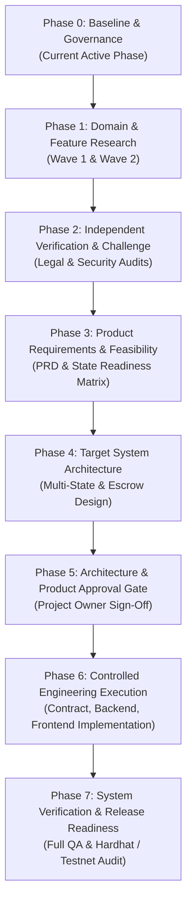

# MASTER ROADMAP
# Bhūmi Ledger — India Land Transaction & Registry Platform

**Document Version:** 1.0.0  
**Status:** Approved Phased Execution Plan  
**Horizon:** Multi-Phase Progressive Engineering Pipeline  

---

## 1. Phased Execution Overview

---

## 2. Phase-by-Phase Roadmap & Milestones

### Phase 0: Project Baseline, Environment & Governance
- **Status:** **IN PROGRESS (Finishing Setup)**
- **Objectives:**
  1. Inspect and freeze Git baseline (19 modified files, untracked scripts preserved).
  2. Map all working entry points (`contracts/LandRegistry.sol`, `backend/server.js`, `frontend/src/App.jsx`).
  3. Validate existing test suites (57 Hardhat unit tests passing, 27 backend tests passing, 7-step E2E passing).
  4. Instantiate multi-agent hierarchy and 10 central project governance files.
  5. Establish feature dossiers F01 through F17 in `Docs/research/`.
- **Deliverables:**
  - `project-governance/` registers established.
  - Baseline Verification Snapshot.
  - Phase 0 Completion & Phase 1 Launch Report.

---

### Phase 1: Independent Domain and Feature Research
- **Status:** **PLANNED / COMMENCING**
- **Strategy:** Executed in two controlled waves to prevent duplicate context and unbounded execution:
  - **Wave 1 (Foundation & Legal Reality)**:
    - F15: Multi-State Architecture & State Selector Model.
    - F01: Land Registration & UP Revenue Code (2006) Procedural Baseline.
    - F10: Documents, Verification & IT Act 2000 (Section 1(4) conveyance deed exemptions).
    - F11: Payments, Escrow & RBI Escrow / Fiat Settlement Realities.
  - **Wave 2 (Marketplace, Facilitation & Valuation)**:
    - F02 / F03: Buying and Selling Journeys in UP (Tehsil to SRO).
    - F04: Land Records, Khatauni (RoR), Gata numbering & BhuNaksha GIS.
    - F05: Direct Marketplace & Disintermediation Regulations.
    - F06: Remote NRI Conveyance & Power of Attorney (PoA) Verification.
    - F07: Tehsil Facilitator / Document Writer Accountability Directory.
    - F08: UP Circle Rate Valuation & Collector Guidelines.
    - F09: Agricultural vs. Non-Agricultural Land Leasing Regulations.
    - F12: Benami Transactions, Forgery & Fraud Prevention.
    - F13: Notifications & SMS / WhatsApp Transaction Tracking.
    - F14: Identity, Roles & DigiLocker / Aadhaar Verification Feasibility.
    - F16: Official Portals (Bhulekh, IGRSUP, Vaad) Integration Feasibility.
    - F17: Security, Audit Trail & Data Protection (DPDP Act 2023).
- **Deliverables:**
  - 17 Individual Feature Dossiers in `Docs/research/F01` to `F17`.

---

### Phase 2: Independent Verification and Challenge
- **Status:** **PENDING PHASE 1**
- **Objectives:**
  - Assign independent adversarial reviewers (Legal & Security specialists) to challenge research dossiers.
  - Expose contradictory government sources, invalid legal assumptions (e.g. digital deeds bypassing SROs), and operational roadblocks.
- **Deliverables:**
  - `independent-review.md` for each feature.
  - Updated `ASSUMPTIONS.md` and `RISK_REGISTER.md`.

---

### Phase 3: Product Requirements and Feasibility
- **Status:** **PENDING PHASE 2**
- **Objectives:**
  - Consolidate verified research into an official Product Requirements Document (PRD).
  - Define MVP Scope vs. Phase 2 Multi-State Scope.
  - Finalize Uttar Pradesh Feature Readiness Matrix.
- **Deliverables:**
  - Comprehensive PRD in `Docs/product/PRD.md`.
  - User Stories & Acceptance Criteria per feature.

---

### Phase 4: Target System Architecture
- **Status:** **PENDING PHASE 3**
- **Objectives:**
  - Architect decoupled multi-state engine (`StateAdapter` pattern).
  - Design Hybrid On-Chain/Off-Chain Data Flow (EVM event proofs + SQLite cache + private document storage).
  - Design compliant Escrow and Payment settlement flows.
  - Update Smart Contract specifications (refactoring direct ETH push to PullPayment pattern).
- **Deliverables:**
  - System Architecture Document in `Docs/architecture/`.
  - Architecture Decision Records (ADRs) in `project-governance/DECISION_REGISTER.md`.

---

### Phase 5: Architecture and Product Approval Gate (STOP GATE)
- **Status:** **MANDATORY STOP GATE**
- **Objectives:**
  - Present consolidated decision package to the Project Owner.
  - Await explicit sign-off on product scope, UP rollout, and architecture before writing or altering application code.
- **Deliverable:**
  - Project Owner Decision Package & Approval Artifact.

---

### Phase 6: Controlled Engineering Execution
- **Status:** **PENDING APPROVAL GATE**
- **Objectives:**
  - Wave-based, dependency-aware implementation across `contracts/`, `backend/`, and `frontend/`.
  - Zero disruption to existing working tests.
  - Preserve public contracts and database integrity.
- **Deliverables:**
  - Verified, compiling, and fully integrated production codebase.

---

### Phase 7: System Verification & Release Readiness
- **Status:** **PENDING PHASE 6**
- **Objectives:**
  - Comprehensive QA: Contract fuzzing/coverage, API integration tests, E2E simulation, multi-state UI verification.
  - Release readiness evaluation.
- **Deliverables:**
  - Full Verification Report (`TESTING_REPORT_v2.md`).
  - Production Deployment Guide.
