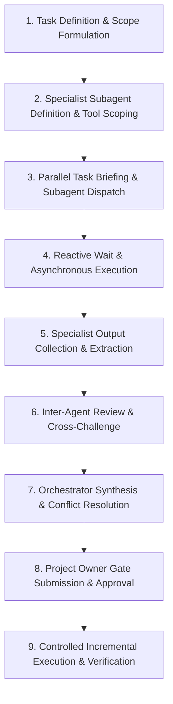

# MULTI-AGENT EXECUTION & COORDINATION PROTOCOL
# Bhūmi Ledger — India Land Transaction & Registry Platform

**Document Version:** 1.0.0  
**Phase:** Phase 5 (Autonomous Multi-Agent Engineering Organisation)  
**Authors:** Chief AI Engineering Orchestrator  
**Date:** October 31, 2026  
**Status:** Active Canonical Execution Protocol  

---

## 1. Objective & Governance Mandate

This protocol establishes the standardized lifecycle for executing engineering tasks across the Bhūmi Ledger multi-agent organisation. It guarantees that work is never performed by an uncoordinated single agent assuming multiple personas, but is instead conducted through **formally defined specialist subagents, isolated execution contexts, asynchronous reactive messaging, structured peer challenges, and unified synthesis**.

---

## 2. Nine-Stage Multi-Agent Execution Lifecycle

### Stage 1: Task Definition & Scope Formulation
- The Orchestrator inspects the project roadmap, active sprint scope, and unresolved decision registers.
- Defines the required specialist perspectives (e.g. Legal, Security, Architecture, Backend, Frontend, QA).

### Stage 2: Specialist Subagent Definition & Tool Scoping
- Evaluates active subagents via `manage_subagents(Action: 'list')`.
- If new specialists are required, defines them using `define_subagent`:
  - Enforces least privilege (e.g. `EnableWriteTools: false` during planning/review passes).
  - Supplies role-tailored system prompts embedding project context, statutory baselines, and scope boundaries.

### Stage 3: Parallel Task Briefing & Subagent Dispatch
- Dispatches tasks in parallel using `invoke_subagent`:
  - `Model`: Defaults to `inherit` (or `pro` for complex legal/security threat models).
  - `Role`: Specific job title (e.g., "Product & Legal Research Specialist").
  - `Prompt`: Structured briefing containing problem statement, specific review questions, primary sources to inspect, and strict boundaries.

### Stage 4: Reactive Wait & Asynchronous Execution
- The Orchestrator does NOT poll or execute busy-wait loops.
- Yields turn execution. The Antigravity platform automatically wakes up the Orchestrator upon subagent message delivery or task completion.

### Stage 5: Specialist Output Collection & Extraction
- As subagents complete, their findings are received in full into the Orchestrator context.
- The Orchestrator logs the ConversationId, execution timestamp, and key conclusions of each specialist.

### Stage 6: Inter-Agent Review & Cross-Challenge
- If a specialist identifies a risk affecting another domain (e.g. Legal identifies DPDP linkability risk affecting Backend database design, or Security identifies ReDoS risk affecting Parser dependencies), the Orchestrator routes the challenge to the relevant agent via `send_message`.
- Specialists refine their specifications based on peer feedback.

### Stage 7: Orchestrator Synthesis & Conflict Resolution
- The Orchestrator synthesizes all specialist findings into a single, unified implementation plan.
- Explicitly documents points of tension, tradeoffs made, and remaining open questions.

### Stage 8: Project Owner Gate Submission & Approval
- The Orchestrator presents the consolidated implementation report and specific decision items (OD-01, OD-02, etc.) to the Project Owner.
- Execution halts until the Project Owner grants explicit authorization.

### Stage 9: Controlled Incremental Execution & Verification
- Once authorized, the assigned Lead Engineer modifies only the designated files within the approved boundaries.
- The QA Specialist runs all automated unit tests and full regression baselines.
- The Orchestrator verifies `git status` and diffs to guarantee zero unrelated files were touched.

---

## 3. Communication Tools & Channel Guidelines

| Interaction Channel | Tool / Mechanism | Permitted Purpose | Prohibited Usage |
| :--- | :--- | :--- | :--- |
| **Orchestrator ➔ Specialist** | `invoke_subagent` | Launching new tasks, delegating reviews | Launching redundant agents for existing work |
| **Specialist ➔ Specialist** | `send_message` | Peer challenge, contract clarification | Bypassing Orchestrator oversight |
| **Specialist ➔ Orchestrator** | Automatic reactive message | Returning completed findings, reporting blockers | Requesting human input directly |
| **Orchestrator ➔ Project Owner**| Direct visible text response | Formal gate reports, strategic decisions | Delegating agent coordination to user |

---

## 4. Anti-Patterns & Prohibited Practices

1. **Persona Simulation:** The Orchestrator must NEVER simulate specialist outputs in a single response turn while claiming multi-agent collaboration occurred. Actual subagents must be invoked with verifiable ConversationIds.
2. **Unbounded Permissions:** Specialist agents performing review or planning tasks must NEVER be granted write tools that allow unreviewed changes to the codebase.
3. **Silent Assumptions:** When a statutory provision or architectural dependency is ambiguous, specialists must flag it as an assumption or open question rather than guessing.
4. **Destructive Git Operations:** No agent is permitted to run `git reset --hard`, `git checkout .`, `git clean -fd`, or `git restore` on user-modified working files.
